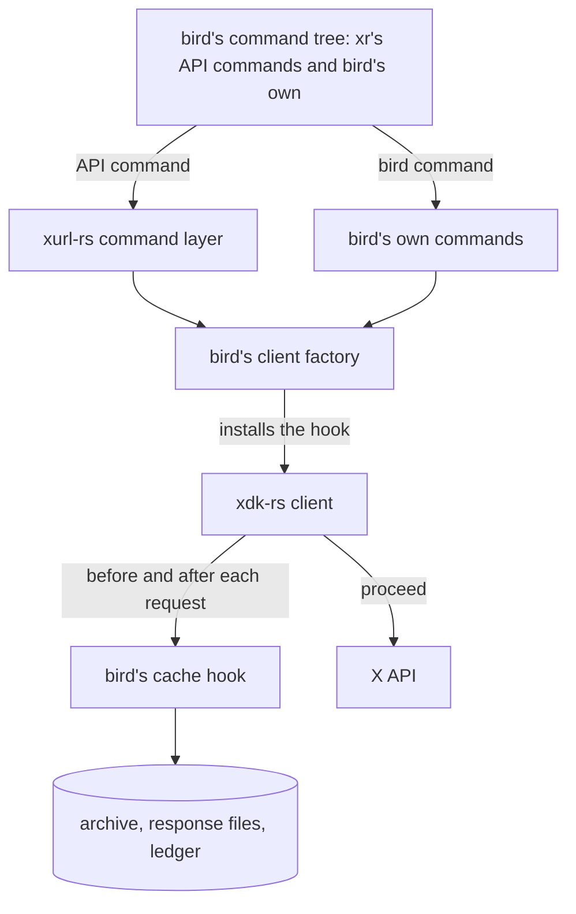

# What goes in bird and what goes in xr

bird and `xr` are two command lines over one X API library. This document decides which of them a capability belongs in,
describes how bird runs `xr`'s commands and how it pages, and lists the tests that hold bird to the line.

## Three layers

| Layer                | What it is                                                                              | Home                                              |
| -------------------- | --------------------------------------------------------------------------------------- | ------------------------------------------------- |
| xdk-rs (`use xdk::`) | The X API as a Rust library: requests, authentication, the token store, typed responses | [xurl-rs](https://github.com/brettdavies/xurl-rs) |
| `xr` (xurl-rs)       | The X-approvable CLI built on xdk-rs: API commands, their flags, and their envelopes    | [xurl-rs](https://github.com/brettdavies/xurl-rs) |
| bird                 | A client built on both: a program with an account, a machine, and a memory              | this repository                                   |

The line between xdk-rs and `xr` belongs to xurl-rs, and its canon is xurl-rs
[`AGENTS.md` § "Where a change goes"](https://github.com/brettdavies/xurl-rs/blob/main/AGENTS.md#where-a-change-goes).
bird holds no copy of it and no copy of any other xurl-rs document. This document draws the second line, between `xr`
and bird.

xdk-rs and `xr` are public, and whatever they hold serves every consumer. Whatever bird holds serves bird's users only.

## The line between bird and xr

1. **bird composes every `xr` API command.** bird links xurl-rs's command layer as a library and runs `xr`'s API
   commands in-process, `auth` and `usage` included, with `xr`'s verbs, flags, and output. A composed command prints
   what `xr` prints for the same parsed input, with `bird` wherever `xr` prints its own name, and exits with `xr`'s
   code. bird adds no flag to a composed command and no paging to it, and keeps no API command of its own that `xr` also
   has. `xr`'s raw mode and its meta commands are not composed; bird's `schema`, `completions`, and `skill` are its own.
2. **bird's own commands are the ones `xr` cannot have.** Each one needs money, memory, or this machine, as the table
   under [bird's own commands](#birds-own-commands) records.
3. **Money and memory live in bird.** Prices, cost estimates, the spend ledger, the archive, stored responses, and the
   watchlist appear in no xdk-rs or `xr` code.
4. **One flag set, one envelope.** bird's global flags are `xr`'s plus `--refresh`, `--no-cache`, `--cache-only`, and
   `--examples`, and `xr`'s form wins a conflict. Every environment-bound flag reads a `BIRD_*` name; the token store,
   which xdk-rs owns and `xr` shares, keeps `XURL_TOKEN_STORE`. bird's own commands print through `xr`'s envelope
   renderer, so a bird error and a composed error carry the same keys; bird adds the reasons `config-error`,
   `cache-miss`, and `cancelled`.
5. **bird writes no xurl-rs code.** A capability every embedder would need (a request hook on the client, the command
   layer as a supported library, a public decode) is a request to the xurl-rs team. bird waits for the crates.io release
   that carries it and adapts to the names and shapes that ship, at one seam per capability: the client factory and its
   hook in `src/xurl_client/`, composition in `src/cli/`. A bird copy of something xdk-rs or `xr` should own is the line
   failing.

### bird's own commands

| Command                           | What makes it bird's                                                                            |
| --------------------------------- | ----------------------------------------------------------------------------------------------- |
| `archive bookmarks\|likes\|posts` | Fetches a whole personal collection into the local archive                                      |
| `rank`                            | Gathers posts through the request `xr search` sends and ranks them by a public metric           |
| `thread`                          | Rebuilds a conversation from its root post and a `conversation_id` search                       |
| `watchlist`                       | Keeps a list of users in bird's config and checks each one's recent posts                       |
| `cache`                           | Reports on and clears the archive and the stored responses                                      |
| `spend`                           | Reads the spend ledger, beside X's actual usage when asked                                      |
| `schema`                          | Prints bird's own schema documents and lists them with `xr`'s, bird's winning for its own names |
| `doctor`                          | Reports this machine's credentials, config, and store                                           |
| `skill`                           | Installs the bird-skill bundle into an agent host                                               |
| `completions`                     | Prints completions for bird's command tree                                                      |

### Placing a new capability

Ask in order; the first yes decides.

1. Does xurl-rs's own canon place it in xdk-rs or `xr`? It is a request to the xurl-rs team.
2. Is it a command or flag that any X account holder could use from an X-approvable CLI? It belongs in `xr`, and bird
   gets it by composition.
3. Does it need a price or a policy about money, persist across runs on this machine, or serve bird's users over what
   bird stored? It belongs in bird.

Two tests settle a capability that sits on the line:

- **The third-party test.** If a developer using xdk-rs without bird would need it, it belongs upstream.
- **The divergence test.** If placing it in bird would make bird and `xr` answer the same input differently, and the
  difference is not about money, stored state, or bird's own ergonomics, it belongs upstream.

## How a request flows

bird builds one xdk-rs client per invocation through its client factory, with bird's cache hook installed. The command
layer builds its client through the same factory, and bird's own commands call xdk-rs's typed shortcuts on it, so every
request bird sends passes the hook.

- **Before a request,** the hook answers a `GET` from the stored response for the same request (method, normalized URL,
  and account) written the same UTC day, so a repeat prints what the first run printed and costs nothing. `--refresh`
  skips the answer and stores the fresh response; `--no-cache` neither answers nor stores. Under `--cache-only` the hook
  declines, with reason `cache-miss` and before anything is sent, every request it cannot answer, every write among
  them.
- **After a request,** the hook writes the posts and users in the response into the archive, the response into a
  response file, and a cost estimate into the ledger. Only `GET` responses are stored; every other method reaches the
  ledger alone, and direct-message responses are never stored.
- **A store failure** never changes what a printing command prints or its exit code; bird prints one `[store] warning`
  line. `bird archive`, whose job is storing, exits non-zero with the path and the OS error instead.

## What bird stores

bird keeps no database. It writes three kinds of files:

- **The archive:** one Markdown file with YAML frontmatter per post, user, and bookmark, in an archive directory the
  user can point at a notes vault.
- **Response files:** one JSON file per stored response, which answers the same request later that UTC day.
- **The spend ledger:** a JSONL file with one line per request and its cost estimate, which `bird spend` reads.

bird stores no credentials. Tokens live in xdk-rs's token store, which bird and `xr` share.

## How bird pages

bird has no pagination contract. These rules cover every command:

- **A composed list command pages as `xr`'s does:** one request per run, `--limit` as `xr` clamps it, `--cursor` naming
  the next page, and the next cursor in `meta`.
- **bird's own multi-page commands follow X's `next_token` themselves.** `rank`, `thread`, and `archive` share one page
  loop: one request per page, posts deduplicated by id, `includes` merged, stopping at the command's `-n/--max-posts`
  bound or at a page with no `next_token`. A page that fails ends the run with that page's error.
  - `rank` gathers up to `--max-posts` posts (1 to 1000, default 100), each page asking for the posts still needed up to
    100 and never fewer than X's minimum of 10. After the last page it sorts once by the chosen metric, ties by id
    descending, and drops posts below `--min-likes`. The global `--limit` keeps `xr`'s per-request meaning and does not
    size a rank run.
  - `thread` reads up to 1000 posts by default and 2500 at most.
  - `archive` reads to the end of the collection or to its bound.
- **`watchlist fetch` reads one page per watched user.**
- **Under `--cache-only`** a request is answered only by its own stored response from the same UTC day; bird does not
  assemble a list from stored posts.

Nothing refuses a run on cost before it starts. bird prints its cost estimate after each request, and `rank`'s ceiling
of 1000 posts bounds a ranking run.

## Conformance tests

Each test guards one rule above.

| Test                   | Assertion                                                                                                                                                                                                          |
| ---------------------- | ------------------------------------------------------------------------------------------------------------------------------------------------------------------------------------------------------------------ |
| No HTTP client         | None of `reqwest`, `hyper`, `ureq`, `isahc`, or `curl` is among bird's direct dependencies (`cargo metadata`); every request goes through the xdk-rs client                                                        |
| No re-implemented verb | No bird command performs what a composed `xr` command performs; bird's own commands call the endpoints they need through xdk-rs's typed shortcuts on the hooked client, with no request URL of their own           |
| Command surface        | `bird --help` lists exactly `xr`'s API commands and bird's own commands                                                                                                                                            |
| Composed parity        | For `like`, `read`, `user`, `search`, and `usage credits`, bird and a direct run of the command layer, each on a client whose only hook is the same scripted one, print the same bytes and exit with the same code |
| Agent-native audit     | `anc audit --output json` on bird shows zero failures                                                                                                                                                              |
