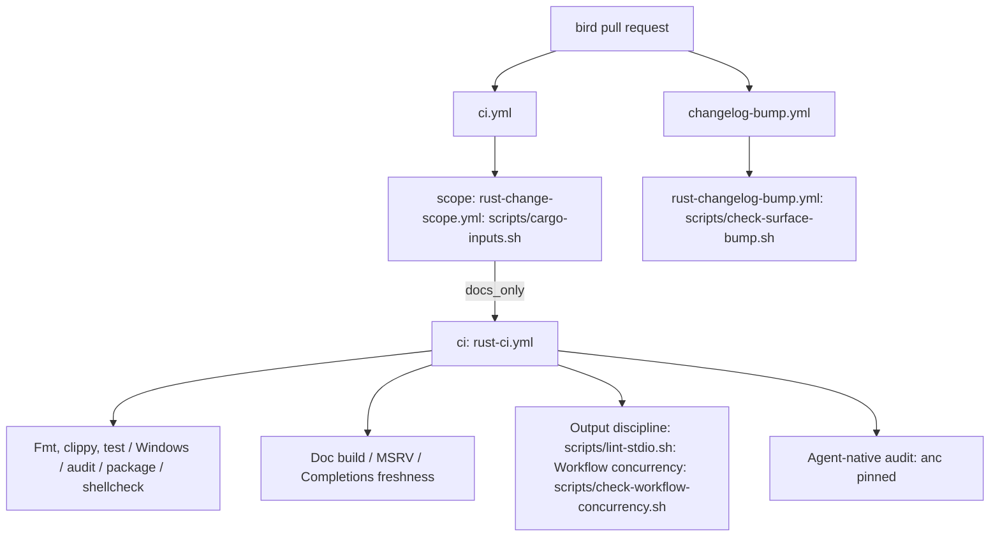

# Shared CI jobs for bird and xurl-rs - Plan

## Goal Capsule

- **Objective:** a bird pull request is held to the same checks as a xurl-rs pull request (doc build, MSRV, completions
  freshness, output discipline, workflow concurrency, agent-native audit, documentation-only scoping, and the changelog
  bump rule), and every one of those checks has one definition that both repositories call.
- **Means:** opt-in inputs on `rust-ci.yml` and two new reusable workflows in `brettdavies/.github`, each running a
  script from the consumer's checkout (KTD1, KTD2).
- **Authority:** the parity backlog's Rules (`docs/plans/2026-10-22-001-xurl-rs-parity-backlog.md`), then this plan,
  then the code.
- **Stop conditions:** merging a `brettdavies/.github` PR waits for the user's approval, because it changes shared CI
  inputs. No xurl-rs PR opens until the xurl-rs release has shipped.
- **Execution profile:** the `.github` PRs and bird's consumer PRs are opened together; bird's PRs stay drafts that call
  the shared workflow at the `.github` branch ref until that PR merges, then move to `@main`.

---

## Product Contract

### Summary

Seven jobs and one PR-body check that xurl-rs runs in its own `ci.yml` and `changelog-bump.yml` move into
`brettdavies/.github`. bird turns them on through its thin callers. xurl-rs swaps its in-repo copies for the same
callers once its release ships.

### Problem Frame

bird's CI is the bare `rust-ci.yml` call. It builds no rustdoc with warnings denied, checks no MSRV, never notices that
every file in `completions/` is stale against the binary, runs its writer-injection guard as a one-off workflow, and has
no anc gate, no change scoping, and no rule tying a CLI surface change to a minor changelog section. xurl-rs has all of
these, but as in-repo jobs, so copying them into bird would leave two definitions to drift.

### Requirements

**Shared jobs**

- R1. `rust-ci.yml` offers a doc build, an MSRV check, a completions freshness check, an output-discipline check, a
  workflow-concurrency check, and an anc audit, each off unless its caller turns it on.
- R2. A consumer that sets none of the new inputs keeps every job it runs today, with unchanged names and verdicts.
- R3. A documentation-only change, as the consumer's own classifier decides it, skips every Rust job and still satisfies
  required checks.
- R4. A pull request whose CLI or schema surface grows fails unless its `## Changelog` block has a bullet under
  `### Added`, `### Deprecated`, or `### Breaking changes`.

**bird**

- R5. bird's CI runs every check in R1, R3, and R4; `completions/` is regenerated in the change that turns the freshness
  check on.
- R6. bird's writer-injection rule (no output macro outside `src/main.rs` and `src/error/fatal.rs`) is enforced by the
  shared output-discipline job, and the separate `guard-r20.yml` workflow is removed.
- R7. bird's anc gate fails on any `fail` or `error` row, not only MUST-tier ones.

**xurl-rs**

- R8. After its release ships, xurl-rs calls the shared jobs in place of its in-repo copies, keeping its repo-specific
  jobs (`semver`, `consumer`, `features`, `parity`, `feature-powerset`) in-repo.

### Scope Boundaries

- Outside this plan: bird's hooks (lane A1 adopts the template `pre-commit` and `pre-push`), the ruleset changes (lane
  A1 prepares them from U11's check names), and the `.anc.toml` and stack 2 work that clears bird's two anc failures.

#### Deferred to Follow-Up Work

- bird calling `lint-basics.yml` (actionlint and markdownlint), which xurl-rs already calls; it needs no new shared
  work.
- Making `cargo-inputs.sh` and `check-surface-bump.sh` canonical templates in `github-repo-setup`, once both
  repositories run per-repo copies that agree on an interface.

---

## Planning Contract

### Key Technical Decisions

- KTD1. **Opt-in inputs on `rust-ci.yml`, not one reusable workflow per job.** One caller block keeps every check under
  the `ci /` prefix and lets every new job honor `docs_only` the way the existing jobs do. The cost is that a consumer
  which opts into nothing sees the new jobs listed as skipped; a skipped job counts as passing and is required nowhere,
  so R2 holds.
- KTD2. **Scripts run from the consumer's checkout.** The shared job owns the runner, toolchain, and gate; the consumer
  owns the script at a conventional path (`scripts/lint-stdio.sh`, `scripts/generate-completions.sh`,
  `scripts/check-workflow-concurrency.sh`, `scripts/cargo-inputs.sh`, `scripts/check-surface-bump.sh`). This is the
  pattern `guard-main-docs.yml` and its vendored `scripts/release/guarded-paths.sh` already use. The rules the
  output-discipline and surface checks enforce are per-repository (file paths, binary name, changelog heading), so they
  cannot live in the shared workflow.
- KTD3. **Change scope is its own reusable workflow, `rust-change-scope.yml`, feeding the existing `docs_only` input.**
  Putting a scope job inside `rust-ci.yml` would add a `needs:` edge to every existing job of every consumer. A separate
  workflow is the shape xurl-rs already runs in-repo, and `docs_only` was written for exactly this caller. The scope job
  fails open: on a non-PR event, or when the classifier fails, it reports `rust=true` or no output, and the caller's
  `docs_only: ${{ needs.scope.outputs.rust == 'false' }}` runs the full battery.
- KTD4. **The changelog bump check is its own reusable workflow, `rust-changelog-bump.yml`.** Its verdict depends on the
  PR body, so it needs the `edited` trigger, which a CI run does not have. The caller owns the triggers (`opened`,
  `edited`, `synchronize`, `reopened`; `branches-ignore: [main]`) and the concurrency group.
- KTD5. **bird's R20 guard becomes bird's `scripts/lint-stdio.sh`.** The rule is unchanged. The script passes `src` to
  `rg` explicitly, because with no path and a non-terminal stdin `rg` searches stdin: in a pre-push hook, whose stdin is
  git's ref list, the current inline step reads the refs and passes without looking at `src/`.
- KTD6. **The anc job audits the source tree and the release binary together** (`anc audit . --bin <bin>` after
  `cargo build --release --locked --bin <bin>`), so source rows such as `code-unwrap` count. Inputs: `anc_version`
  (empty means off; the pin makes an anc release reach a consumer only through a PR that bumps it), `anc_bin`,
  `anc_score_floor`, `anc_blocking_tiers` (`must` by default, `any` for bird per R7), and `release_size_ceiling_bytes`
  (0 means off).
- KTD7. **The doc build carries an optional docs.rs pass** (`docs_rs_package`): README doctests and a nightly
  `--cfg docsrs` build of one library package, so xurl-rs can drop its `docs` job without losing either.

### High-Level Technical Design

How a bird pull request reaches each check once U5 to U9 land:

### Inputs added to the shared workflows

| Workflow                  | Input                                                                                           | Type, default                                                       | Job name it controls                 |
| ------------------------- | ----------------------------------------------------------------------------------------------- | ------------------------------------------------------------------- | ------------------------------------ |
| `rust-ci.yml`             | `docs`                                                                                          | bool, false                                                         | Doc build                            |
| `rust-ci.yml`             | `docs_rs_package`                                                                               | string, empty                                                       | Doc build (docs.rs steps)            |
| `rust-ci.yml`             | `msrv`                                                                                          | bool, false                                                         | MSRV                                 |
| `rust-ci.yml`             | `completions`                                                                                   | bool, false                                                         | Completions freshness                |
| `rust-ci.yml`             | `lint_stdio`                                                                                    | bool, false                                                         | Output discipline                    |
| `rust-ci.yml`             | `workflow_concurrency`                                                                          | bool, false                                                         | Workflow concurrency                 |
| `rust-ci.yml`             | `anc_version`, `anc_bin`, `anc_score_floor`, `anc_blocking_tiers`, `release_size_ceiling_bytes` | string empty, string empty, number 0, string `must`, number 0       | Agent-native audit                   |
| `rust-change-scope.yml`   | `script`                                                                                        | string, `scripts/cargo-inputs.sh`                                   | Change scope (output `rust`)         |
| `rust-changelog-bump.yml` | `script`, `surface_paths`                                                                       | string `scripts/check-surface-bump.sh`, string `completions schema` | Surface growth needs a minor section |

### Assumptions

- The `ubuntu-22.04` runner's `jq` and Python 3.10 are enough for `generate-completions.sh` and `check-surface-bump.sh`;
  xurl-rs's script already carries the `tomllib` shim for 3.10.
- bird's MSRV (`rust-version = "1.94"`) compiles the tree with `--all-features --locked`; the pre-push hook runs the
  same check when the toolchain is installed.
- No Rust source in bird names a markdown file in a string literal today, so every markdown path except the manifest's
  `readme` is documentation only for bird's classifier.

### Risks & Dependencies

- bird's anc gate is red until stack 2 clears `code-unwrap` and `p6-must-sigterm`, so U9 lands after stack 2.
- Turning on the shared jobs in xurl-rs renames its required checks (`Doc build` becomes `ci / Doc build`). Its rulesets
  must change in the same window, which is a live-settings change for the user to approve.
- Lane A1 edits bird's `ci.yml` (trigger, concurrency, `advisories_blocking`) and vendors
  `scripts/check-workflow-concurrency.sh`. bird's consumer PRs rebase onto stack 1 when it merges; the vendored script
  is byte-identical in both.

---

## Implementation Units

### U1. Opt-in doc, MSRV, completions, output-discipline, and concurrency jobs in `rust-ci.yml`

- **Goal:** R1 (all but anc), R2, R3.
- **Files:** `.github/workflows/rust-ci.yml`, `README.md` (in `brettdavies/.github`).
- **Approach:** five jobs, each `if: inputs.<flag> && !inputs.docs_only`, with the toolchain, cache, and pins the
  existing jobs use. The MSRV job reads `rust-version` from the root `Cargo.toml` and checks
  `--workspace --all-features --locked` on it. KTD1, KTD2, KTD7.
- **Test scenarios:** a bird draft PR with all five on runs them green; the same PR with one stale completions file
  fails `Completions freshness`; a `println!` added under `src/` fails `Output discipline`; a consumer passing no new
  input shows the five as skipped and its existing jobs unchanged.
- **Verification:** actionlint and `scripts/check-workflow-concurrency.sh` pass in `.github`; the draft PR's runs are
  linked from the `.github` PR.

### U2. Agent-native audit job in `rust-ci.yml`

- **Goal:** R1 (anc), R7.
- **Dependencies:** U1 (same file; stacked).
- **Files:** `.github/workflows/rust-ci.yml`, `README.md`.
- **Approach:** KTD6. The scorecard and the sorted row list upload as an artifact on every run.
- **Test scenarios:** bird with `anc_blocking_tiers: any` fails today, naming `code-unwrap` and `p6-must-sigterm`; with
  `must` it fails on `p6-must-sigterm` only; a floor above the score fails with the score in the message.
- **Verification:** the failing runs above, linked from the PR; a green run follows once stack 2 lands.

### U3. `rust-change-scope.yml`

- **Goal:** R3.
- **Files:** `.github/workflows/rust-change-scope.yml`, `README.md`.
- **Approach:** KTD3. On `pull_request` it pipes `git diff --no-renames --name-only HEAD^1 HEAD` from a depth-2 checkout
  into the caller's script; on any other event it answers `rust=true`.
- **Test scenarios:** a bird PR touching only `docs/` reports `rust=false` and every Rust job skips; one touching
  `README.md` (the manifest's `readme`) or any `.rs` file reports `rust=true`.
- **Verification:** both runs linked from the PR.

### U4. `rust-changelog-bump.yml`

- **Goal:** R4.
- **Files:** `.github/workflows/rust-changelog-bump.yml`, `README.md`.
- **Approach:** KTD4. Extract `surface_paths` from `HEAD^1` into `$RUNNER_TEMP/base`, write the PR body from the
  environment to a file, run `bash <script> check <base> . <body>`.
- **Test scenarios:** bird PR adding a flag with only `### Changed` fails; the same PR edited to add `### Added` passes
  on the `edited` event without a push; a PR that changes no surface passes.
- **Verification:** the three runs linked from the PR.

### U5. bird: doc, MSRV, concurrency, and output-discipline jobs on

- **Goal:** R5, R6.
- **Dependencies:** U1.
- **Files:** `.github/workflows/ci.yml`, `scripts/lint-stdio.sh` (new), `scripts/check-workflow-concurrency.sh`
  (vendored verbatim from `github-repo-setup`), `.github/workflows/guard-r20.yml` (removed).
- **Approach:** KTD5. The pre-push R20 step moves to calling `scripts/lint-stdio.sh` when lane A1's hook adoption lands.
- **Test scenarios:** the script passes on `dev`; an added `eprintln!` in `src/cli/` fails with its file and line;
  `src/error/fatal.rs` stays exempt.
- **Verification:** the draft PR's runs.

### U6. bird: completions regenerated and held fresh

- **Goal:** R5.
- **Dependencies:** U5 (stacked).
- **Files:** `completions/bird.{bash,zsh,fish,elvish,powershell}`, `.github/workflows/ci.yml`.
- **Approach:** `scripts/generate-completions.sh`, then `completions: true` in the same change.
- **Test scenarios:** `scripts/generate-completions.sh --check` exits 0 after regeneration and 1 before it.
- **Verification:** `Completions freshness` green on the PR.

### U7. bird: documentation-only scoping

- **Goal:** R3, R5.
- **Dependencies:** U3, U6 (stacked).
- **Files:** `scripts/cargo-inputs.sh` (new), `.github/workflows/ci.yml`.
- **Approach:** a markdown path is documentation only unless a tracked `.rs` file names it in a string literal or a
  tracked `Cargo.toml` names it as `readme`; every other path is a cargo input. The `ci` job takes `needs: scope`,
  `if: ${{ !cancelled() }}`, and `docs_only` from the scope output.
- **Test scenarios:** `printf 'docs/x.md\n' | bash scripts/cargo-inputs.sh` prints nothing; `README.md`, `src/main.rs`,
  and `.github/workflows/ci.yml` each print themselves.
- **Verification:** the scope job's runs on a docs-only and a code commit.

### U8. bird: changelog bump check

- **Goal:** R4, R5.
- **Dependencies:** U4, U6 (it reads `completions/bird.bash`).
- **Files:** `scripts/check-surface-bump.sh` (new; xurl-rs's script with `completions/bird.bash`, the root `Cargo.toml`,
  and a `## Changelog` heading), `.github/workflows/changelog-bump.yml` (new caller).
- **Test scenarios:** `check-surface-bump.sh surface .` lists bird's commands and schema leaves; `check` against a base
  without one flag fails with a `### Changed`-only body and passes with an `### Added` bullet.
- **Verification:** the U4 runs, executed on this PR.

### U9. bird: anc gate

- **Goal:** R5, R7.
- **Dependencies:** U2, and stack 2 of the backlog merged.
- **Files:** `.github/workflows/ci.yml`.
- **Approach:** `anc_version: "0.6.0"`, `anc_bin: bird`, `anc_blocking_tiers: any`, and the floor set to the score stack
  2 leaves.
- **Verification:** `ci / Agent-native audit` green.

### U10. xurl-rs adopts the shared jobs (after its release ships)

- **Goal:** R8.
- **Dependencies:** U1 to U4 merged; the xurl-rs release shipped.
- **Files (xurl-rs):** `.github/workflows/ci.yml`, `.github/workflows/changelog-bump.yml`, `.github/rulesets/*.json`.
- **Approach:** its `scope` job becomes a `rust-change-scope.yml` call on its own `scripts/cargo-inputs.sh`; `docs`
  (with `docs_rs_package: xdk-rs`), `completions`, `msrv`, `lint-stdio`, the concurrency step, and `anc` (with its size
  ceiling) become `rust-ci.yml` inputs; `changelog-bump.yml` becomes a caller. Required contexts in both rulesets are
  renamed in the same window, with the user's approval.
- **Verification:** xurl-rs CI green on the adoption PR with each moved check reporting under its new name.

### U11. Required-check names for the rulesets

- **Goal:** lane A1's ruleset work names checks that exist.
- **Approach:** no code. bird's callers produce `scope / Change scope`, `ci / Doc build`, `ci / MSRV`,
  `ci / Completions freshness`, `ci / Output discipline`, `ci / Workflow concurrency`, `ci / Agent-native audit`, and
  `changelog-bump / Surface growth needs a minor section`. The last runs only on PRs whose base is not `main`, so it
  belongs in protect-dev and never in protect-main.
- **Test expectation:** none, it is a naming handoff.

---

## Verification Contract

| Check                  | Command or evidence                                                                                              | Applies to |
| ---------------------- | ---------------------------------------------------------------------------------------------------------------- | ---------- |
| Workflow lint          | `actionlint` and `bash scripts/check-workflow-concurrency.sh` in `brettdavies/.github`                           | U1 to U4   |
| Shared jobs work       | a bird draft PR calling each workflow at the `.github` branch ref, green, plus the negative runs each unit names | U1 to U8   |
| bird scripts           | `shellcheck --severity=warning` and `shfmt -i 2 -ci -bn -d` on every new script                                  | U5, U7, U8 |
| bird gates             | `cargo fmt --all --check`, `cargo clippy --all-targets -- -D warnings`, `cargo test --all`, `cargo deny check`   | U5 to U9   |
| No consumer regression | the `.github` PR's own lint run, and a consumer run with no new input showing unchanged job verdicts             | U1, U2     |

## Definition of Done

- U1 to U4 are open as `.github` PRs with green lint and linked evidence runs, and merged once the user approves.
- U5 to U8 are merged in bird, calling `@main`; U9 is merged after stack 2.
- `guard-r20.yml` is gone and the R20 rule runs only through `scripts/lint-stdio.sh`.
- U10 is open as a xurl-rs PR after its release, with the ruleset rename ready for approval.
- No experimental workflow edits or scratch branches remain in either repository.

## Open Questions

- Whether xurl-rs's anc gate moves from its binary-only audit (`--command target/release/xr`, floor 98) to KTD6's
  source-and-binary audit; its floor is re-measured at U10 either way.
- Whether `ci / Agent-native audit` becomes a required check on bird's `main`, given that an anc release can only reach
  it through a pin bump.
