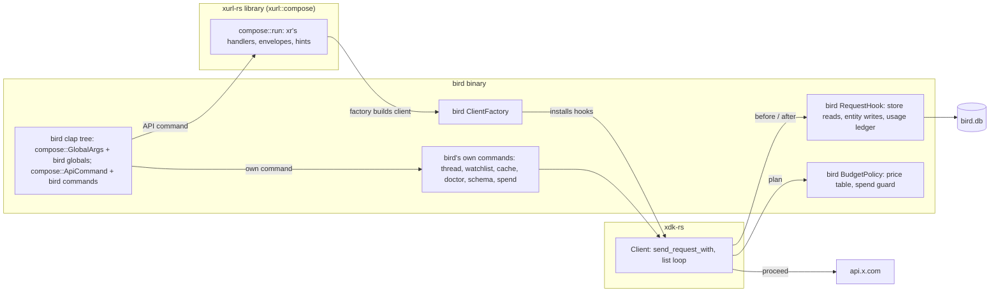
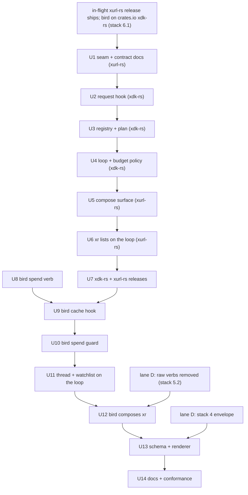

# bird extends xr in-process - Plan

## Goal Capsule

- **Objective:** A bird user drives every `xr` API command with `xr`'s verbs, flags, and output, and gets bird's cache,
  spend control, and its own commands on top, from one binary; an `xr` user sees no change beyond list commands that
  page past 100 results.
- **Means:** an xdk-rs request hook and list loop, a supported xurl-rs command-layer library, and bird composing that
  library with its cache hook and budget policy installed (KTD1, KTD5, KTD7).
- **Authority:** the Product Contract below (origin: `docs/brainstorms/2026-10-22-bird-extends-xr-requirements.md`),
  then the parity backlog's Rules (`docs/plans/2026-10-22-001-xurl-rs-parity-backlog.md`), then this Planning Contract.
  Where xdk-rs or xurl-rs behavior and bird differ, the upstream form wins.
- **Stop conditions:** stop and ask the maintainer before opening any xurl-rs pull request while the in-flight xurl-rs
  release is unshipped; before merging U1 through U6 (each changes an xdk-rs or xurl-rs contract); before tagging U7's
  releases; and if any unit's evidence shows `xr`'s output changing outside its list verbs.
- **Execution profile:** two stacks. The xurl-rs stack (U1 to U6) lands first and ships in U7; the bird stack (U8 to
  U14) builds on the crates.io releases U7 publishes. U8 alone can land before U7.
- **Who finishes:** the bird parity goal's lane C and lane E implement the xurl-rs stack; lane C implements the bird
  stack; the maintainer approves each cross-repo merge and each tag.

---

## Product Contract

Product Contract preservation: carried from the origin with R-IDs, F-IDs, and AE-IDs unchanged. R1 is scoped to the hook
and the library surface, because `xr`'s list verbs paging through the loop is in scope and changes `xr` for `--limit`
above 100. R4 lets an answer cover any method, resolving the origin's deferred question in KTD2. R7 lets a multipart
upload be declined, so `--cache-only` refuses an upload as R20 requires.

### Summary

bird stops re-implementing `xr`. Its command set becomes `xr`'s API commands, composed in-process from the xurl-rs
library, plus the commands only bird has. Every request goes through one xdk-rs client, and bird's cache and spend
policy ride on that client as hooks.

### Problem Frame

bird duplicates `xr`'s verbs, request builders, page loops, and envelope, and each has drifted from `xr` (origin,
Problem Frame). Two upstream gaps block composition: the xurl-rs library target is `#[doc(hidden)]` and disclaims
embedders (`crates/xurl-cli/src/lib.rs`), and xdk-rs offers no point where an embedder answers a request from a store or
records what X returned (`crates/xdk/src/api/request/transport.rs`).

### Key Decisions

Carried from the origin; the normative text lives on the governed requirements.

- **bird composes `xr`'s API commands instead of mapping its verbs onto `xr`'s names.** Governs R17.
- **The hook lives on the client, not in the command layer.** Governs R3 to R8, R18.
- **xurl-rs takes a client factory, not a built client.** Governs R13.
- **Spend control is a second hook, on the list loop's plan.** Governs R10, R18.
- **block, unblock, and blocked stay.** Governs R17.
- **bird's raw HTTP verbs do not return.** Governs R12, R21.
- **bird keeps its `BIRD_*` environment variables.** Governs R19.

### Requirements

**xr stays whole**

- R1. The request hook and the library surface change nothing `xr` does; `xr`'s list verbs paging through the list loop
  (R9) is the one `xr` change.
- R2. Nothing in xdk-rs or xurl-rs depends on bird or names a bird concept, and `xr` installs no hook.

**Request hook (xdk-rs)**

- R3. An embedder installs a request hook on a client built from credentials or from a token store.
- R4. Before a request is sent, the hook can answer it with a response body the client decodes as X's, sending nothing
  and needing no credential.
- R5. Before any request is sent, the hook can decline it, and the caller receives an error in place of a response.
- R6. After a sent request completes, the hook observes the request as sent and its outcome, once per logical request
  after any rate-limit retry.
- R7. Every request on the JSON path reaches the hook, including each list page and each caller-id lookup; multipart
  uploads can be declined and observed, never answered; streaming requests do not reach it.
- R8. A client with no hook behaves as it does today.

**List loop (xdk-rs)**

- R9. A list call returns up to `limit` unique items across pages, with a lossless next cursor and a closed-set stop
  reason (contract D1 to D3).
- R10. Before the first page the loop plans the run and binds a budget; an embedder's budget policy sees the plan and
  refuses the run or returns the budget (D4).
- R11. `Call::send` with a `pagination_token` keeps working unchanged.

**Command layer (xurl-rs)**

- R12. xurl-rs exposes `xr`'s API commands and global flags as a supported library, separate from its meta commands and
  raw mode.
- R13. The library runs one parsed API command with parsed global flags, writers, the token store path, the environment
  as data, and a client factory, and returns `xr`'s exit code.
- R14. A composed command prints exactly what `xr` prints for the same parsed input.
- R15. The library exposes `xr`'s schema documents and its envelope renderer.
- R16. The library surface is documented, semver-checked in CI, and open to additive change without a major release.

**bird composition**

- R17. bird's command set is `xr`'s API commands plus `thread`, `watchlist`, `cache`, `doctor`, `schema`, `completions`,
  `skill`, and `spend`; every bird verb `xr` has retires with no alias.
- R18. Every command bird runs goes through a client bird builds with its cache hook and budget policy installed.
- R19. bird's global flags are `xr`'s plus `--refresh`, `--no-cache`, `--cache-only`, `--max-spend`, and `--examples`;
  `xr`'s form wins a conflict; every environment-bound flag reads its `BIRD_*` name.
- R20. Under `--cache-only` a composed read answers from the store or fails with bird's cache-miss error before any
  request, and a composed write refuses.
- R21. bird has no raw HTTP verbs.
- R22. `bird usage` and `bird usage credits` are `xr`'s; bird's estimate ledger and estimate-against-actual view move to
  `bird spend`.

**Seam and documents**

- R23. The seam document says flag parsing is presentation implemented once in `xr`'s command layer, and a client passes
  an `xr` capability through by composing its command.
- R24. The seam document and the pagination contract live in xurl-rs in the xdk-rs and xurl-rs split's vocabulary; bird
  keeps only its conformance document.

### Key Flows

- F1. A composed read served from the cache: `bird read <id>` a second time the same UTC day; the hook answers; stdout
  is byte-identical to the first run; no request reaches X.
- F2. A composed list refused on cost: `bird search "rust" --limit 5000`; the loop plans, bird's policy prices the plan
  above `--max-spend`; nothing is sent and the refusal names the estimate and the flag.
- F3. A retired verb: `bird tweet hi`, `bird me`, or `bird get /2/users/me` fails as an unknown command at exit 2.

### Acceptance Examples

- AE1. **Covers R4, R18.** A post cached today: `bird read <id>` sends nothing and prints what `xr read <id>` prints for
  that post.
- AE2. **Covers R1, R8.** xurl-rs with the hook and the library surface: its existing CLI tests and goldens pass
  unchanged.
- AE3. **Covers R14, R19.** `bird like <id> --output json` and `xr like <id> --output json` against the same scripted
  responses: same stdout, same exit code.
- AE4. **Covers R10.** A refusing budget policy: the list call returns the policy's error and sends nothing.
- AE5. **Covers R20.** `--cache-only` and an empty store: `bird user jack` fails with bird's cache-miss error and sends
  nothing.

### Scope Boundaries

- In: U1 to U14.
- Out: `xr`'s raw mode and meta commands (`schema`, `completions`, `version`, `examples`, `skill`, `validate`) in bird;
  any change to `xr`'s verbs, flags, or envelopes outside its list verbs.
- Considered and not built: a request rewrite in the hook (bird's batch-ID partial hits stay in bird's own code before
  the call, since no composed `xr` verb sends an `ids=` batch); a separate `Refuse(Error)` decision beside `Decline` (no
  caller needs an error other than the decline; add one when an embedder does).

#### Deferred to Follow-Up Work

- The query cache (contract D7.2), checkpoint mode (D6), author hydration (D7.5), and the `cost`, `checkpoint`, `cache`,
  and `hydration` fields on a composed command's envelope.
- Vendored prose evidence with checksums for depth caps and fan-out (D2.4); the registry cites the X documentation pages
  instead.
- `xr endpoints`, the `SEAM_VERSION` and `CONTRACT_VERSION` constants, the seam's ast-grep rules, and its `## Seam` CI
  workflow.
- Ranking over the local store, which bird's retired `search --sort` and `--min-likes` did.

### Dependencies / Assumptions

- The in-flight xurl-rs release ships, and bird moves onto its xdk-rs from crates.io (backlog stack 6 item 1), before U2
  opens.
- Lane D removes bird's raw HTTP verbs (backlog stack 5 item 2) before U12, because bird's raw `post` and `delete`
  collide with `xr`'s.
- xdk-rs keeps one JSON send path, `Client::send_request_with`, which every shortcut, every page, and
  `send_saving_identity` go through.
- bird stays synchronous and drives the async library on its current-thread runtime (`src/xurl_client/mod.rs`,
  `EmbeddedClient`).

### Outstanding Questions

#### Resolve Before Implementation

- (U1 to U6; maintainer) Approval to open the xurl-rs stack once the in-flight release ships, and to merge each PR.
- (U12, R22; maintainer) `bird spend` as the ledger's name. Default: `spend`.
- (U12, R17; maintainer) Retiring `search --sort likes --min-likes` with no 1.0.0 replacement. Default: retire.
- (U3, U4; maintainer) The 1.0.0 pagination cut in Deferred to Follow-Up Work. Default: ship without them.
- (U12; maintainer) Composing `xr`'s `auth` family, which retires `bird login`. Default: compose.

---

## Planning Contract

### Key Technical Decisions

- KTD1. **The hook wraps `Client::send_request_with`.** That function is the single JSON path
  (`crates/xdk/src/api/request/transport.rs`); it already owns the rate-limit retry, so the hook is consulted once
  before the first attempt and observes once after the final one. `send_multipart_request` consults it for a decline and
  observes; `stream_request` does not touch it. Governs R6, R7.
- KTD2. **The hook trait follows `OnTokenRefreshed`.** `Send + Sync + 'static`, object-safe, methods returning boxed
  futures, held as an `Arc<dyn RequestHook>` in the client's shared `Inner` (`crates/xdk/src/auth/credentials.rs`,
  `crates/xdk/src/store/hook.rs`). Two methods: one decides before a request (proceed, answer with a body, or decline
  with a message), one observes after it. The client does not restrict answers by method: the hook's own policy decides,
  which lets any embedder test writes offline by answering them, and bird's production hook answers only GETs.
- KTD3. **The hook sees the request as rendered.** The before-request view carries the method, the rendered URL, the
  typed target (template path, path parameters, query), and the requested scheme and username; the after-request view
  adds the scheme, app, and user the request went out under, from the auth-header resolution, and the outcome (body, or
  the error with its status). bird's existing cache keys on the rendered URL (`src/db/client/entity.rs`,
  `compute_raw_cache_key`), so it carries over unchanged.
- KTD4. **A declined request is a new `xdk::Error` variant.** `Error` is `#[non_exhaustive]`, so the variant is
  additive; its `kind` is `request-declined` and its exit code is the contract's 80 (bounded stop, nothing delivered).
  Inside the list loop a decline is the `cache_miss` stop instead.
- KTD5. **The list loop is a terminator beside `Call::send`.** xurl-rs's adoption-grade plan (KTD18 there) reserved this
  shape: a new method on list calls, bounded by a trait on the item type for its `id`, while `send` stays as it is. List
  shortcuts are already marked `.paginated()` (`crates/xdk/src/api/request/call.rs`); the loop replaces the per-page
  `max_results` with the page-size rule (D2.7). It offers a collecting form and a page stream.
- KTD6. **The budget policy is a synchronous hook on the client.** Pricing a plan is pure arithmetic over an in-memory
  table, so the policy is a plain trait method taking the plan and returning a budget or a refusal; it is installed like
  the request hook. With no policy the loop binds the plan's default budget (D4.4). A refusal is a new `xdk::Error`
  variant at the contract's exit code 81.
- KTD7. **xurl-rs exposes a `compose` module and builds `xr` from it.** `xurl::compose` (public, documented, not
  `#[doc(hidden)]`) holds the API-command subcommand enum, the global-flags struct, the client-factory trait, the run
  entry point, the schema documents, and the envelope renderer. `xr`'s own `Cli` becomes the global flags, the raw-mode
  arguments, and a command enum that flattens the API commands beside the meta commands. The rest of `xurl::cli` stays
  hidden. Help text and goldens stay byte-identical, with explicit display order where flattening would move an option.
- KTD8. **The client factory receives the resolved `Config` and `Auth`.** `xr`'s `--app`, `--timeout`, and
  `--wait-on-rate-limit` shape them before any command runs (`crates/xurl-cli/src/cli/commands/mod.rs`, `run`), and
  every handler calls `make_client(cfg, auth)`; the factory replaces `make_client`, and `xr`'s own factory is today's
  `make_client`. The library renders the run's `tracing` diagnostics itself, as the runner does, so composed output
  matches `xr`'s (R14).
- KTD9. **The contract's exit codes join xdk's table.** 75 (partial data), 80 (bounded stop, nothing delivered), and 81
  (pre-flight refusal) become constants beside `EXIT_RATE_LIMITED` in `crates/xdk/src/error.rs`; the contract reserves
  them so they collide with none of xdk's codes.
- KTD10. **The registry carries what the spec states and cites the rest.** Floors, ceilings, cursor parameters, and
  expansion enums come from `vendor/x-api-openapi.json` behind a drift test; depth caps and the prose-sourced fan-out
  bounds are constants citing the X documentation page each comes from.
- KTD11. **bird's cache moves behind the hook, and the hook replaces bird's test seam.** `BirdClient`'s read and write
  logic (`src/db/client/`) becomes bird's `RequestHook`; bird's own commands send through the hooked `xdk::Client`;
  `XurlClient` and `MockXurlClient` retire in favor of a scripted test hook that answers every request, so bird's tests
  stay at the bird/xdk boundary with no HTTP server.
- KTD12. **bird composes by clap flattening and rebinds environment names after building the command.** bird's root
  flattens `xurl::compose`'s global flags and bird's own, and its command enum flattens the API commands beside bird's
  own; bird then rebinds each composed argument's `XURL_*` environment name to its `BIRD_*` name on the built
  `clap::Command` before matching. A test walks every argument with an environment binding and asserts the `BIRD_`
  prefix.
- KTD13. **bird's spend guard prices plans with its existing price constants.** `src/cost.rs` holds the per-object
  prices; U10 keys them by the registry's resource kinds and adds `spend.hard_cap_usd` and `spend.max_spend_usd` to
  bird's config, with `--max-spend` overriding the second up to the first (D4.7).

### High-Level Technical Design

Component topology after U12:



One request through the hook (KTD1, KTD2, KTD4):

```text
send_request_with(request)
  hook.before(view) ──► Proceed ──► send (429 wait and retry as today) ──► hook.after(view, outcome) ──► result
                   ├──► Answer(body) ──► decode body as X's ──► result          (nothing sent, no credential read)
                   └──► Decline(msg) ──► Error::Declined (exit 80)               (in the list loop: stop cache_miss)
```

PR order across the two repositories:



### Assumptions

- No composed `xr` verb sends an `ids=` batch, so the hook needs no partial-answer path; bird's batch lookups stay in
  bird's own code.
- `xr`'s webhooks family, if it ships in the in-flight release, is part of the API-command set and arrives in bird
  unchanged.
- bird's `--examples` stays a bird flag; `xr`'s `examples` command is not composed.

---

## Seam

Rows in the four-column format of `docs/designs/2026-09-04-xurl-bird-seam.md` (allowed values: implementation `crate`,
`client`, `presentation`; surface `xr`, `client`, `both`, `API`).

| Concern                                                                   | Implementation | Surface | Question that decided it                                       |
| ------------------------------------------------------------------------- | -------------- | ------- | -------------------------------------------------------------- |
| Request hook: answer, decline, observe                                    | crate          | API     | mechanical shape every embedder needs; values are the client's |
| Store-backed client builder that takes a hook                             | crate          | API     | third-party test                                               |
| Cache policy behind the hook (freshness, stored responses, entity writes) | client         | client  | persistent state                                               |
| Usage ledger written from hook observations                               | client         | client  | money and persistent state                                     |
| List registry: floors, ceilings, cursor parameter, depth caps, fan-out    | crate          | API     | API fact; `xr endpoints` deferred                              |
| List loop, page-size rule, dedup, stop reasons, lossless cursor           | crate          | both    | mechanical consequence; bird's surface is by composition       |
| List plan and default budget                                              | crate          | both    | pure arithmetic; `xr --dry-run` prints it                      |
| Budget policy hook                                                        | crate          | API     | shape-versus-value test                                        |
| Price table, spend guard, `--max-spend`, refusal                          | client         | client  | money                                                          |
| Exit codes 75, 80, 81                                                     | crate          | both    | contract, one table in xdk-rs                                  |
| `xr`'s command layer as a library (`xurl::compose`)                       | presentation   | API     | flag parsing implemented once in `xr`'s command layer          |
| `xr`'s API commands in bird                                               | presentation   | both    | passthrough by composition                                     |
| Client factory                                                            | presentation   | API     | `xr`'s flags shape the client it builds                        |
| `xr`'s schema documents and envelope renderer                             | presentation   | API     | one envelope for every surface                                 |
| `BIRD_*` names on composed flags                                          | client         | client  | ergonomics for bird's users                                    |
| `bird spend`                                                              | client         | client  | money and persistent state                                     |

---

## Seam Document Revision

U1 lands this text in xurl-rs as part of moving `docs/designs/2026-09-04-xurl-bird-seam.md` there. Each change is a
replacement of the bird draft's text.

**The three layers** (table rows):

| Layer          | What it is                                                                                                                                                                      | Who consumes it                                                            |
| -------------- | ------------------------------------------------------------------------------------------------------------------------------------------------------------------------------- | -------------------------------------------------------------------------- |
| `xdk-rs` crate | The X API v2 as a Rust library: facts about the API and the mechanics every consumer needs the same                                                                             | `xr`, `bird`, and any third-party Rust program                             |
| `xr` CLI       | The crate on the command line: flag parsing, output formatting, and discovery commands. Its command layer is also a library, `xurl::compose`, that a client composes in-process | People, agents, programs driving a subprocess, and clients that compose it |
| client         | A program with an account, a machine, and a memory, built on the crate. `bird` is the reference                                                                                 | Its own users; `bird` serves agents and its maintainer                     |

**Axis 1, the implementation bullet:** "`presentation` means the contract defines the behaviour and `xr`'s command layer
implements it. Flag parsing is presentation, implemented once in `xr`'s command layer; a client that exposes an `xr`
capability composes that command, with its flags, rather than parsing them again. A row named for a capability records
where the behaviour behind its flags lives."

**Axis 2, rule 2, appended:** "A client passes a capability through by composing `xr`'s command for it whenever `xr` has
one. The composed command parses, runs, and prints exactly as `xr` does; the client contributes only the hooks it
installs on the client it supplies (a request hook, a budget policy) and its own commands."

**Axis 2, rule 5, replaced:** "Presentation (flags, exit codes, envelope core) is defined once by the contract and
implemented once, in `xr`'s command layer. A client that composes a command presents it through that code; a client's
own commands print the same envelope through `xr`'s renderer."

**Anti-patterns, added:** "A client that re-implements an `xr` command, its flags, or its envelope instead of composing
it." and "A hook in the crate or in `xr` that names a client concept (cache, price, spend)."

**Vocabulary:** every "the `xurl-rs` crate" in the draft reads "the `xdk-rs` crate", and code paths name `xdk::` where
the draft names `xurl_rs::`.

---

## Implementation Units

### Unit Index

| U-ID | Title                                                  | Repo: key files                                       | Depends on                   |
| ---- | ------------------------------------------------------ | ----------------------------------------------------- | ---------------------------- |
| U1   | Seam and contract documents move to xurl-rs            | xurl-rs: `docs/designs/`                              | in-flight release            |
| U2   | Request hook and store-backed builder                  | xurl-rs: `crates/xdk/src/api/request/`                | U1                           |
| U3   | List registry and pure plan                            | xurl-rs: `crates/xdk/src/api/lists/`                  | U2                           |
| U4   | List loop and budget policy                            | xurl-rs: `crates/xdk/src/api/lists/`, `call.rs`       | U3                           |
| U5   | `xurl::compose` library surface                        | xurl-rs: `crates/xurl-cli/src/compose/`, `cli/mod.rs` | U4                           |
| U6   | `xr` list verbs on the loop                            | xurl-rs: `crates/xurl-cli/src/cli/commands/`          | U5                           |
| U7   | xdk-rs and xurl-rs releases                            | xurl-rs: release branch                               | U6                           |
| U8   | `bird spend` takes the local ledger                    | bird: `src/usage/`, `src/cli/mod.rs`                  | none                         |
| U9   | bird's cache behind the hook                           | bird: `src/db/`, `src/xurl_client/`                   | U7, U8                       |
| U10  | bird's spend guard as a budget policy                  | bird: `src/cost.rs`, `src/config.rs`                  | U9                           |
| U11  | thread and watchlist page through the loop             | bird: `src/thread.rs`, `src/watchlist/`               | U10                          |
| U12  | bird composes `xr`'s API commands                      | bird: `src/cli/`                                      | U11, lane D raw-verb removal |
| U13  | `bird schema` and bird's envelopes through `xr`'s code | bird: `src/schema_print.rs`, `src/output.rs`          | U12, lane D stack 4          |
| U14  | bird documents, conformance, and completions           | bird: `AGENTS.md`, `docs/`, `completions/`            | U13                          |

### U1. Seam and contract documents move to xurl-rs

- **Goal:** xurl-rs holds the seam document and the pagination contract, revised for the split and for composition.
- **Requirements:** R23, R24.
- **Dependencies:** the in-flight xurl-rs release has shipped.
- **Repo and PR:** xurl-rs, first PR of the xurl-rs stack,
  `docs(designs): adopt the seam and the list contract with command-layer composition`.
- **Files:** `docs/designs/2026-09-04-xurl-bird-seam.md` (new in xurl-rs),
  `docs/designs/2026-09-03-pagination-and-result-bounding.md` (new in xurl-rs), `docs/designs/README.md` or the docs
  index xurl-rs keeps.
- **Approach:**
  1. Copy both bird drafts, apply the Seam Document Revision above, and rename the crate vocabulary (KTD7, R24).
  2. In the contract, scope the 1.0.0 cut: the deferred items in this plan's Scope Boundaries become an explicit "not
     yet implemented" list in the contract's own Apply-to-each-repo section, so nothing claims behavior the crate lacks.
  3. In the contract's exit-code section, record that 75, 80, and 81 are xdk-rs constants (KTD9).
  4. Leave `status: draft` until the maintainer approves the PR; the approval flips both to `accepted`.
- **Test expectation:** none, documentation only; markdownlint on each named file.
- **Verification:** both documents render in xurl-rs, name `xdk-rs` and `xurl-rs` correctly, and carry the revision text
  verbatim.

### U2. Request hook and store-backed builder

- **Goal:** an embedder answers, declines, or observes every JSON request a client sends.
- **Requirements:** R2 to R8.
- **Dependencies:** U1.
- **Repo and PR:** xurl-rs (xdk-rs crate), `feat(xdk): let an embedder answer, decline, or observe each request`.
- **Files:** `crates/xdk/src/api/request/hook.rs` (new), `crates/xdk/src/api/request/mod.rs`,
  `crates/xdk/src/api/request/transport.rs`, `crates/xdk/src/api/request/builder.rs`, `crates/xdk/src/api/mod.rs`,
  `crates/xdk/src/error.rs`, `crates/xdk/tests/request_hook.rs` (new), `crates/xdk-consumer-check/src/lib.rs`.
- **Approach:**
  1. Define the trait and the two request views (KTD2, KTD3); hold the hook in `Inner` beside `rate_limit`.
  2. Wrap `send_request_with` per KTD1: answer returns the body through the same decode path `Call::send` uses; decline
     returns the KTD4 variant; proceed runs today's path; observe fires once after the final attempt.
  3. Consult the hook in `send_multipart_request` for a decline only and observe after; an answer there is a validation
     error.
  4. Add `ClientBuilder::request_hook` and a store-backed entry on the builder taking `&Config` and `Auth`, carrying the
     user agent, timeout, and rate-limit wait; `Client::new`, `with_timeout`, and `new_with_user_agent` route through it
     unchanged.
  5. Add the `Declined` variant with its `kind`, exit code, and no `next_action` (KTD4, KTD9).
- **Patterns to follow:** `OnTokenRefreshed` and `StoreRefreshHook`; `ClientBuilder::on_token_refreshed`;
  `Client::record_rate_limit` for state held in `Inner`.
- **Test scenarios:**
  - A proceeding hook: `MockX` records one request; the hook's observation carries the method, the rendered URL, status
    200, and the body.
  - Covers AE1 at the crate level. An answering hook on `read_post`: `MockX` records zero requests and the decoded
    `Post` equals the answered fixture.
  - An answering hook on a client with no credential: the call succeeds with no auth error.
  - A declining hook: the caller gets `Error::Declined`, `kind()` is `request-declined`, `exit_code()` is 80, and
    `MockX` records nothing.
  - A 429 with `wait_on_rate_limit` and a reset inside the bound: the hook decides once and observes once, with the
    second response.
  - A 404: the observation carries status 404 and the caller gets `Error::Api` 404.
  - `send_saving_identity` on `get_me` reaches the hook.
  - A multipart upload under an answering hook returns a validation error; under a proceeding hook it is observed.
  - A streaming request never calls the hook.
  - A hook installed through the store-backed builder sees the same requests as one installed through `Client::builder`.
  - `ClientBuilder`'s `Debug` output shows whether a hook is set and nothing else about it.
- **Execution note:** run xdk-rs's existing test suite before the change and keep it green unmodified; it is the R8
  characterization.
- **Verification:** xdk-rs tests pass; the public-API semver job reports an additive change; the consumer check builds a
  hook from `xdk` paths alone.

### U3. List registry and pure plan

- **Goal:** xdk-rs knows each list endpoint's bounds and can say what a list run will cost in requests and objects
  before it starts.
- **Requirements:** R9, R10.
- **Dependencies:** U2.
- **Repo and PR:** xurl-rs (xdk-rs crate), `feat(xdk): add the list endpoint registry and a pure list plan`.
- **Files:** `crates/xdk/src/api/lists/mod.rs`, `crates/xdk/src/api/lists/registry.rs`,
  `crates/xdk/src/api/lists/plan.rs` (all new), `crates/xdk/src/api/mod.rs`, `crates/xdk/tests/list_registry_drift.rs`
  (new).
- **Approach:**
  1. One registry row per list endpoint a shortcut marks `.paginated()`: path, list class, floor, ceiling, cursor
     parameter, time-filter support, depth cap, primary kind, and fan-out per accepted expansion (contract D2.2, D2.3;
     KTD10).
  2. `next_page_size` per D2.7 and `plan` per D4.1 to D4.3, both pure; `Plan` carries effective limit, `depth_capped`,
     `requests_max`, `objects_max` by kind, `ceiling_is_bound`, and the default `Budget` with the D4.4 allowance rule.
  3. Mark the stop-reason and resource-kind enums `#[non_exhaustive]`.
- **Patterns to follow:** `crates/xdk/src/api/auth_matrix.rs` for a spec-keyed table; `vendor/spec-metadata.json` for
  spec identity.
- **Test scenarios:**
  - Search (floor 10, ceiling 100): limit 103 plans pages `[93, 10]`; limit 205 plans `[100, 95, 10]` (contract D4.2).
  - A limit below the floor is refused before any plan, naming the floor.
  - A limit above a depth cap plans to the cap and reports `depth_capped`.
  - Search with `expansions=author_id`: `objects_max` is `L` posts and `L` users.
  - An unbounded expansion sets `ceiling_is_bound` false.
  - The default budget bounds requests by the allowance rule and leaves objects unbounded.
  - The drift test: every registry floor, ceiling, and cursor parameter matches `vendor/x-api-openapi.json`, and a row
    the spec lacks fails.
- **Verification:** the drift test reads the vendored spec and passes; `plan` performs no I/O (it takes no client).

### U4. List loop and budget policy

- **Goal:** one list call delivers up to `limit` unique items under a budget, with a lossless cursor and a stop reason,
  and an embedder can price or refuse the run first.
- **Requirements:** R9 to R11.
- **Dependencies:** U3.
- **Repo and PR:** xurl-rs (xdk-rs crate), `feat(xdk): page a list call to a limit under a budget`.
- **Files:** `crates/xdk/src/api/lists/run.rs`, `crates/xdk/src/api/lists/budget.rs` (new),
  `crates/xdk/src/api/request/call.rs`, `crates/xdk/src/api/request/builder.rs`, `crates/xdk/src/api/response/types.rs`
  (an `id` trait on `Post`, `User`, `DmEvent`), `crates/xdk/src/error.rs`, `crates/xdk/tests/list_loop.rs` (new).
- **Approach:**
  1. Add the list terminator on paginated calls (KTD5) with collecting and streaming forms, dedup by `id`, and the
     page-loop state machine in the contract's "Page-loop state machine" section, including the two-empty-pages stop and
     the opt-in rate-limit wait against the deadline.
  2. Add the budget-policy trait and its builder method (KTD6); consult it once, before the first page, with the plan; a
     refusal is the new 81 variant.
  3. Map a request-hook decline inside the loop to the `cache_miss` stop, delivering what was collected (KTD4).
  4. Return `ListMeta` with `returned`, `complete`, `truncated`, `stop`, `next_cursor`, `previous_cursor`, `newest_id`,
     `oldest_id`, `requests_made`, `objects_fetched` by kind, `duplicates_dropped`, `rate_limit`, `waits`, and the
     partial `errors`.
- **Patterns to follow:** `Call::send` for option threading; `Client::rate_limit_pause` for the reset arithmetic.
- **Test scenarios:**
  - Limit 25 over search with full pages: two requests sized by the plan, 25 items, stop `limit_reached`, `next_cursor`
    present, `truncated` true.
  - A last page with no `next_token`: stop `exhausted`, `complete` true, `truncated` false.
  - A page repeating ids: duplicates are dropped, counted, and the run fills toward the limit.
  - Two consecutive empty pages: stop `empty_pages` with the cursor kept.
  - A 500 on page two: stop `request_failed`, page-one items delivered, `next_cursor` addresses page two.
  - A 429 without the wait flag: stop `rate_limited` with `retry_after_seconds`.
  - Covers AE4. A refusing budget policy: error at exit 81 and `MockX` records nothing.
  - A scaling budget policy that halves objects: the run stops `plan_cap` with a lossless cursor.
  - A declining request hook on page two: stop `cache_miss`, page-one items delivered.
  - `send()` with `pagination_token` on the same shortcut sends one request exactly as before (R11).
- **Verification:** the loop never sends a request past `budget.requests` and never asks for more objects than the
  budget has left (contract D2.7, D4.4), shown by the scaling-policy scenario.

### U5. `xurl::compose` library surface

- **Goal:** an embedder parses `xr`'s API commands and global flags in its own clap tree and runs them exactly as `xr`
  does.
- **Requirements:** R1, R12 to R16.
- **Dependencies:** U4 (the factory installs U2's hook and U4's policy).
- **Repo and PR:** xurl-rs (xurl-rs crate), `feat(cli): expose xr's API commands as a supported library`.
- **Files:** `crates/xurl-cli/src/compose/mod.rs` (new), `crates/xurl-cli/src/lib.rs`, `crates/xurl-cli/src/cli/mod.rs`,
  `crates/xurl-cli/src/cli/runner.rs`, `crates/xurl-cli/src/cli/commands/mod.rs`,
  `crates/xurl-cli/src/cli/commands/schema.rs`, `crates/xurl-cli/src/cli/output/mod.rs`,
  `crates/xurl-cli/tests/compose.rs` (new), the CI semver job's package list.
- **Approach:**
  1. Split `Cli` into `GlobalArgs`, the raw-mode arguments, and `XrCommand`, which flattens `ApiCommand` (post through
     media, plus auth and usage) beside the meta commands (KTD7); give `GlobalArgs` and its siblings `#[non_exhaustive]`
     so a new flag is additive.
  2. Replace `make_client` with a `ClientFactory` passed through `Run` (KTD8); `xr`'s runner passes today's
     `make_client` as its factory.
  3. Move the runner's tier-3 work (config, auth, store snapshot, dispatch, failure rendering with hints, diagnostics)
     into `compose::run`, which `xr`'s runner calls; parse-error rendering stays in the runner.
  4. Re-export the schema registry as data and the envelope renderer (`OutputConfig`, the success, error, and dry-run
     emitters, `Reason`, `NextStep`) from `compose`.
  5. Pin help and parse output with explicit display order wherever flattening moves an option.
- **Patterns to follow:** `run_with_env` for an entry point that reads nothing from the process;
  `xdk::assert_send_sync!` for the public types.
- **Test scenarios:**
  - Covers AE2. The existing CLI test suite and every golden pass unchanged.
  - A test crate flattens `GlobalArgs` and `ApiCommand` into its own clap root, parses `like 123 --output json`, runs it
    through `compose::run` with a factory over `MockX`, and gets the bytes `xr like 123 --output json` prints.
  - A factory that returns an error: `compose::run` renders it as `xr` renders a client build failure and returns its
    exit code.
  - The factory receives `Config` with `--timeout` applied and `Auth` with `--app` applied.
  - `compose` exports no item that names a raw-mode or meta command.
- **Verification:** semver checks cover the xurl-rs library and report an additive change against the release before U7;
  `cargo doc` documents `xurl::compose` without `#[doc(hidden)]`.

### U6. `xr` list verbs on the loop

- **Goal:** `xr search`, `timeline`, `mentions`, `bookmarks`, `likes`, `following`, `followers`, `muted`, `blocked`, and
  `dms` deliver up to `--limit` items through the loop.
- **Requirements:** R9, R1 (the one `xr` change).
- **Dependencies:** U5.
- **Repo and PR:** xurl-rs, `feat(cli): page list commands past 100 through the list loop`.
- **Files:** `crates/xurl-cli/src/cli/commands/reads.rs`, `engagement.rs`, `graph.rs`, `dms.rs`, `mod.rs`
  (`effective_limit`), `crates/xurl-cli/src/cli/output/` (`ListMeta` serialization), `schema/` list documents,
  `crates/xurl-cli/tests/` list goldens.
- **Approach:**
  1. Replace the 1-to-100 clamp in `effective_limit` with the plan's floor and depth-cap handling; keep
     `-n/--max-results` and `--limit` precedence.
  2. Send list calls through the loop with the default budget; `--cursor` seeds the loop; `--wait-on-rate-limit` maps to
     the loop's wait flag.
  3. Print the crate's `ListMeta` under `meta`; `--dry-run` prints the plan in requests and objects.
  4. Map stops to exit codes 0, 75, 80 per the contract table.
- **Test scenarios:**
  - `xr search rust --limit 10` against `MockX`: one request and the same `data` as before the change.
  - `--limit 150`: two requests, 150 items, stop `limit_reached`.
  - `--limit 5` on search: refused before any request, naming the floor of 10, exit 81.
  - `--dry-run --limit 205`: prints `requests_max` 3 and sends nothing.
  - A mid-run 500 after items: exit 75 with `next_cursor`.
- **Verification:** list goldens with `--limit` at or below 100 are unchanged in `data`; the envelope schema documents
  list the new `meta` keys.

### U7. xdk-rs and xurl-rs releases

- **Goal:** crates.io carries an xdk-rs and an xurl-rs with U2 to U6, so bird pins them by version.
- **Requirements:** R16; dependency of U9 to U14.
- **Dependencies:** U6, and the maintainer's go for each tag.
- **Repo and PR:** xurl-rs release branch per its `RELEASES.md`; tags `xdk-rs-v<next>` and `v<next>`.
- **Approach:** xdk-rs takes the next minor version (new public modules and error variants); xurl-rs takes the next
  minor (a new public module, `xr`'s list verbs paging); the release notes name the `compose` module, the hook, and the
  loop.
- **Test expectation:** none, release mechanics; xurl-rs's preflight and postflight scripts are the gates.
- **Verification:** both versions resolve from the crates.io index; `cargo publish --dry-run -p bird` resolves them in
  U9.

### U8. `bird spend` takes the local ledger

- **Goal:** bird's estimate ledger and its estimate-against-actual view live under `bird spend`, freeing `usage` for
  `xr`'s command.
- **Requirements:** R22.
- **Dependencies:** none; lands on bird `dev` before U7.
- **Repo and PR:** bird, `feat(spend)!: move the local usage ledger to bird spend`.
- **Files:** `src/cli/mod.rs`, `src/cli/dispatch.rs`, `src/cli/commands/usage.rs` (renamed to `spend.rs`), `src/usage/`
  (renamed to `src/spend/`), `schema/usage.schema.json` (renamed), `tests/cli_smoke.rs`, `tests/schema_parity.rs`.
- **Approach:**
  1. Rename the verb, its module, its schema document, and its examples; no alias (hard cutover).
  2. Keep `--local`'s meaning as the default for `spend` (no API call) and keep the estimate-against-actual view behind
     a flag that reads `/2/usage/tweets` through the existing client.
- **Patterns to follow:** the existing `usage` command's tests.
- **Test scenarios:**
  - `bird spend --output json` prints the ledger with no request sent.
  - `bird usage` fails as an unknown command until U12 composes `xr`'s.
  - `bird schema spend` prints the renamed document.
- **Verification:** the CLI smoke suite and schema parity pass with the new name.

### U9. bird's cache behind the hook

- **Goal:** every request bird sends goes through one hooked `xdk::Client`, and bird's cache and ledger work as a hook.
- **Requirements:** R18, R20.
- **Dependencies:** U7, U8.
- **Repo and PR:** bird, `refactor(cache): serve and record requests through the xdk request hook`.
- **Files:** `Cargo.toml` (xdk-rs at U7's version), `src/xurl_client/mod.rs` (becomes the client factory),
  `src/xurl_client/mock.rs` (becomes the scripted test hook), `src/db/client/` (its get and write paths become the
  hook), `src/db/mod.rs`, `src/cli/runner.rs`, `src/cli/dispatch.rs`, the command handlers that call `BirdClient::get`
  and `request`, `tests/` that use `MockXurlClient`.
- **Approach:**
  1. Implement bird's `RequestHook` from `BirdClient`'s get path (KTD11): answer fresh entity and stored-response hits
     for GETs, honoring `--refresh` and `--no-cache`; under `--cache-only`, answer or decline every request, writes
     included (R20).
  2. Write entities, stored responses, and the usage ledger from the after-request observation.
  3. Build the client through the store-backed builder with bird's user agent and the hook; bird's own commands send
     rendered URLs through it.
  4. Replace `MockXurlClient` with a scripted hook that answers every request and records what it saw.
- **Execution note:** characterization first: keep the existing cache tests' assertions, swap only the harness, and see
  them pass before deleting `BirdClient`'s transport code.
- **Patterns to follow:** `src/db/client/get.rs` freshness rules; `src/db/client/entity.rs` cache keys.
- **Test scenarios:**
  - A GET for a post cached today is answered by the hook and the scripted transport sees no request.
  - `--refresh` on the same GET proceeds and the observation rewrites the stored entity.
  - `--no-cache` proceeds and nothing is written.
  - Covers AE5 at bird's own-command level. `--cache-only` on an empty store: the decline surfaces as bird's cache-miss
    error, exit 80.
  - `--cache-only` on a write: declined before any request.
  - A 404 observation writes nothing and logs nothing billable.
  - A store that cannot open: the hook is absent and requests proceed (today's degrade path).
- **Verification:** bird's full suite passes with the scripted hook; no bird test opens a socket.

### U10. bird's spend guard as a budget policy

- **Goal:** a list run bird starts, composed or its own, is priced and refused or bounded before its first request.
- **Requirements:** R10, R18, R19.
- **Dependencies:** U9.
- **Repo and PR:** bird, `feat(spend): refuse or bound list runs by their priced plan`.
- **Files:** `src/cost.rs`, `src/config.rs`, `src/cli/mod.rs` (`--max-spend`), `src/xurl_client/mod.rs` (installs the
  policy), `src/cost.rs` tests, `tests/cli_smoke.rs`.
- **Approach:**
  1. Key `src/cost.rs`'s per-object prices by the registry's resource kinds; unpriced kinds contribute $0 and are named
     (contract D4.5).
  2. Add `spend.hard_cap_usd` (default 5.00) and `spend.max_spend_usd` (default 1.00) to bird's config and `--max-spend`
     (KTD13).
  3. The policy refuses when `--max-spend` exceeds the hard cap, the estimate exceeds `max_spend`, or the plan is
     unbounded; otherwise it scales the budget per D4.4.
- **Test scenarios:**
  - Covers F2. A plan priced above `max_spend`: refusal naming the estimate and `--max-spend`, exit 81, nothing sent.
  - `--max-spend 9` over a hard cap of 5: refusal naming the config key, nothing sent.
  - An unbounded expansion: refusal before any request.
  - A plan under the limit: the budget equals the plan scaled by `max_spend / estimate`.
- **Verification:** a refusal never reaches the scripted transport.

### U11. thread and watchlist page through the loop

- **Goal:** bird runs no page loop of its own.
- **Requirements:** R18; the seam's "a page loop in a client" anti-pattern.
- **Dependencies:** U10.
- **Repo and PR:** bird, `refactor(thread): page conversations through the xdk list loop`.
- **Files:** `src/thread.rs`, `src/watchlist/check.rs`, their inline tests.
- **Approach:** `thread`'s conversation search and `watchlist fetch`'s per-user search call the search shortcut's list
  terminator with bird's limits; thread-tree building stays bird's.
- **Test scenarios:**
  - A conversation spanning two scripted pages builds the same tree as today.
  - A watchlist fetch over three users sends one search per user and stops at the limit.
  - A thread whose second page is declined under `--cache-only` returns the first page's tree with a `cache_miss` note.
- **Verification:** `src/thread.rs` and `src/watchlist/` hold no `next_token` or `pagination_token` string.

### U12. bird composes `xr`'s API commands

- **Goal:** bird's command set is `xr`'s API commands plus bird's own, every overlapping bird verb retired.
- **Requirements:** R14, R17, R19, R20, R21; F1, F3.
- **Dependencies:** U11; lane D's raw-verb removal; the maintainer's answers on `spend`, `search --sort`, and `auth`.
- **Repo and PR:** bird, `feat(cli)!: compose xr's commands and retire bird's copies`.
- **Files:** `Cargo.toml` (xurl-rs at U7's version), `src/cli/mod.rs`, `src/cli/runner.rs`, `src/cli/dispatch.rs`,
  `src/cli/argv.rs`, `src/cli/clap_errors.rs`, `src/cli/commands/` (retired handlers deleted), `src/bookmarks.rs`,
  `src/search.rs`, `src/profile.rs`, `src/login.rs`, `src/cli/commands/writes/` (deleted), `tests/cli_smoke.rs`,
  `tests/compose_parity.rs` (new).
- **Approach:**
  1. Flatten `compose::GlobalArgs` and bird's globals into bird's root and `compose::ApiCommand` beside bird's own
     commands (KTD12); rebind environment names to `BIRD_*`.
  2. Dispatch an API command to `compose::run` on bird's runtime with bird's factory (U9's hook, U10's policy).
  3. Retire `login`, `me`, `profile`, `bookmarks`, `search`, `tweet`, `reply`, `like`, `unlike`, `repost`, `unrepost`,
     `follow`, `unfollow`, `dm`, `block`, `unblock`, `mute`, `unmute`, and bird's write guard; bird's `--page` alias,
     `-v` count, `--pretty`, `--plain`, and `--no-color` give way to `xr`'s flags (R19).
- **Test scenarios:**
  - Covers AE3. For `like`, `read`, `user`, `search`, and `usage credits`, bird and a direct `compose::run`, each on a
    client whose only hook is the same scripted answering hook, print the same bytes and exit codes.
  - Covers F1 / AE1. `bird read <id>` twice: the second run sends nothing and prints the same bytes.
  - Covers F3. `bird tweet hi`, `bird me`, `bird get /2/users/me`: unknown command, exit 2, nothing sent.
  - Every argument with an environment binding reads a `BIRD_` name; `XURL_OUTPUT=json` does not change bird's output.
  - `bird --help` lists exactly `xr`'s API verbs and bird's own commands.
  - `bird --cache-only like <id>`: declined before any request.
- **Verification:** anc audit shows no new failure; bird holds no request builder for an endpoint `xr` has a command
  for.

### U13. `bird schema` and bird's envelopes through `xr`'s code

- **Goal:** `bird schema` lists `xr`'s documents beside bird's own, and bird's own commands print `xr`'s envelope
  through `xr`'s renderer.
- **Requirements:** R15, R17.
- **Dependencies:** U12; lane D's stack 4 (bird's own commands already print `xr`'s envelope shape).
- **Repo and PR:** bird, `refactor(output): print bird's envelopes through xr's renderer`.
- **Files:** `src/schema_print.rs`, `src/output.rs`, `schema/`, `tests/schema_parity.rs`,
  `tests/envelope_consistency.rs`, `tests/json_envelope.rs`.
- **Approach:** replace bird's envelope emitter with `compose`'s renderer; `bird schema --list` merges `compose`'s
  schema documents with bird's own, bird's own winning for its own command names.
- **Test scenarios:**
  - `bird schema --list` names every `xr` API document and every bird document once.
  - `bird cache stats --output json` and a composed command share the success-envelope keys.
  - A bird-own error and a composed error render the same envelope keys.
- **Verification:** the envelope tests pass against the renderer with no bird-side emitter left.

### U14. bird documents, conformance, and completions

- **Goal:** bird's documents describe the composed verb set, and bird keeps no copy of xurl-rs's design documents.
- **Requirements:** R24, R17.
- **Dependencies:** U13.
- **Repo and PR:** bird, `docs: describe bird as xr's commands plus bird's own`.
- **Files:** `AGENTS.md`, `README.md`, `docs/CLI_DESIGN.md`, `docs/DEVELOPER.md`,
  `docs/designs/2026-09-04-xurl-bird-seam.md` (deleted), `docs/designs/2026-09-03-pagination-and-result-bounding.md`
  (deleted), `docs/designs/2026-09-04-bird-client-conformance.md`, `completions/`, `examples/`.
- **Approach:** rewrite the command reference, the global-flag table, and the exit-code table (75, 80, 81 added); point
  the conformance document at U1's xurl-rs paths and versions; regenerate completions from the composed tree.
- **Test expectation:** none beyond the completions freshness check, which holds the regenerated files.
- **Verification:** no bird document names a retired verb, `BIRD_XURL_PATH`, or a subprocess transport.

---

## Coordination with Stacks 4 and 5

Lane D's stack 4 and stack 5 plan runs alongside this one. These points keep its work from being undone here:

- Do not rename bird verbs that `xr` supplies (`tweet` to `post`, `me` to `whoami`, `profile` to `user`): U12 retires
  them and `xr`'s arrive.
- Do remove bird's raw HTTP verbs (`get`, `post <path>`, `put`, `delete <path>`) now; U12 cannot compose `xr`'s `post`
  and `delete` while bird's exist.
- Do not remove `block` and `unblock`: `xr` ships `block`, `unblock`, and `blocked`, the vendored spec lists
  `/2/users/{id}/blocking`, and U12 replaces bird's copies with `xr`'s.
- Stack 4's envelope work targets bird's own commands only (`cache`, `watchlist`, `thread`, `schema`, `doctor`, `skill`,
  `spend`), matches the documents `xr schema --envelope` prints, and keeps bird's emitter behind one module boundary,
  which U13 swaps for `xr`'s renderer.
- Stack 4 adds no bird-only global output flag: U12 replaces bird's globals with `xr`'s, so `--pretty`, `--plain`,
  `--no-color`, the `-v` count, the `--page` alias, and bird's write guard retire there.
- bird's `usage` becomes `spend` in U8; envelope work on that command targets `spend`.
- `xr`'s destructive-command gate (`--force`, the `confirmation-required` envelope at exit 1) replaces bird's
  `requires-confirmation` at exit 2 for composed verbs; bird's own destructive commands (`cache clear`,
  `watchlist remove`) should match `xr`'s.
- Stack 5 item 1's wire vocabulary and store purge for bird's own requests land before U9, which builds the hook on the
  store as stack 5 leaves it.
- bird's `search` pagination retires in U12 and `thread`'s and `watchlist`'s move to the loop in U11; stack 5 item 3 is
  U3, U4, U6, U10, and U11 of this plan.

---

## Risks & Dependencies

- **The in-flight xurl-rs release slips.** Every xurl-rs unit waits on it; U8 is the only unit that can land first.
  Mitigation: U8 lands early, and the xurl-rs PRs are drafted against `dev` locally so they open the day the release
  ships.
- **Flattening changes `xr`'s help output.** clap orders flattened arguments by declaration; U5 pins order explicitly
  and AE2's goldens catch any drift.
- **A composed command's `tracing` output differs from `xr`'s.** U5 runs the diagnostics renderer inside `compose::run`,
  so bird does not need its own.
- **bird's tests lose coverage when `MockXurlClient` goes.** U9 swaps the harness under unchanged assertions before
  deleting transport code.
- **The contract's 1.0.0 cut leaves documented behavior unimplemented.** U1 lists the deferred items in the contract
  itself.

---

## Verification Contract

| Repo    | Gate                                                                                                                                                                                        | When                        |
| ------- | ------------------------------------------------------------------------------------------------------------------------------------------------------------------------------------------- | --------------------------- |
| xurl-rs | `cargo test --workspace --locked`, the CLI goldens, `cargo clippy --workspace --all-targets -- -D warnings`, `cargo doc --workspace --no-deps --locked` with `-D warnings`                  | every xurl-rs PR (U1 to U6) |
| xurl-rs | the Public API semver job, extended to the `xurl-rs` library in U5                                                                                                                          | U2 to U6                    |
| xurl-rs | the consumer-check crate builds a hook and a policy from `xdk` paths alone                                                                                                                  | U2, U4                      |
| xurl-rs | `scripts/release/preflight.sh` and `postflight.sh`                                                                                                                                          | U7                          |
| bird    | `cargo fmt --all --check`, `cargo clippy --all-targets -- -D warnings`, `cargo test --all`, `RUSTDOCFLAGS="-D warnings" cargo doc --no-deps`, `cargo deny check`, `cargo publish --dry-run` | every bird PR (U8 to U14)   |
| bird    | `anc audit --output json` shows no new failure                                                                                                                                              | U12, U14                    |

---

## Definition of Done

- U1 to U6 merged in xurl-rs with the maintainer's approval, and U7's two releases on crates.io.
- U8 to U14 merged in bird, bird pinning xdk-rs and xurl-rs from crates.io with no git dependency.
- AE1 to AE5 each hold as a passing test.
- bird's `--help` lists `xr`'s API verbs and bird's own commands and nothing else; bird holds no page loop and no
  request builder for an endpoint `xr` covers.
- No abandoned-attempt code, unused trait, or test double for a removed seam remains in either repo.
