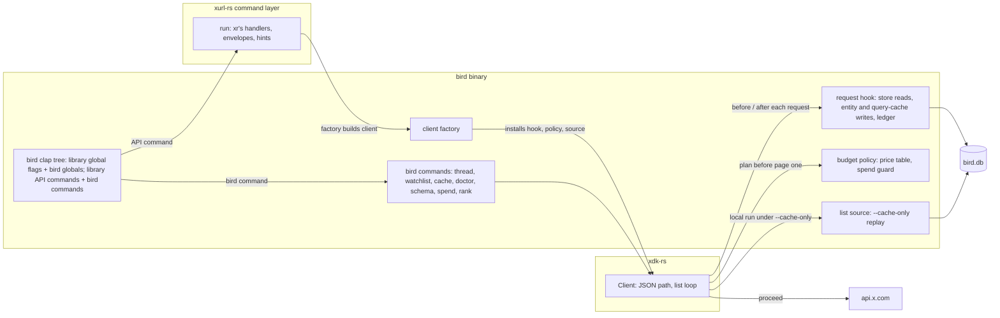
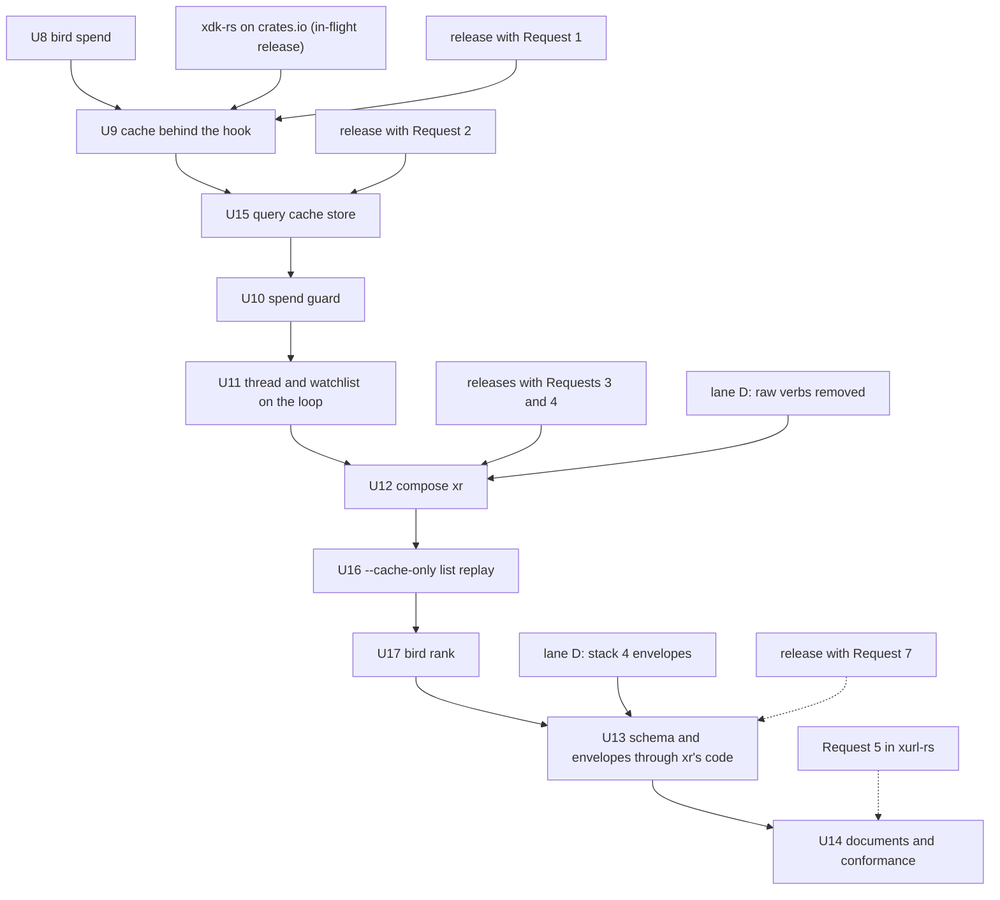

# bird extends xr in-process - Plan

## Goal Capsule

- **Objective:** A bird user drives every `xr` API command with `xr`'s verbs, flags, and output, and gets bird's cache,
  spend control, list replay, and its own commands on top, from one binary; an `xr` user sees no change beyond list
  commands that page past 100 results.
- **Means:** bird composes the xurl-rs command layer and installs its cache hook, budget policy, and list source on the
  xdk-rs client it supplies (KTD7, KTD11, KTD14). xdk-rs and xurl-rs supply those capabilities as the Requests to the
  xurl-rs team section describes; bird writes no code in xurl-rs.
- **Authority:** the Product Contract below (origin: `docs/brainstorms/2026-10-22-bird-extends-xr-requirements.md`),
  then the parity backlog's Rules (`docs/plans/2026-10-22-001-xurl-rs-parity-backlog.md`), then this Planning Contract.
  Where xdk-rs or xurl-rs behavior and bird differ, the upstream form wins. The xurl-rs team owns the design and timing
  of every request.
- **Stop conditions:** a bird unit waits until the xdk-rs or xurl-rs release that carries its upstream requirements is
  on crates.io. When a shipped capability differs from its request, bird adapts inside KTD14's seam and updates this
  plan; when it cannot meet a requirement, stop and ask the maintainer.
- **Execution profile:** one bird stack, U8 to U17. U8 can land now; the rest follow the upstream releases.
- **Who finishes:** bird's lane C implements U8 to U17; the xurl-rs team ships the requests on its own schedule.

---

## Product Contract

Product Contract preservation: carried from the origin with R-, F-, and AE-IDs unchanged. R1 is scoped to the hook and
the library surface, because `xr`'s list verbs paging through the loop changes `xr` for `--limit` above 100. R4 lets an
answer cover any method, which KTD2 relies on. R7 lets a multipart upload be declined, so `--cache-only` refuses an
upload as R20 requires.

### Summary

bird stops re-implementing `xr`. Its command set becomes `xr`'s API commands, composed in-process from the xurl-rs
library, plus the commands only bird has. Every request goes through one xdk-rs client, and bird's cache, spend policy,
and list replay ride on that client as hooks. bird remembers the order of every list it fetches, so `--cache-only`
replays a list at no cost.

### Problem Frame

bird duplicates `xr`'s verbs, request builders, page loops, and envelope, and each has drifted from `xr` (origin,
Problem Frame). Composition needs capabilities xdk-rs and xurl-rs do not have: the xurl-rs library target is
`#[doc(hidden)]` and disclaims embedders (`crates/xurl-cli/src/lib.rs`), and xdk-rs offers no point where an embedder
answers a request from a store or records what X returned (`crates/xdk/src/api/request/transport.rs`).

### Key Decisions

Carried from the origin; the normative text lives on the governed requirements.

- **bird composes `xr`'s API commands instead of mapping its verbs onto `xr`'s names.** Governs R17.
- **bird asks; xdk-rs and xurl-rs decide.** bird writes no code in xurl-rs and adapts to the names and shapes that ship.
  Governs R3 to R16, R23, R24, R30 to R34.
- **The hook lives on the client, not in the command layer.** Governs R3 to R8, R18.
- **bird asks for a client factory, not a built client.** Governs R13.
- **Spend control is a second hook, on the list loop's plan.** Governs R10, R18.
- **block, unblock, and blocked stay.** Governs R17.
- **bird's raw HTTP verbs do not return.** Governs R12, R21.
- **bird keeps its `BIRD_*` environment variables.** Governs R19.
- **xr's `auth` family composes, and `bird login` is removed.** Governs R17.
- **bird's local ledger is `bird spend`.** Governs R22.
- **The query cache ships in 1.0.0; checkpoints and hydration do not.** Governs R25 to R28.
- **Ranking is a bird command, not a `search` flag.** Governs R29.

### Requirements

**xr stays whole**

- R1. The request hook and the library surface change nothing `xr` does; `xr`'s list verbs paging through the list loop
  (R9) is the one `xr` change.
- R2. Nothing in xdk-rs or xurl-rs depends on bird or names a bird concept, and `xr` installs no hook.

**Needed from xdk-rs: request hook**

- R3. An embedder installs a request hook on a client built from credentials or from a token store.
- R4. Before a request is sent, the hook can answer it with a response body the client decodes as X's, sending nothing
  and needing no credential.
- R5. Before any request is sent, the hook can decline it, and the caller receives an error in place of a response.
- R6. After a sent request completes, the hook observes the request as sent and its outcome, once per logical request
  after any rate-limit retry.
- R7. Every request on the JSON path reaches the hook, including each list page and each caller-id lookup; multipart
  uploads can be declined and observed, never answered; streaming requests do not reach it.
- R8. A client with no hook behaves as it does today.

**Needed from xdk-rs: list loop**

- R9. A list call returns up to `limit` unique items across pages, with a lossless next cursor and a closed-set stop
  reason (contract D1 to D3).
- R10. Before the first page the loop plans the run and binds a budget; an embedder's budget policy sees the plan and
  refuses the run or returns the budget (D4).
- R11. `Call::send` with a `pagination_token` keeps working unchanged.
- R32. Each page request carries, on the hook's views, the list's canonical request identity, list class, primary
  resource kind, page index, and addressing cursor.
- R33. A local list source on the client serves a list run with no request; the run plans zero requests, skips the
  floor, and carries the source's fields into its list metadata.
- R34. Exit codes 75, 80, and 81 are xdk-rs constants, and a list run's metadata names the code its stop maps to.

**Needed from xurl-rs: command layer**

- R12. xurl-rs exposes `xr`'s API commands and global flags as a supported library, separate from its meta commands and
  raw mode.
- R13. The library runs one parsed API command with parsed global flags, writers, the token store path, the environment
  as data, and a client factory, and returns `xr`'s exit code.
- R14. A composed command prints exactly what `xr` prints for the same parsed input.
- R15. The library exposes `xr`'s schema documents and its envelope renderer.
- R16. The library surface is documented, semver-checked in CI, and open to additive change without a major release.
- R30. xdk-rs exposes its post-vocabulary normalizer, or a public typed decode, so a body bird stored or requested
  itself reads `post_count` where `xr`'s output does.
- R31. `xr schema --list --output json` prints one `ok` document, not one `{"message"}` per row.

**bird composition**

- R17. bird's command set is `xr`'s API commands, `auth` included, plus `thread`, `watchlist`, `cache`, `doctor`,
  `schema`, `completions`, `skill`, `spend`, and `rank`; every bird verb `xr` has retires with no alias, `login` among
  them.
- R18. Every command bird runs goes through a client bird builds with its cache hook and budget policy installed.
- R19. bird's global flags are `xr`'s plus `--refresh`, `--no-cache`, `--cache-only`, `--max-spend`, and `--examples`;
  `xr`'s form wins a conflict; every environment-bound flag reads its `BIRD_*` name.
- R20. Under `--cache-only` a composed read answers from the store or fails with bird's cache-miss error before any
  request, and a composed write refuses.
- R21. bird has no raw HTTP verbs.
- R22. `bird usage` and `bird usage credits` are `xr`'s; bird's estimate ledger and estimate-against-actual view move to
  `bird spend`.

**Query cache (bird)**

- R25. Per list request identity, bird stores the ordered ids an online run observes, each id's observation time, and
  the API cursor where observation stopped, updated by contract D7.2's head, end-cursor, and other-cursor rules.
- R26. Under `--cache-only` a list command replays the stored list in stored order up to `limit`, sends nothing, carries
  a `cache` field with the observation-time range, and stops with `cache_miss` and the stored end cursor when the stored
  list runs out first (D7.4).
- R27. Each page's entity writes, query-cache update, and ledger entry commit in one transaction (D7.6).
- R28. An online list run always fetches; the query cache serves only `--cache-only` (D7.3).

**Ranking (bird)**

- R29. `bird rank <query> [--by likes|reposts|replies|quotes] [--min-likes <n>]`, bounded by the global `--limit`, sends
  exactly the requests `bird search <query>` sends for the same `--limit`, ranks after the last page (likes by default),
  and drops posts below `--min-likes`; under `--cache-only` it ranks the stored list for that query and sends nothing.

**Needed from xurl-rs: seam and documents**

- R23. The seam document says flag parsing is presentation implemented once in `xr`'s command layer, and a client passes
  an `xr` capability through by composing its command.
- R24. The seam document and the pagination contract live in xurl-rs in the xdk-rs and xurl-rs split's vocabulary; bird
  keeps only its conformance document.

### Key Flows

- F1. A composed read served from the cache: `bird read <id>` a second time the same UTC day; the hook answers; stdout
  is byte-identical to the first run; no request reaches X.
- F2. A composed list refused on cost: `bird search "rust" --limit 5000`; the loop plans, bird's policy prices the plan
  above `--max-spend`; nothing is sent and the refusal names the estimate and the flag.
- F3. A retired verb: `bird tweet hi`, `bird me`, `bird login`, or `bird get /2/users/me` fails as an unknown command at
  exit 2.

### Acceptance Examples

- AE1. **Covers R4, R18.** A post cached today: `bird read <id>` sends nothing and prints what `xr read <id>` prints for
  that post.
- AE2. **Covers R1, R8.** xurl-rs with the hook and the library surface: its existing CLI tests and goldens pass
  unchanged.
- AE3. **Covers R14, R19.** `bird like <id> --output json` and `xr like <id> --output json` against the same scripted
  responses: same stdout, same exit code.
- AE4. **Covers R10.** A refusing budget policy: the list call returns the policy's error and sends nothing.
- AE5. **Covers R20.** `--cache-only` and an empty store: `bird user jack` fails with bird's cache-miss error and sends
  nothing.
- AE6. **Covers R25, R26.** After an online `bird search rust --limit 30` stored 30 ids,
  `bird search rust --limit 20 --cache-only` prints the first 20 in stored order with `meta.cache` and sends nothing;
  with `--limit 40` it prints 30 and stops with `cache_miss` and the stored end cursor.
- AE7. **Covers R29.** For the same query and `--limit`, `bird rank` and `bird search` send the same requests, and
  `bird rank`'s `data` is `bird search`'s posts sorted by like count with those under `--min-likes` removed.

### Scope Boundaries

- In: U8 to U17 in bird.
- Needed from upstream, owned by the xurl-rs team: the seven requests in Requests to the xurl-rs team.
- Out: `xr`'s raw mode and meta commands (`schema`, `completions`, `version`, `examples`, `skill`, `validate`) in bird;
  any change to `xr`'s verbs, flags, or envelopes outside its list verbs; any bird-authored change in xurl-rs.
- Considered and not built: a request rewrite in the hook (bird's batch-ID partial hits stay in bird's own code before
  the call, since no composed `xr` verb sends an `ids=` batch); per-page cursor segments in the query cache (the replay
  cursor in KTD17 covers mid-list positions without storing every page's cursor; revisit if a replay must continue
  online from mid-list).

#### Deferred to Follow-Up Work

- Checkpoint mode (contract D6), author hydration (D7.5), and the `cost`, `checkpoint`, and `hydration` envelope fields.
- Vendored prose evidence with checksums for depth caps and fan-out (D2.4).
- `xr endpoints`, the `SEAM_VERSION` and `CONTRACT_VERSION` constants, the seam's ast-grep rules, and its `## Seam` CI
  workflow.

### Dependencies / Assumptions

- The in-flight xurl-rs release reaches crates.io and bird moves onto its xdk-rs (backlog stack 6 item 1) before U9.
- Lane D removes bird's raw HTTP verbs (backlog stack 5 item 2) before U12, because bird's raw `post` and `delete`
  collide with `xr`'s.
- Lane D's store migration (the `tweets` to `posts` rename and purge) lands before U15 adds the query-cache tables.
- bird stays synchronous and drives the async libraries on its current-thread runtime (`src/xurl_client/mod.rs`,
  `EmbeddedClient`).

### Outstanding Questions

#### Resolve Before Implementation

- (U9 onward; xurl-rs team) Which xdk-rs and xurl-rs releases carry Requests 1 to 4, and under what names; bird starts
  each unit against the release that ships its capability.

---

## Planning Contract

### Key Technical Decisions

KTD1 to KTD10 record what bird codes against in each request; the requests themselves are the xurl-rs team's to design.

- KTD1. **bird relies on one hook consultation before, and one observation after the final attempt of, every JSON
  request** (Request 1). Governs R6, R7.
- KTD2. **bird's hook policy decides what to answer, writes included.** The client does not limit answers by method, so
  bird's tests answer every request and open no socket; bird's production hook answers only single-object GETs (KTD16).
  Governs R4.
- KTD3. **bird keys its cache on the rendered URL in the hook's view** (Request 1), as `src/db/client/entity.rs`
  (`compute_raw_cache_key`) does today.
- KTD4. **bird reads a declined request as xdk's declined error at exit 80, and as the `cache_miss` stop inside a list
  run** (Requests 1, 2).
- KTD5. **bird pages through a list terminator beside `Call::send`** (Request 2), the shape xurl-rs's adoption-grade
  plan reserved (KTD18 there).
- KTD6. **bird's spend guard is a synchronous budget policy on the client** (Request 2).
- KTD7. **bird composes through a public command-layer module of xurl-rs** (Request 3) and expects `xr` to be built from
  the same module, so composed and native output cannot drift.
- KTD8. **bird supplies a client factory that receives `Config` and `Auth` with `xr`'s flags applied** (Request 3), and
  relies on the library to render the run's diagnostics.
- KTD9. **bird documents exit codes 75, 80, and 81 from xdk's constants** (Request 2) and adds none of its own.
- KTD10. **bird reads list bounds, classes, and resource kinds from xdk's registry** (Request 2) and holds no copy.
- KTD11. **bird's cache moves behind the hook, and the hook replaces bird's test seam.** `BirdClient`'s read and write
  logic (`src/db/client/`) becomes bird's `RequestHook`; bird's own commands send through the hooked `xdk::Client`;
  `XurlClient` and `MockXurlClient` retire in favor of a scripted test hook that answers every request.
- KTD12. **bird composes by clap flattening and rebinds environment names after building the command.** bird's root
  flattens the library's global flags and bird's own, its command enum flattens the API commands beside bird's own, and
  each composed argument's `XURL_*` environment name is rebound to `BIRD_*` on the built `clap::Command` before
  matching.
- KTD13. **bird's spend guard prices plans with its existing price constants.** `src/cost.rs` keys its per-object prices
  by the registry's resource kinds; `spend.hard_cap_usd` and `spend.max_spend_usd` join bird's config, with
  `--max-spend` overriding the second up to the first (D4.7).
- KTD14. **bird adapts at one seam per upstream capability.** The factory, hook, budget policy, and list source live in
  `src/xurl_client/`, and composition lives in `src/cli/compose.rs`; a shipped name or shape that differs from its
  request changes those files and nothing else.
- KTD15. **The query cache is two tables beside the entity store.** One row per list request identity (identity key,
  list class, primary kind, stored end cursor, last observed time) and one row per stored id (identity, position, id,
  observation time), written from the after-request view's page context in the same transaction as the page's entities
  and ledger row (R25, R27, R32).
- KTD16. **Online list pages always proceed.** bird's hook answers single-object GETs from the store and never a request
  whose view carries a page context (R28, contract D7.3).
- KTD17. **A replay that stops before the stored list ends reports a bird replay cursor.** The store keeps only the end
  cursor, so bird's list source issues an opaque `bird-replay:` cursor that a later `--cache-only` run resumes from, and
  bird's hook declines that cursor on an online run with a message naming `--cache-only`. A replay that delivers through
  the stored end reports the stored end cursor, which continues online (R26).
- KTD18. **`bird rank` builds the call `xr search` builds.** It calls xdk's search shortcut with `xr`'s search
  parameters through the list terminator on bird's hooked client, so its requests, fields, and billable objects equal
  the composed `search` for the same `--limit`. It ranks after the last page by the chosen public metric, breaks ties by
  id descending, and then drops posts below `--min-likes`, so it can print fewer than `--limit` posts (R29).

### High-Level Technical Design

Component topology after U12:



A list run on bird's client:

```text
list call ── list source serves? ── yes ──► local run: items in stored order up to limit, meta.cache, no request
                                  └─ no ───► plan ──► budget policy ── refuse ──► exit 81, no request
                                                                  └─ budget ─► each page:
                                                                       hook.before(view + page context) ──► Proceed (always, KTD16)
                                                                       send ──► hook.after(view + page context, body)
                                                                                 └─ one transaction: entities, query cache, ledger
```

bird's unit order and the upstream releases each waits for:



### Assumptions

- No composed `xr` verb sends an `ids=` batch, so the hook needs no partial-answer path.
- `xr`'s webhooks family, if it ships, is part of the API-command set and arrives in bird unchanged.
- bird's `--examples` stays a bird flag; `xr`'s `examples` command is not composed.

---

## Requests to the xurl-rs team

bird is moving to compose `xr`'s commands in-process instead of re-implementing them, with its cache, spend control, and
list replay installed as hooks on the xdk-rs client it supplies. bird writes no xurl-rs code. This is what bird needs,
in priority order, with the interface bird plans to code against and the behavior bird will test. Names and exact
signatures are yours; bird adapts to what ships. Every request is additive, and `xr` without an embedder behaves as it
does today except where Request 4 says otherwise. Requests 1 to 4 gate bird's 1.0.0; Requests 5 to 7 do not.

Already in flight, and bird's first dependency: an xdk-rs on crates.io with serde-saphyr in place of serde_yaml
(RUSTSEC-2024-0449) and `xdk::store::locate_store`.

### Request 1. A request hook on `xdk::api::Client`

bird needs to answer a request from its own store, decline one it must not send, and record what X returned, for every
request any caller makes on the client, `xr`'s command handlers included.

Shape bird codes against:

```rust
pub trait RequestHook: Send + Sync + 'static {
    fn before<'a>(&'a self, request: &'a HookRequest) -> BoxFuture<'a, HookDecision>;
    fn after<'a>(&'a self, request: &'a HookRequest, outcome: HookOutcome<'a>) -> BoxFuture<'a, ()>;
}
#[non_exhaustive] pub enum HookDecision { Proceed, Answer(serde_json::Value), Decline(String) }
#[non_exhaustive] pub struct HookRequest {
    pub method: String,               // as sent
    pub url: String,                  // fully rendered, query included
    pub target: RequestTarget,        // template, path params, query
    pub auth_type: String,            // as requested; empty = auto-detect
    pub username: String,             // as requested
    pub sent_as: Option<SentAs>,      // after only: scheme, app, user the request went out under
    pub page: Option<PageContext>,    // Request 2; None outside a list run
}
pub enum HookOutcome<'a> { Body(&'a serde_json::Value), Error { status: Option<u16>, error: &'a xdk::Error } }
impl ClientBuilder {
    pub fn request_hook(self, hook: impl RequestHook) -> Self;
    pub fn from_store(config: &Config, auth: Auth) -> Self;  // a builder for store-backed clients too
}
// xdk::Error::Declined { message }: kind() == "request-declined", exit_code() == 80
```

Behavior bird depends on:

- `before` runs once per logical request on the JSON path, before credentials are resolved; `after` runs once after the
  final attempt, after any rate-limit wait and retry, for every request that was sent.
- `Answer` returns the body through the same decode a real response takes; nothing is sent and no credential is read.
  Answers are not limited by method: the hook's policy decides.
- `Decline` returns `Error::Declined` and sends nothing.
- `send_saving_identity` and every shortcut reach the hook. A multipart upload consults `before` for a decline (an
  answer there is a validation error) and is observed by `after`. Streaming requests never reach the hook.
- A client with no hook behaves exactly as today.

Acceptance bird tests:

- bird's whole test suite runs on a hook that answers every request, with no socket opened.
- An answered `read_post` decodes into the same `Post` the same body sent by X would.
- A declined request fails at exit 80 with kind `request-declined`, and `xr`'s renderer prints it.
- A 429 waited out and retried produces one `before` and one `after`, carrying the second response.

### Request 2. A list loop with a plan, a budget policy, page context, and a local list source

bird needs list commands, `xr`'s composed ones and bird's own, to page to a limit under a budget that bird can price
before page one, to tell bird which list each page belongs to so bird can store the list's order, and to let bird replay
a stored list with no request. The behavior is the pagination contract's D1 to D5
(`docs/designs/2026-09-03-pagination-and-result-bounding.md`, which Request 5 moves into xurl-rs).

Shape bird codes against:

```rust
impl<T: ListItem> Call<ApiResponse<Vec<T>>> {          // on .paginated() shortcuts
    pub fn list(self, limit: u32) -> ListCall<T>;
}
impl<T: ListItem> ListCall<T> {
    pub fn wait_for_rate_limit(self, on: bool) -> Self;
    pub fn deadline(self, at: std::time::Instant) -> Self;
    pub fn plan(&self) -> xdk::Result<Plan>;                // pure: no I/O, no clock
    pub async fn collect(self) -> xdk::Result<ListResult<T>>; // data, includes, errors, meta: ListMeta
    pub fn pages(self) -> impl Stream<Item = xdk::Result<Page<T>>>;
}
pub trait ListItem { fn id(&self) -> &str; }               // Post, User, DmEvent
pub trait BudgetPolicy: Send + Sync + 'static {
    fn budget(&self, list: &ListIdentity, plan: &Plan) -> Result<Budget, Refusal>;
}
pub trait ListSource: Send + Sync + 'static {
    fn serve<'a>(&'a self, list: &'a ListIdentity, cursor: Option<&'a str>, limit: u32)
        -> BoxFuture<'a, xdk::Result<Option<LocalList>>>;
}
#[non_exhaustive] pub struct ListIdentity { pub key: String, pub endpoint: &'static str, pub class: ListClass, pub primary: ResourceKind }
#[non_exhaustive] pub struct PageContext { pub list: ListIdentity, pub index: u32, pub cursor: Option<String> }
#[non_exhaustive] pub struct LocalList { pub items: Vec<serde_json::Value>, pub includes: Option<serde_json::Value>,
                                         pub next_cursor: Option<String>, pub exhausted: bool,
                                         pub extensions: BTreeMap<String, serde_json::Value> }
#[non_exhaustive] pub struct ListMeta { /* contract D3.5 fields */ pub extensions: BTreeMap<String, serde_json::Value> }
impl ClientBuilder { pub fn budget_policy(self, p: impl BudgetPolicy) -> Self; pub fn list_source(self, s: impl ListSource) -> Self; }
pub const EXIT_PARTIAL_DATA: i32 = 75; pub const EXIT_BOUNDED_STOP: i32 = 80; pub const EXIT_PREFLIGHT_REFUSED: i32 = 81;
// a Refusal surfaces as an xdk::Error at exit 81; ListMeta::exit_code() maps the stop per the contract's table
```

Behavior bird depends on:

- `limit` counts unique items by `id`; page sizes follow D2.7, so no page asks for more than the run needs; the stop
  reason is the closed, non-exhaustive set in D3.4; `next_cursor` is lossless per D3.2.
- The plan (D4.1 to D4.3) is computed from a registry of list endpoints (floor, ceiling, cursor parameter, list class,
  depth cap, primary kind, fan-out per expansion). bird reads the registry by import and keeps no table of its own.
- The budget policy runs once, before page one, with the plan; a refusal sends nothing. With no policy the loop binds
  the plan's default budget (D4.4).
- `ListIdentity.key` is canonical: endpoint, path parameters, and every query parameter except page size and cursor, so
  two runs of the same list share it whatever their `limit`.
- Every page request's `HookRequest.page` carries that identity, the page's index in the run, and the cursor that
  addressed it (`None` for the head page).
- The list source runs before planning. `Some` makes a local run: zero requests and zero objects planned, no floor, no
  budget policy, items decoded into `T` in the order given, stop `limit_reached` when `limit` is filled and `cache_miss`
  when the source is exhausted first, `next_cursor` as the source gives it, and `extensions` copied into
  `ListMeta.extensions`. `None` runs online.
- A request-hook decline during an online run stops it with `cache_miss`, carrying the decline's message, and delivers
  the items collected so far.
- `Call::send` with `pagination_token` sends one request exactly as today.

Acceptance bird tests:

- `limit` 25 over scripted search pages sends exactly the plan's requests and delivers 25 items with `next_cursor`.
- A refusing policy fails at exit 81 and nothing is sent.
- Two runs of one search with `limit` 10 and `limit` 50 report the same `ListIdentity.key` on every page.
- A list source serving 30 stored items for `limit` 20 sends nothing and delivers 20 with bird's extension in
  `ListMeta`.

### Request 3. `xr`'s command layer as a supported library

bird needs to put `xr`'s API commands and global flags in its own clap tree, run them exactly as `xr` runs them, and
print its own commands' output through `xr`'s envelope code.

Shape bird codes against:

```rust
pub mod compose {                                   // public, documented, semver-checked
    #[derive(clap::Args)] #[non_exhaustive] pub struct GlobalArgs { /* xr's global flags, raw mode excluded */ }
    #[derive(clap::Subcommand)] pub enum ApiCommand { /* every API command, auth and usage included; no meta command, no raw mode */ }
    pub trait ClientFactory: Send + Sync { fn build(&self, config: &Config, auth: Auth) -> xdk::Result<Client>; }
    #[non_exhaustive] pub struct Session<'a> { pub stdout: &'a mut dyn Write, pub stderr: &'a mut dyn Write,
                                               pub store_path: &'a Path, pub overrides: &'a EnvOverrides,
                                               pub factory: &'a dyn ClientFactory }
    pub async fn run(command: ApiCommand, globals: &GlobalArgs, session: Session<'_>) -> i32;
    pub fn schema_documents() -> impl Iterator<Item = (&'static str, serde_json::Value)>;
    pub mod output { /* OutputConfig and the ok, error, and dry-run envelope emitters, with Reason and NextStep */ }
}
```

Behavior bird depends on:

- `run` prints exactly what `xr` prints for the same parsed input, hints and diagnostics included, and returns `xr`'s
  exit code.
- The factory receives `Config` with `--timeout` and `--wait-on-rate-limit` applied and `Auth` with `--app` applied;
  `xr`'s own factory is the client it builds today.
- `xr` is built from the same module, so its help, parsing, and goldens do not change.
- No `ApiCommand` variant or `GlobalArgs` flag is named `thread`, `watchlist`, `cache`, `doctor`, `schema`,
  `completions`, `skill`, `spend`, `rank`, `--refresh`, `--no-cache`, `--cache-only`, `--max-spend`, or `--examples`,
  which bird uses.

Acceptance bird tests:

- bird's clap root flattens `GlobalArgs` and `ApiCommand` beside its own commands with no id collision.
- `bird like 123 --output json` and `xr like 123 --output json` on the same scripted hook print the same bytes and exit
  code.
- A factory error renders as `xr` renders a client build failure.

### Request 4. `xr`'s list commands on the loop

bird needs its composed list commands to page past one request and to print the loop's list metadata, bird's extension
fields included.

Behavior bird depends on:

- `search`, `timeline`, `mentions`, `bookmarks`, `likes`, `following`, `followers`, `muted`, `blocked`, and `dms` run
  through Request 2's loop with `--limit`, `--cursor`, and `--wait-on-rate-limit`.
- `meta` prints `ListMeta`, with `ListMeta.extensions` merged into `meta` (a local run's `cache` field reaches the user
  this way); `--dry-run` prints the plan; stops map to exit codes 0, 75, and 80.
- A `--limit` below an endpoint's floor is refused before any request at exit 81.

Acceptance bird tests:

- Composed `search --limit 150` sends two requests and delivers 150 posts.
- A composed `search` served by bird's list source prints `meta.cache`.

### Request 5. The seam document and the pagination contract in xurl-rs

bird holds both documents as drafts in its own `docs/designs/`, though both name xurl-rs as their home. bird asks
xurl-rs to adopt them, in the xdk-rs and xurl-rs split's vocabulary, with this revision to the seam document; bird then
deletes its copies and cites xurl-rs's.

- **The three layers:** the `xr` CLI row reads "The crate on the command line: flag parsing, output formatting, and
  discovery commands. Its command layer is also a library that a client composes in-process", consumed by "People,
  agents, programs driving a subprocess, and clients that compose it"; the crate row names `xdk-rs`.
- **Axis 1, the implementation bullet:** "`presentation` means the contract defines the behaviour and `xr`'s command
  layer implements it. Flag parsing is presentation, implemented once in `xr`'s command layer; a client that exposes an
  `xr` capability composes that command, with its flags, rather than parsing them again."
- **Axis 2, rule 2, appended:** "A client passes a capability through by composing `xr`'s command for it whenever `xr`
  has one. The composed command parses, runs, and prints exactly as `xr` does; the client contributes only the hooks it
  installs on the client it supplies and its own commands."
- **Axis 2, rule 5:** "Presentation (flags, exit codes, envelope core) is defined once by the contract and implemented
  once, in `xr`'s command layer. A client that composes a command presents it through that code; a client's own commands
  print the same envelope through `xr`'s renderer."
- **Anti-patterns, added:** "A client that re-implements an `xr` command, its flags, or its envelope instead of
  composing it." and "A hook in the crate or in `xr` that names a client concept."
- **The contract:** a list of what the shipped crate does not implement yet (checkpoints, hydration, the `cost`,
  `checkpoint`, and `hydration` fields, vendored prose evidence, `xr endpoints`, the version constants), so no clause
  describes behavior the crate lacks; 75, 80, and 81 recorded as xdk-rs constants.

### Request 6. A public post-vocabulary normalizer

bird stores X's bodies as sent and prints some of them (stored replays, its own commands' reads). bird needs xdk-rs's
normalizer (`crates/xdk/src/api/response/vocabulary.rs`, `normalize`), or a public typed decode, so a stored user object
prints `post_count` where `xr`'s typed output does.

Acceptance bird tests: a stored body carrying `public_metrics.tweet_count` prints `post_count` after normalization, and
a body already in the current vocabulary is unchanged.

### Request 7. `xr schema --list --output json` as one `ok` document

`xr schema --list --output json` prints one `{"message"}` document per row with no `status`. bird needs it to print one
`ok` document, as every other command does, because `bird schema --list` merges `xr`'s list with bird's own and prints
through `xr`'s renderer.

Acceptance bird tests: the output parses as one JSON document with `"status": "ok"` naming every schema.

---

## Request Traceability

| Request                   | Requirements           | bird units that wait for it |
| ------------------------- | ---------------------- | --------------------------- |
| In-flight release         | backlog stack 6 item 1 | U9                          |
| 1. Request hook           | R3 to R8               | U9                          |
| 2. List loop              | R9 to R11, R32 to R34  | U10, U11, U15, U16, U17     |
| 3. Command layer          | R12 to R16             | U12, U13                    |
| 4. `xr` lists on the loop | R1, R9                 | U12, U16                    |
| 5. Seam and contract      | R23, R24               | U14                         |
| 6. Normalizer             | R30                    | U16                         |
| 7. Schema list envelope   | R31                    | U13                         |

---

## Seam

Rows in the four-column format of `docs/designs/2026-09-04-xurl-bird-seam.md` (allowed values: implementation `crate`,
`client`, `presentation`; surface `xr`, `client`, `both`, `API`).

| Concern                                                                   | Implementation | Surface | Question that decided it                                       |
| ------------------------------------------------------------------------- | -------------- | ------- | -------------------------------------------------------------- |
| Request hook: answer, decline, observe                                    | crate          | API     | mechanical shape every embedder needs; values are the client's |
| Store-backed client builder that takes a hook                             | crate          | API     | third-party test                                               |
| Cache policy behind the hook (freshness, stored responses, entity writes) | client         | client  | persistent state                                               |
| Usage ledger written from hook observations                               | client         | client  | money and persistent state                                     |
| List registry: floors, ceilings, cursor parameter, depth caps, fan-out    | crate          | API     | API fact; `xr endpoints` deferred                              |
| List loop, page-size rule, dedup, stop reasons, lossless cursor           | crate          | both    | mechanical consequence; bird's surface is by composition       |
| List plan and default budget                                              | crate          | both    | pure arithmetic; `xr --dry-run` prints it                      |
| Budget policy hook                                                        | crate          | API     | shape-versus-value test                                        |
| Page context on each page request                                         | crate          | API     | mechanical consequence a third party storing pages needs       |
| Local list source and list-metadata extensions                            | crate          | API     | shape-versus-value test                                        |
| Query cache: stored id order per list identity                            | client         | client  | persistent state                                               |
| `--cache-only` list replay and the `cache` field                          | client         | client  | persistent state and ergonomics                                |
| Price table, spend guard, `--max-spend`, refusal                          | client         | client  | money                                                          |
| Exit codes 75, 80, 81                                                     | crate          | both    | contract, one table in xdk-rs                                  |
| `xr`'s command layer as a library                                         | presentation   | API     | flag parsing implemented once in `xr`'s command layer          |
| `xr`'s API commands in bird                                               | presentation   | both    | passthrough by composition                                     |
| Client factory                                                            | presentation   | API     | `xr`'s flags shape the client it builds                        |
| `xr`'s schema documents and envelope renderer                             | presentation   | API     | one envelope for every surface                                 |
| `BIRD_*` names on composed flags                                          | client         | client  | ergonomics for bird's users                                    |
| `bird spend`                                                              | client         | client  | money and persistent state                                     |
| `bird rank`                                                               | client         | client  | ergonomics over the composed search request                    |

---

## Implementation Units

Upstream capabilities are requests, not bird units; U1 to U7 are retired IDs.

### Unit Index

| U-ID | Title                                                  | Key files                                  | Depends on                                      |
| ---- | ------------------------------------------------------ | ------------------------------------------ | ----------------------------------------------- |
| U8   | `bird spend` takes the local ledger                    | `src/usage/`, `src/cli/mod.rs`             | none                                            |
| U9   | bird's cache behind the hook                           | `src/db/`, `src/xurl_client/`              | U8; release with R3 to R8                       |
| U15  | Query cache store                                      | `src/db/store/`, `src/xurl_client/hook.rs` | U9; release with R32                            |
| U10  | Spend guard as a budget policy                         | `src/cost.rs`, `src/config.rs`             | U15; release with R9, R10, R34                  |
| U11  | thread and watchlist page through the loop             | `src/thread.rs`, `src/watchlist/`          | U10                                             |
| U12  | bird composes `xr`'s API commands                      | `src/cli/`                                 | U11; releases with R12 to R16 and R1/R9 in `xr` |
| U16  | `--cache-only` list replay                             | `src/xurl_client/source.rs`                | U12; release with R33                           |
| U17  | `bird rank`                                            | `src/rank.rs`, `src/cli/mod.rs`            | U16                                             |
| U13  | `bird schema` and bird's envelopes through `xr`'s code | `src/schema_print.rs`, `src/output.rs`     | U17; lane D stack 4; release with R15           |
| U14  | bird documents, conformance, and completions           | `AGENTS.md`, `docs/`, `completions/`       | U13                                             |

### U8. `bird spend` takes the local ledger

- **Goal:** bird's estimate ledger and its estimate-against-actual view live under `bird spend`, freeing `usage` for
  `xr`'s command.
- **Requirements:** R22.
- **Dependencies:** none; lands on bird `dev` now.
- **Files:** `src/cli/mod.rs`, `src/cli/dispatch.rs`, `src/cli/commands/usage.rs` (renamed `spend.rs`), `src/usage/`
  (renamed `src/spend/`), `schema/usage.schema.json` (renamed), `tests/cli_smoke.rs`, `tests/schema_parity.rs`.
- **Approach:**
  1. Rename the verb, its module, its schema document, and its examples, with no alias.
  2. `bird spend` shows the local ledger and sends nothing; the estimate-against-actual view, which reads
     `/2/usage/tweets`, sits behind a flag.
- **Patterns to follow:** the existing `usage` command's tests.
- **Test scenarios:**
  - `bird spend --output json` prints the ledger with no request sent.
  - `bird usage` fails as an unknown command until U12 composes `xr`'s.
  - `bird schema spend` prints the renamed document.
- **Verification:** the CLI smoke suite and schema parity pass with the new name.

### U9. bird's cache behind the hook

- **Goal:** every request bird sends goes through one hooked `xdk::Client`, and bird's cache and ledger work as a hook.
- **Requirements:** R18, R20, R28.
- **Dependencies:** U8; the xdk-rs release that carries R3 to R8 (Request 1).
- **Files:** `Cargo.toml`, `src/xurl_client/mod.rs` (the client factory), `src/xurl_client/hook.rs` (new),
  `src/xurl_client/mock.rs` (the scripted test hook), `src/db/client/`, `src/db/mod.rs`, `src/cli/runner.rs`,
  `src/cli/dispatch.rs`, the handlers that call `BirdClient::get` and `request`, the tests that use `MockXurlClient`.
- **Approach:**
  1. Implement bird's hook from `BirdClient`'s get path (KTD11): answer fresh entity and stored-response hits for
     single-object GETs, honoring `--refresh` and `--no-cache`, and let every request with a page context proceed
     (KTD16).
  2. Under `--cache-only`, answer from the store or decline, writes included (R20).
  3. Write entities, stored responses, and the ledger from the after-request view.
  4. Build the client through the store-backed builder with bird's user agent and the hook (KTD14).
  5. Replace `MockXurlClient` with a scripted hook that answers every request and records what it saw.
- **Execution note:** keep the existing cache tests' assertions, swap only the harness, and see them pass before
  deleting `BirdClient`'s transport code.
- **Patterns to follow:** `src/db/client/get.rs` freshness rules; `src/db/client/entity.rs` cache keys.
- **Test scenarios:**
  - A GET for a post cached today is answered and the scripted transport sees no request.
  - `--refresh` on the same GET proceeds and the observation rewrites the stored entity.
  - `--no-cache` proceeds and writes nothing.
  - A request with a page context proceeds even when its URL is stored (KTD16).
  - Covers AE5 at bird's own-command level. `--cache-only` on an empty store declines at exit 80 with a message naming
    `--cache-only`.
  - `--cache-only` on a write declines before any request.
  - A 404 observation writes nothing and logs nothing billable.
  - A store that cannot open leaves the hook out and requests proceed.
- **Verification:** bird's full suite passes on the scripted hook and no bird test opens a socket.

### U15. Query cache store

- **Goal:** bird remembers the order of every list it fetches online, per list request identity.
- **Requirements:** R25, R27, R28.
- **Dependencies:** U9; the xdk-rs release that carries R32 (Request 2's page context); lane D's store migration.
- **Files:** `src/db/store/lists.rs` (new), `src/db/store/mod.rs` (migration), `src/xurl_client/hook.rs`,
  `src/db/store/lists.rs` tests.
- **Approach:**
  1. Add the two tables of KTD15 in one migration after lane D's.
  2. In the hook's after-request path, for a view with a page context, apply contract D7.2: a head page of a stable list
     replaces the stored order, and later pages of the same run append; a head run of a time-ordered list merges by id
     descending; a run whose first cursor equals the stored end cursor appends; any other cursor updates entities only.
  3. Record the page's `next_token` as the stored end cursor when the page extends the stored tail.
  4. Commit the page's entities, list rows, and ledger row in one transaction (R27).
- **Patterns to follow:** `src/db/store/bookmarks.rs` for an ordered table; the store's existing migrations.
- **Test scenarios:**
  - Two scripted pages of a stable list from the head store 20 ids in page order with the second page's `next_token` as
    the end cursor.
  - A second head run of the same stable list replaces the stored order.
  - A head run of a time-ordered list whose ids overlap the stored ones merges by id descending with no duplicate.
  - A run starting at the stored end cursor appends; one starting elsewhere changes entities only.
  - Two runs of one query with different limits update the same identity.
  - A store write failing mid-page leaves neither the page's entities nor its list rows (R27).
- **Verification:** the store's migration test opens a pre-migration database and finds both tables empty and the entity
  rows intact.

### U10. Spend guard as a budget policy

- **Goal:** a list run bird starts, composed or its own, is priced and refused or bounded before its first request.
- **Requirements:** R10, R18, R19.
- **Dependencies:** U15; the xdk-rs release that carries R9, R10, and R34 (Request 2).
- **Files:** `src/cost.rs`, `src/config.rs`, `src/cli/mod.rs` (`--max-spend`), `src/xurl_client/policy.rs` (new),
  `tests/cli_smoke.rs`.
- **Approach:**
  1. Key the per-object prices in `src/cost.rs` by the registry's resource kinds; an unpriced kind contributes $0 and is
     named (D4.5).
  2. Add `spend.hard_cap_usd` (default 5.00), `spend.max_spend_usd` (default 1.00), and `--max-spend` (KTD13).
  3. Refuse when `--max-spend` exceeds the hard cap, the estimate exceeds `max_spend`, or the plan is unbounded;
     otherwise scale the budget per D4.4.
- **Test scenarios:**
  - Covers F2. A plan priced above `max_spend` is refused at exit 81 naming the estimate and `--max-spend`, and nothing
    is sent.
  - `--max-spend 9` over a hard cap of 5 is refused naming the config key.
  - An unbounded expansion is refused before any request.
  - A plan under the limit binds the plan scaled by `max_spend / estimate`.
- **Verification:** no refusal reaches the scripted transport.

### U11. thread and watchlist page through the loop

- **Goal:** bird runs no page loop of its own.
- **Requirements:** R18; the seam's "a page loop in a client" anti-pattern.
- **Dependencies:** U10.
- **Files:** `src/thread.rs`, `src/watchlist/check.rs`, their inline tests.
- **Approach:** `thread`'s conversation search and `watchlist fetch`'s per-user search use the search shortcut's list
  terminator with bird's limits; building the thread tree stays bird's.
- **Test scenarios:**
  - A conversation spanning two scripted pages builds the same tree as today.
  - A watchlist fetch over three users sends one search per user and stops at the limit.
  - Each conversation search's pages reach the query cache under one identity.
- **Verification:** `src/thread.rs` and `src/watchlist/` hold no `next_token` or `pagination_token` string.

### U12. bird composes `xr`'s API commands

- **Goal:** bird's command set is `xr`'s API commands plus bird's own, every overlapping bird verb retired.
- **Requirements:** R14, R17, R19, R20, R21; F1, F3.
- **Dependencies:** U11; the xurl-rs release that carries R12 to R16 (Request 3) and `xr`'s lists on the loop (Request
  4); lane D's raw-verb removal.
- **Files:** `Cargo.toml`, `src/cli/mod.rs`, `src/cli/compose.rs` (new), `src/cli/runner.rs`, `src/cli/dispatch.rs`,
  `src/cli/argv.rs`, `src/cli/clap_errors.rs`, `src/cli/commands/` (retired handlers deleted), `src/bookmarks.rs`,
  `src/search.rs`, `src/profile.rs`, `src/login.rs`, `src/cli/commands/writes/` (deleted), `tests/cli_smoke.rs`,
  `tests/compose_parity.rs` (new).
- **Approach:**
  1. Flatten the library's global flags and bird's globals into bird's root, and its API commands beside bird's own
     commands (KTD12); rebind environment names to `BIRD_*`.
  2. Dispatch an API command to the library's `run` on bird's runtime with bird's factory (U9's hook, U10's policy).
  3. Retire `login`, `me`, `profile`, `bookmarks`, `search`, `tweet`, `reply`, `like`, `unlike`, `repost`, `unrepost`,
     `follow`, `unfollow`, `dm`, `block`, `unblock`, `mute`, `unmute`, and bird's write guard; `search --sort` and
     `--min-likes` go with `search` (U17 brings ranking back as `bird rank`); bird's `--page` alias, `-v` count,
     `--pretty`, `--plain`, and `--no-color` give way to `xr`'s flags (R19).
- **Test scenarios:**
  - Covers AE3. For `like`, `read`, `user`, `search`, and `usage credits`, bird and a direct library `run`, each on a
    client whose only hook is the same scripted answering hook, print the same bytes and exit codes.
  - Covers F1 / AE1. `bird read <id>` twice: the second run sends nothing and prints the same bytes.
  - Covers F3. `bird tweet hi`, `bird me`, `bird login`, and `bird get /2/users/me` fail as unknown commands at exit 2
    and send nothing.
  - `bird auth status` runs `xr`'s `auth status` against bird's token store.
  - Every argument with an environment binding reads a `BIRD_` name; `XURL_OUTPUT=json` does not change bird's output.
  - `bird --help` lists exactly `xr`'s API verbs and bird's own commands.
  - `bird --cache-only like <id>` declines before any request.
- **Verification:** anc audit shows no new failure; bird holds no request builder for an endpoint `xr` has a command
  for.

### U16. `--cache-only` list replay

- **Goal:** under `--cache-only`, every list command, composed or bird's own, replays the stored list at no cost.
- **Requirements:** R26.
- **Dependencies:** U12; the xdk-rs release that carries R33 (Request 2's list source); R30 (Request 6) when it ships,
  for stored user objects.
- **Files:** `src/xurl_client/source.rs` (new), `src/xurl_client/mod.rs` (installs the source under `--cache-only`),
  `src/xurl_client/hook.rs` (declines a replay cursor online), `tests/cache_replay.rs` (new).
- **Approach:**
  1. bird's list source serves the stored ids for the run's identity in stored order from the caller's cursor up to
     `limit`, with entities from the entity cache.
  2. It sets `extensions.cache` to `{observed_from, observed_to}`, the observation-time range of what it served (D7.4).
  3. It reports the stored end cursor when it delivers through the stored end, and a `bird-replay:` cursor otherwise
     (KTD17); `exhausted` is set when the stored list runs out before `limit`.
  4. With no stored list for the identity it serves an empty, exhausted list, so the run stops with `cache_miss` and no
     request.
  5. bird's hook declines an online request carrying a `bird-replay:` cursor, naming `--cache-only`.
- **Test scenarios:**
  - Covers AE6. After a scripted online `bird search rust --limit 30`, `--limit 20 --cache-only` prints the first 20
    stored posts in order with `meta.cache` and sends nothing.
  - Covers AE6. `--limit 40 --cache-only` prints 30 and stops with `cache_miss` and the stored end cursor.
  - `--cache-only --cursor bird-replay:<token>` resumes the replay where the last one stopped.
  - The `bird-replay:` cursor on an online run is declined before any request.
  - An identity never fetched stops with `cache_miss`, prints no posts, and sends nothing.
  - `bird thread <id> --cache-only` rebuilds the tree from the stored conversation list.
- **Verification:** no replay reaches the scripted transport, and `meta.cache` appears only on `--cache-only` runs.

### U17. `bird rank`

- **Goal:** `bird rank <query> [--by likes|reposts|replies|quotes] [--min-likes <n>]` ranks a search's posts by a public
  metric at the cost of that search.
- **Requirements:** R29; AE7.
- **Dependencies:** U16.
- **Files:** `src/rank.rs` (new), `src/cli/mod.rs`, `src/cli/dispatch.rs`, `schema/rank.schema.json` (new),
  `tests/rank.rs` (new).
- **Approach:**
  1. Build the search call `xr search` builds and run it through the list terminator on bird's hooked client, with the
     global `--limit` (KTD18), so the hook, the query cache, the spend guard, and under `--cache-only` the list source
     apply unchanged.
  2. After the last page, sort the delivered posts by the `--by` metric's count (`like_count`, `repost_count`,
     `reply_count`, `quote_count`), ties by id descending, then drop those below `--min-likes`.
  3. Print `xr`'s success envelope: `data` the ranked posts, `includes` as fetched, `meta` the run's list metadata plus
     a `rank` field with `by`, `min_likes`, and the number dropped.
- **Test scenarios:**
  - Covers AE7. `bird rank rust --limit 20` and `bird search rust --limit 20` on the same scripted answers send the same
    requests.
  - `--by reposts` orders by `repost_count`, ties by id descending.
  - `--min-likes 5` drops posts with fewer than five likes and reports the number dropped.
  - `--cache-only` ranks the stored list for the query, sends nothing, and carries `meta.cache`.
  - A plan above `--max-spend` is refused exactly as `bird search` refuses it.
- **Verification:** `bird rank` holds no request builder of its own; it calls the same shortcut as the composed
  `search`.

### U13. `bird schema` and bird's envelopes through `xr`'s code

- **Goal:** `bird schema` lists `xr`'s documents beside bird's own, and bird's own commands print `xr`'s envelope
  through `xr`'s renderer.
- **Requirements:** R15, R17.
- **Dependencies:** U17; lane D's stack 4; the xurl-rs release that carries R15 (Request 3); R31 (Request 7) for the
  merged list's envelope.
- **Files:** `src/schema_print.rs`, `src/output.rs`, `schema/`, `tests/schema_parity.rs`,
  `tests/envelope_consistency.rs`, `tests/json_envelope.rs`.
- **Approach:** replace bird's envelope emitter with the library's renderer; `bird schema --list` merges the library's
  schema documents with bird's own, bird's own winning for its own command names.
- **Test scenarios:**
  - `bird schema --list` names every `xr` API document and every bird document once, as one `ok` document.
  - `bird cache stats --output json` and a composed command share the success-envelope keys.
  - A bird error and a composed error render the same envelope keys.
- **Verification:** the envelope tests pass against the renderer with no bird-side emitter left.

### U14. bird documents, conformance, and completions

- **Goal:** bird's documents describe the composed verb set, and bird keeps no copy of xurl-rs's design documents once
  xurl-rs holds them.
- **Requirements:** R17, R24.
- **Dependencies:** U13; Request 5 in xurl-rs for the conformance pointers.
- **Files:** `AGENTS.md`, `README.md`, `docs/CLI_DESIGN.md`, `docs/DEVELOPER.md`,
  `docs/designs/2026-09-04-bird-client-conformance.md`, `docs/designs/2026-09-04-xurl-bird-seam.md` and
  `docs/designs/2026-09-03-pagination-and-result-bounding.md` (deleted once xurl-rs holds them), `completions/`,
  `examples/`.
- **Approach:** rewrite the command reference (with `spend` and `rank`), the global-flag table, and the exit-code table
  (75, 80, and 81 added); point the conformance document at xurl-rs's documents and versions when they exist; regenerate
  completions from the composed tree.
- **Test expectation:** none beyond the completions freshness check, which holds the regenerated files.
- **Verification:** no bird document names a retired verb, `BIRD_XURL_PATH`, or a subprocess transport.

---

## Coordination with Stacks 4 and 5

Lane D's plan (`docs/plans/2026-10-22-004-feat-xr-output-contract-and-post-vocabulary-plan.md`) runs alongside this one.
These points keep its work from being undone here:

- Do not rename bird verbs that `xr` supplies (`tweet` to `post`, `me` to `whoami`, `profile` to `user`): U12 retires
  them and `xr`'s arrive.
- Remove bird's raw HTTP verbs (`get`, `post <path>`, `put`, `delete <path>`) now; U12 cannot compose `xr`'s `post` and
  `delete` while bird's exist.
- Keep `block` and `unblock`: `xr` ships `block`, `unblock`, and `blocked`, and U12 replaces bird's copies with `xr`'s.
- `bird login` is removed in U12, where `xr`'s `auth` family composes, so the login-envelope unit of stack 4 drops.
- Stack 4's envelope work targets bird's own commands only (`cache`, `watchlist`, `thread`, `schema`, `doctor`, `skill`,
  `spend`, `rank`), matches the documents `xr schema --envelope` prints, and keeps bird's emitter behind one module
  boundary, which U13 swaps for `xr`'s renderer.
- Stack 4 adds no bird-only global output flag: U12 replaces bird's globals with `xr`'s, so `--pretty`, `--plain`,
  `--no-color`, the `-v` count, the `--page` alias, and bird's write guard retire there.
- bird's `usage` becomes `spend` in U8; envelope work on that command targets `spend`.
- `search --sort` and `--min-likes` leave with bird's `search` in U12; ranking lives in `bird rank` (U17).
- `xr`'s destructive-command gate (`--force`, the `confirmation-required` envelope at exit 1) replaces bird's
  `requires-confirmation` at exit 2 for composed verbs; bird's own destructive commands (`cache clear`,
  `watchlist remove`) match `xr`'s.
- Stack 5 item 1's wire vocabulary and store migration land before U9 and U15; U15's query-cache migration follows lane
  D's.
- bird's `search` pagination retires in U12, and `thread`'s and `watchlist`'s move to the loop in U11; stack 5 item 3 is
  U10, U11, U15, U16, and Requests 2 and 4.

---

## Risks & Dependencies

- **The upstream releases slip or ship a different shape.** U8 lands now; every other unit names the release it waits
  for, and KTD14 confines an adaptation to the adapter files.
- **The query cache's tables are stored data.** A schema change after release needs a migration, so U15 lands the full
  KTD15 shape at once and tests its migration from a pre-migration store.
- **A replay cursor reaches X.** bird's hook declines a `bird-replay:` cursor online (U16), so it never leaves the
  machine.
- **bird's tests lose coverage when `MockXurlClient` goes.** U9 swaps the harness under unchanged assertions before
  deleting transport code.

---

## Verification Contract

| Gate                                                                                                                                                                                        | When                                                          |
| ------------------------------------------------------------------------------------------------------------------------------------------------------------------------------------------- | ------------------------------------------------------------- |
| `cargo fmt --all --check`, `cargo clippy --all-targets -- -D warnings`, `cargo test --all`, `RUSTDOCFLAGS="-D warnings" cargo doc --no-deps`, `cargo deny check`, `cargo publish --dry-run` | every bird PR (U8 to U17)                                     |
| The acceptance tests listed under each request in Requests to the xurl-rs team                                                                                                              | the PR that moves bird onto the release carrying that request |
| `anc audit --output json` shows no new failure                                                                                                                                              | U12, U17, U14                                                 |

---

## Definition of Done

- U8 to U17 merged in bird, pinning xdk-rs and xurl-rs from crates.io with no git dependency.
- AE1 to AE7 each hold as a passing test.
- bird's `--help` lists `xr`'s API verbs and bird's own commands and nothing else; bird holds no page loop and no
  request builder for an endpoint `xr` covers.
- Requests 5 to 7 are shipped and adopted, or recorded in the backlog as waiting on xurl-rs.
- No abandoned-attempt code, unused trait, or test double for a removed seam remains.
