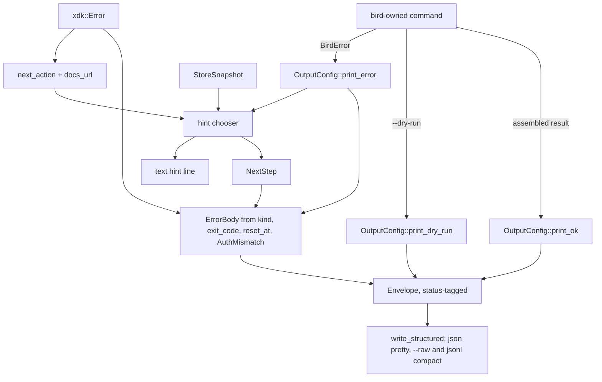
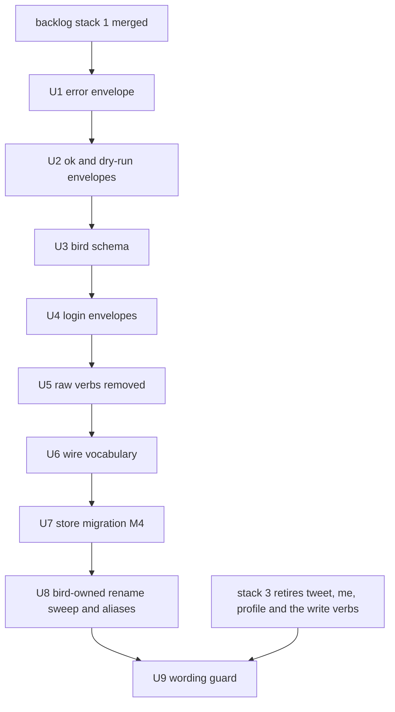

# xr output contract and post vocabulary for bird's own commands - Plan

## Goal Capsule

- **Objective:** An agent that parses `xr` output parses bird's own commands the same way: one `status` discriminator on
  every structured result, xr's error envelope with a runnable `next_step`, and X's post vocabulary in every key bird
  owns, so a script written against `xr` needs no bird-specific branch.
- **Means:** One typed envelope module mirroring xr's `Envelope`, `ErrorBody`, and `NextStep` (KTD1, KTD2), every
  bird-owned emitter routed through it, then the wire-vocabulary cutover, a one-shot store migration, the bird-owned
  rename sweep with its wording guard, and removal of the raw HTTP verbs (KTD8, KTD9, KTD10, KD3).
- **Product authority:** the backlog `docs/plans/2026-10-22-001-xurl-rs-parity-backlog.md` (stack 4; stack 5 items 1
  and 2) and its Rules: where bird and xdk-rs or xurl-rs differ, bird moves to the upstream form. This plan owns bird's
  own commands and bird's own request builders and store. Verbs `xr` supplies belong to
  `docs/plans/2026-10-22-003-feat-bird-extends-xr-plan.md` (stack 3); the pagination and cost contract belongs to stack
  5 item 3.
- **Execution profile:** Nine units in two stacks of stacked PRs (stack 4: U1 to U4; stack 5: U5 to U9), one concern per
  PR, each green on the full Verification Contract. No live X API call: every unit is proved offline over
  `MockXurlClient` and in-process runs.
- **Stop conditions:** Stop and report if stack 1 of the backlog has not merged (every unit runs under its hooks and
  checks); if `anc audit` gains a failing row after U1 or U2; if a unit would have to rename or remove a verb `xr`
  supplies (that is stack 3's); or if the xdk-rs on crates.io lacks an API a unit needs (`cargo publish --dry-run`
  builds against it).
- **Tail ownership:** The v1.0.0 cut, the Homebrew formula, and the bird-skill refresh belong to backlog stacks 6 and 7.
  Every unit's PR carries its `## Changelog` entries; breaking ones go under `### Breaking changes`.

---

## Product Contract

### Summary

bird's own commands (cache, watchlist, thread, schema, local usage, doctor, skill, login, the write guard) print xr's
three envelopes: `{"status":"ok", ...}` on success, `{"status":"dry_run","would_succeed","exit_code", ...}` under
`--dry-run`, and `{"status":"error","reason","exit_code","message","next_step", ...}` on stderr. `bird schema` takes
`xr schema`'s shape. bird's own request builders send `post.fields` and read X's 2.168 names, the store renames its
tweet-named tables and purges pre-cutover rows once, bird-owned keys and help drop tweet wording, and the raw HTTP verbs
go away. It is a hard cutover with no aliases and no compatibility shim.

### Problem Frame

bird and `xr` print different shapes for the same kind of answer. bird's success envelope is `{"data","meta"}` with no
discriminator, and several commands skip even that (`thread` prints `{"thread","meta"}`, `doctor` and `watchlist list`
print bare objects or arrays). Its error envelope is `{"error","kind","message","exit_code","meta","command","status"}`,
where `command` is the subcommand name and `status` is the HTTP code. In xr's envelope `command` is the offending value
and `status` is the discriminator. An agent that already handles xr misreads every bird error. bird also carries no
`next_step`, so a 401 or a rate limit tells the caller nothing about what to run next, although xdk-rs classifies both
(`xdk::Error::next_action`, `docs_url`, `reset_at`) and xdk-rs 0.2.0 on crates.io already ships them.

Stack 3 composes `xr`'s command tree into bird, so composed commands will print xr's shapes. Unless bird's own commands
move too, one binary prints two contracts. The vocabulary gap is the same problem on the wire. `xr` and xdk-rs send
`post.fields` and read `referenced_posts`, `repost_count`, and `includes.posts`. bird's own builders (`src/fields.rs`,
`src/thread.rs`, `src/watchlist/check.rs`, `src/search.rs`, `src/cost.rs`) still send `tweet.fields` and read the legacy
keys. Its store names `tweets` tables and columns, and its own output keys say `tweet_count` and `tweets`. Composed
commands will hand bird's cache post-vocabulary bodies its decomposer cannot read.

### Key Decisions

- KD1. **Hard cutover, no alias window** (see origin:
  `docs/plans/2026-09-02-2314-feat-xurl-v3-post-vocabulary-cutover-plan.md` KD1; memory
  `feedback_hard_cutover_no_alias_window.md`). Old envelope keys, error ids, schema names, store names, hidden flag
  aliases, and removed verbs fail or disappear outright. Governs R1 to R16.
- KD2. **xr's envelope is the contract, field for field** (backlog Rules). Where bird's emitter and xr's disagree on a
  key, a reason, an exit code, or JSON rendering, bird takes xr's. Governs R1 to R8.
- KD3. **Drop the raw HTTP escape hatch** (see origin KD2, user-directed: `xr` is the raw tool). Governs R14.
- KD4. **Purge cached entities once, in the cutover migration** (see origin KD4, user-approved: no tweet-vocabulary JSON
  leaves the store, and UTC-day freshness bounds the refetch). Governs R12.
- KD5. **`block` and `unblock` stay until stack 3 retires them.** `xr` ships `block`, `unblock`, and `blocked`
  (xurl-rs #165), so the old plan's removal premise (KD5 there: "xr dropped its block shortcuts") no longer holds. These
  verbs are ones `xr` supplies. Governs R15.

### Requirements

**Envelopes**

- R1. Every bird-owned command that assembles its own result prints exactly one `{"status":"ok", ...payload}` document
  on stdout under `--output json`, with the payload's keys at the top level as xr's `print_success` does. A list result
  carries `data` and `meta` the way X's list bodies do. A single record flattens its fields (KTD3). The `jsonl` shape of
  a streaming list is stack 5 item 3's.
- R2. Every bird error under a structured output mode prints one `{"status":"error","reason","exit_code","message"}`
  document on stderr. It adds `next_step` (`action`, then `command` or `template`, and `docs`) whenever a recovery step
  exists, plus the optional fields xr declares for the same failure. These are `retry_after_secs` and `retry_at` on a
  rate limit with a known reset, `endpoint`, `rendered_url`, `method`, `requested`, `supported`, `available_in_app`,
  `app`, and `other_apps_with_creds` on an auth-method mismatch, and `suggestion` on an unknown command. The keys
  `error`, `kind`, `meta`, the subcommand-name `command`, and the HTTP `status` are gone.
- R3. `reason` is the xdk-rs `kind()` for every library error. For bird's own refusals it is xr's spelling of the same
  refusal, and only a failure xr has no reason for gets a bird-only reason. The full set is closed and declared once
  (KTD4).
- R4. Exit codes follow xr's for every reason both tools share. Destructive confirmation refused under
  `--no-interactive` exits 1 with `confirmation-required`. A declined interactive prompt exits 0 and prints nothing
  further. Argument errors (`invalid-args`, `unknown-command`, `auth-method-mismatch`) exit 2, a value refused after
  parsing (`validation`) exits 1, and bird's own config errors keep 78.
- R5. Under `--dry-run`, a bird write prints `{"status":"dry_run","would_succeed","exit_code","command","method","url"}`
  on stdout, with `body` when the request has one and `confirmation_required: true` when the invocation lacks `--force`.
  It sends nothing.
- R6. `--output json` prints indented JSON, compact under `--raw`. `jsonl` and `ndjson` print one line per document.
  Help and version print plain text on stdout, and an ok envelope (`{"status":"ok","data":{"help":...}}`) when JSON is
  asked for by flag: anc 0.6.0 validates the output flag and envelope consistency only through `--help --output json`,
  so plain help there would turn two passing rows into a warn and a skip.
- R7. Headless login prints `{"status":"awaiting_callback","url","instructions"}` and then, after the redirect URL
  arrives on stdin, `{"status":"ok","message","username"}`.
- R8. Text mode prints the same recovery step a structured caller receives, as one hint line naming the command or
  template.

**Schemas**

- R9. `bird schema <command>` prints that command's response schema itself, with no envelope around it.
  `bird schema envelope` prints the envelope schema, `bird schema --list` lists `<command>  <type>` rows ending in
  `envelope`, and `bird schema --all` prints every schema keyed by command name, as `xr schema` does.
- R10. The envelope schema is generated from the envelope types and a test holds the committed
  `schema/envelope.schema.json` byte-equal to it. Every other committed schema matches its command's runtime output.

**Wire vocabulary and store**

- R11. Requests bird builds itself send `post.fields` and request `in_reply_to_user_id` and referenced posts through
  `expansions`, with the same strings xdk-rs's post reads send. bird reads `referenced_posts`,
  `public_metrics.repost_count`, `includes.posts`, and `edit_history_post_ids`, and reads no legacy name.
- R12. The first store open under this release runs one migration. It renames `tweets` to `posts`, `bookmarks.tweet_id`
  to `post_id`, `usage_actual.tweet_count` to `post_count`, and the tweet-named indexes. It rewrites `usage.object_type`
  from tweet to post spellings and deletes every row from `posts`, `users`, and `raw_responses`. A second open does
  nothing, and `bird doctor` reports the store's schema version.
- R13. Every bird-owned key, help string, schema, module, and doc drops tweet and Twitter wording, except the wire
  strings X keeps (see origin R8: `/2/tweets` paths, `tweet_id`-family body and path keys, `tweet.read`/`tweet.write`
  scopes, `/2/usage/tweets`, the `is:retweet` operator, the `retweeted` reference type, `twitter.com` post-URL hosts,
  and `public_metrics.tweet_count` inside user objects). A repository check fails on a new occurrence outside that
  allowlist.

**Verb surface**

- R14. `get`, `post <path>`, `put`, and `delete <path>` are removed, with no aliases. An invocation naming one fails as
  an unknown command before any request.
- R15. `block` and `unblock` keep their behavior until stack 3 retires them (KD5).
- R16. bird's hidden aliases go: `--plain`, `--no-color`, the `upgrade` alias of `skill update`, and the `check` alias
  of `watchlist fetch`.

### Acceptance Examples

- AE1. Rate limit with a known reset
  - **Covers R2, R3, R4.**
  - **Given** a mock that answers a `bird thread` request with `xdk::Error::Api { status: 429, reset_at: Some(t) }`.
  - **When** `bird thread 1585341984679469056 --output json` runs.
  - **Then** stderr carries
    `{"status":"error","reason":"rate-limited","exit_code":3,...,"retry_after_secs":...,"retry_at":"<RFC
    3339>","next_step":{"action":"wait-and-retry","docs":"https://docs.x.com/resources/fundamentals/rate-limits"}}`, and
    the process exits 3.
- AE2. No credential
  - **Covers R2, R8.**
  - **Given** a temporary token store holding an app with a client id and no token.
  - **When** `bird thread 1585341984679469056 --output json` runs.
  - **Then** stderr carries `reason: auth-required`, `exit_code: 77`, and
    `next_step: {"action":"sign-in","command":"bird login --no-browser"}`. In text mode the error line is followed by
    `Sign in first. Run: bird login`.
- AE3. Unknown command
  - **Covers R2, R3, R14.**
  - **Given** this release.
  - **When** `bird get /2/users/me --output json` runs.
  - **Then** stderr carries `reason: unknown-command`, `exit_code: 2`, and `next_step.action: show-help`, and no request
    is sent.
- AE4. Confirmation refused
  - **Covers R4.**
  - **Given** no `--force`.
  - **When** `bird like 1585341984679469056 --no-interactive --output json` runs.
  - **Then** stderr carries `reason: confirmation-required`, `exit_code: 1`, and
    `next_step: {"action":"confirm","template":"bird like 1585341984679469056 --no-interactive --output json --force"}`,
    and nothing is sent.
- AE5. Dry run
  - **Covers R5.**
  - **When** `bird like 1585341984679469056 --dry-run --output json` runs.
  - **Then** stdout is one
    `{"status":"dry_run","would_succeed":true,"exit_code":0,"command":"like","method":"POST","url":"...","confirmation_required":true,...}`
    document.
- AE6. Local record
  - **Covers R1, R6.**
  - **When** `bird cache stats --output json` runs on a healthy store.
  - **Then** stdout is indented JSON beginning `{"status": "ok", "path": ...` with the stats fields at the top level,
    and the same run with `--raw` prints it on one line.
- AE7. Schema verb
  - **Covers R9, R10.**
  - **When** `bird schema envelope --output json` runs.
  - **Then** stdout is the envelope schema document with no `status` key, byte-equal to `schema/envelope.schema.json`.
- AE8. First open after upgrade
  - **Covers R12.**
  - **Given** a store written by bird 0.2.0 holding a `tweets` row whose JSON contains `referenced_tweets`.
  - **When** any store-opening command runs.
  - **Then** the migration runs once, `posts` exists and is empty, usage rows survive with `object_type` rewritten, and
    `bird doctor --output json` reports the new schema version.

### Success Criteria

- `anc audit` reports zero failing rows after each unit (the goal's gate), and no row regresses from pass.
- No test or doc in the repository asserts or shows `"kind":`, `"error":` as an envelope key, `{"data":`-first success
  documents from a bird-owned command, or a legacy wire name outside the R13 allowlist.

### Scope Boundaries

Owned by other plans:

- Verbs `xr` supplies: `tweet`/`post`, `me`/`whoami`, `profile`/`user`, every write verb, `bookmarks`, `search`, the API
  half of `usage`, `usage credits`, `block`/`unblock`, and whether `login` gives way to a composed `xr auth` (stack 3).
- Global-flag parity with `xr` (`--app` and `XURL_APP`, `--wait-on-rate-limit`, `--no-pager`, yaml/csv/tsv output) and
  bare `bird` exiting 2 where bare `xr` exits 0. Both arrive with the composed tree in stack 3.
- `--limit`, `--cursor`, the `--page` alias, `search --pages`/`--max-results`, `thread --max-pages`, `meta.next_cursor`,
  and the `jsonl` per-item streaming shape (stack 5 item 3).

Considered and not built:

- An auth preflight in the dry run of bird's write verbs (xr fills `auth` and sets `would_succeed` from
  `Client::auth_preflight`). Every such verb retires under stack 3, and the composed `xr` verb carries the preflight.
  Revisit if stack 3 keeps a bird-owned write verb.
- Decomposing `includes.posts` into the entity store. bird's decomposer reads `data` and `includes.users` only, so
  storing included posts would be new caching behavior, not a vocabulary change; stack 3's request hook owns
  decomposition.
- A dual-read fallback for legacy keys in cached rows. KD4's purge means no legacy row survives the migration, so a
  fallback would only hide a missed rename.

#### Deferred to Follow-Up Work

- Importing xr's `Envelope`, `ErrorBody`, and `NextStep` from the xurl-rs library surface once stack 3 exposes it, and
  deleting bird's mirror (KTD2).
- Normalizing user objects on bird's raw request path to xdk-rs's spellings (`post_count` for `tweet_count`), once
  xdk-rs exposes its vocabulary normalizer (Open Questions).
- Removing the legacy `cache.db` usage import in `src/db/store/mod.rs`, which serves pre-0.1 stores. U6 keeps it
  working.

---

## Planning Contract

### Key Technical Decisions

- KTD1. **One emitter per envelope, all on `OutputConfig`.** `print_ok`, `print_dry_run`, and `print_error` build the
  typed envelope and render it. No command writes structured JSON to stdout or stderr any other way. The ad hoc
  `writeln!(stdout, serde_json::to_string(..))` sites in `src/thread.rs`, `src/watchlist/mod.rs`, `src/doctor.rs`,
  `src/usage/mod.rs`, `src/cli/commands/cache.rs`, `src/login.rs`, `src/schema_print.rs`, `src/cli/runner.rs`, and
  `src/cli/dispatch.rs` route through them. `output::success_envelope_string` and `print_envelope` are deleted. This is
  xr's arrangement (`crates/xurl-cli/src/cli/output/mod.rs`, `emit_error_envelope` as the one error path).
- KTD2. **bird's envelope types mirror xr's until xurl-rs exports them.** A new `src/output/envelope.rs` declares
  `Envelope` (`Ok`, `DryRun`, `Error(Box<ErrorBody>)`, tagged on `status`), `ErrorBody` with `deny_unknown_fields` and
  only the optional fields R2 names plus any bird-only ones KTD4 needs, and `NextStep`. All three take field names,
  order, and serde attributes from xr's `crates/xurl-cli/src/cli/envelope.rs` and `hints.rs` at the xurl-rs commit bird
  pins. `NextStep.action` is bird's `Action`, xr's thirteen actions in `NextAction`'s spelling: xdk-rs 0.2.0 on
  crates.io declares eight of them, and the package check builds against it, so bird converts xdk's by wire spelling
  until the xdk-rs release that carries the rest. Each type derives `schemars::JsonSchema` (schemars 1.2 is already in
  `Cargo.lock` through xdk-rs, so it becomes a direct dependency at that version). `src/output.rs`, already past 600
  lines, becomes `src/output/mod.rs` plus `envelope.rs` and `hints.rs`.
- KTD3. **Assembled results get the ok envelope; X's bodies do not.** xr prints X's typed response verbatim
  (`print_response`) and wraps only results it assembles (`print_success`). bird follows the same line. `thread`,
  `watchlist fetch`, local `usage`, `doctor`, `cache`, `watchlist add|remove|list`, `skill`, `--examples`, and `login`
  assemble their results and print the ok envelope. Payload shape: a list puts its items in `data` and its metadata in
  `meta` (`thread`, `watchlist fetch`, `watchlist list`). A record flattens its fields (`doctor`, `cache stats`,
  `usage`, `skill`). A message-shaped result is `{"status":"ok","message"}` (`cache clear`, `watchlist add|remove`), as
  xr's `print_ok_message`. Reads that print X's body until stack 3 composes them (`me`, `profile`, `bookmarks`,
  `search`) keep their current success shape. Only their errors move, through KTD1.
- KTD4. **The reason set is xr's plus a short bird-only tail, declared once.** `Reason` in `src/output/envelope.rs`
  spells every member the way xr does. Library errors take `xdk::Error::kind()` through a `from_kind` conversion,
  exactly as xr's `Reason::from_kind`. A test reads every kind the pinned xdk-rs declares and fails on one the set
  lacks. Bird-only members: `config-error` (exit 78), `cache-miss` (exit 1, `--cache-only` with no stored entry,
  `next_step.action: fix-input`), and `cancelled` (128 plus the signal, an X API call dropped by SIGTERM or SIGINT). The
  mapping of today's ids:

| bird id today                                                                                                                                                                                                         | Reason                                         | Exit     |
| --------------------------------------------------------------------------------------------------------------------------------------------------------------------------------------------------------------------- | ---------------------------------------------- | -------- |
| xdk `kind()` values                                                                                                                                                                                                   | unchanged                                      | xdk      |
| `unknown-argument`, `invalid-value`, `missing-required-argument`, `too-many-values`, `too-few-values`, `missing-equals`, `argument-conflict`, `invalid-arguments`, `missing-subcommand`, `not-a-date`, `not-a-number` | `invalid-args`                                 | 2        |
| `invalid-subcommand`                                                                                                                                                                                                  | `unknown-command`, with `suggestion`           | 2        |
| `invalid-auth`                                                                                                                                                                                                        | `auth-method-mismatch`, with `supported`       | 2        |
| `requires-confirmation`                                                                                                                                                                                               | `confirmation-required`                        | 1        |
| `user-aborted`                                                                                                                                                                                                        | none: a declined prompt exits 0 silently       | 0        |
| `user-name` (invalid username)                                                                                                                                                                                        | `validation`                                   | 1        |
| `command-error` without an xdk source                                                                                                                                                                                 | `io`, `serialization`, or `internal` by source | 5/1      |
| `serialization-failed`                                                                                                                                                                                                | `serialization`                                | 1        |
| `auth-error`                                                                                                                                                                                                          | `auth-required`                                | 77       |
| `config-error`, `client-credentials-missing`, `unknown-schema`, `missing-host`                                                                                                                                        | unchanged                                      | as today |
| entity-not-in-store string under `--cache-only`                                                                                                                                                                       | `cache-miss`                                   | 1        |

- KTD5. **`next_step` comes from xdk-rs first, then bird's store snapshot.** `xdk::Error::next_action()` and
  `docs_url()` fill the step for every library error that has one: `enroll-app`, `wait-and-retry`, `retry`, `fix-input`,
  `report-issue`, and `resume-wait`. A credential failure, where `next_action()` is `None`, picks its step from
  `xdk::store::snapshot::StoreSnapshot`, in xr's `choose_hint` order, with bird's commands. An unreadable store gives
  `inspect-store` with `command: bird doctor`. Tokens under another app give `select-app` with the invocation rerun
  under `--app <name>`. A client id with no token gives `sign-in` with `bird login`, or `bird login --no-browser` under
  structured output. Nothing at all gives `register-app` with xr's registration template, because bird has no
  registration command. Usage errors give `show-help` with `bird <command> --help`. A refused confirmation gives
  `confirm` with the invocation plus `--force` as a template. One built value feeds both the envelope and the text hint
  line (R8), as xr's `Hint`.
- KTD6. **JSON rendering is xr's `write_structured`.** `json` is pretty-printed, and compact when `--raw` is set.
  `jsonl`/`ndjson` are always one line. `--raw`'s help text changes to "Emit unstyled, compact output" to match.
  `print_response_json`'s text-mode panic stays.
- KTD7. **`bird schema` mirrors `xr schema`.** The verb takes `<command>`, `envelope`, `--list`, or `--all`, and prints
  schemas through `print_response`, never wrapped. The envelope schema is `schemars::schema_for!(Envelope)` rendered at
  runtime and committed as `schema/envelope.schema.json`, replacing `success-envelope` and `error-envelope`. Per-command
  schemas stay hand-authored JSON under `schema/`, renamed to the command they describe, and lose their `$id` lines
  because xr's schemas carry none. `tests/schema_parity.rs` keeps its embedded-equals-disk check. Each bird-owned
  command's schema gains a runtime check that walks the emitted keys against the schema's, the pattern
  `tests/doctor_schema_runtime.rs` already uses, with no new validator dependency. One deliberate difference: under
  JSON, `xr schema --list` prints one `{"message"}` line per row with no `status`, which breaks xr's own rule that every
  structured result is one of the three envelopes (`crates/xurl-cli/src/cli/envelope.rs`). bird prints one ok document,
  and the gap is reported upstream with stack 3's xurl-rs work.
- KTD8. **Migration M4 is one `rusqlite_migration` step** (see origin KTD7). It renames the table, columns, and indexes
  (columns keep their position, so the `cache.db` copy's `SELECT *` still lines up), rewrites `usage.object_type`, and
  deletes all rows from `posts`, `users`, and `raw_responses`. `user_version` makes it one-shot. M1 to M3 stay
  byte-identical. A pre-cutover binary opening a migrated store fails its migration check and runs API-only, and
  `doctor` names the schema version so that state is visible.
- KTD9. **bird's request builders copy xdk-rs's post-read strings, and readers read only 2.168 names.** `src/fields.rs`
  becomes the post field set (`POST_FIELDS`, `post_query_params`). `in_reply_to_user_id` moves to `expansions`, and the
  referenced-posts expansion uses the spelling `crates/xdk/src/api/shortcuts.rs` sends at the pinned commit. A unit test
  pins bird's strings to those. User objects on bird's raw path keep X's `public_metrics.tweet_count` (an allowlisted
  wire string under R13) until xdk-rs exposes its normalizer.
- KTD10. **The wording guard is a Rust integration test, not a workflow.** `tests/vocabulary_guard.rs` walks the tracked
  text files under `src/`, `schema/`, `examples/`, `tests/`, and the root docs, applies `tests/vocabulary-allowlist.txt`
  (the R13 wire strings, plus excluded paths: `completions/`, `CHANGELOG.md`, `docs/plans/`, `docs/brainstorms/`,
  `docs/research/`, the M1 to M4 migration text in `src/db/store/mod.rs`, and the U6 fixture builder), and fails naming
  file and line. `cargo test` already runs in pre-push and CI, so no workflow or shared-job input is needed. It is
  proved red with a planted violation before it is enabled.

### High-Level Technical Design

Every structured result reaches a writer through one of three emitters; text mode takes the same values.

### Sequencing

Stack 4 lands first, then stack 5. Inside each stack the order is fixed, and every unit stacks on the one before it.

- U5 comes first in stack 5 because removing raw `post <path>` and `delete <path>` frees the names stack 3's composed
  `post` and `delete` take.
- U4 is dropped if stack 3 replaces `bird login` with a composed `xr auth`. Check that plan before opening it.
- U9 waits for stack 3's verb retirement: before it, `bird tweet` and its help text are legitimate legacy wording the
  guard would flag.
- Backlog stack 2 edits `src/db/store/mod.rs` (`stderr.lock().unwrap()` sites) and `src/skill_install/mod.rs` (`$HOME`
  through the runner). U2 and U7 rebase onto it.
- Lane B's shared checks are on once stack 1 lands. Every unit that changes the CLI or `schema/` regenerates
  `completions/` and carries a `### Breaking changes` or `### Added` entry, so the changelog-bump check passes.

### Assumptions

- The xurl-rs commit bird pins (`f6cec235`) and xdk-rs 0.2.0 on crates.io carry the same `xdk::error` surface
  (`NextAction`, `next_action`, `docs_url`, `Api.reset_at`) and `xdk::store::snapshot::StoreSnapshot`. Checked against
  tag `xdk-rs-v0.2.0` on 2026-10-22.
- `anc` 0.6.0 accepts xr's envelope keys (`status`, `reason`), since xr passes it. The Verification Contract checks this
  after U1 and U2 instead of assuming it.
- No consumer outside this repository relies on bird's `https://bird.dev/schema/*-v1.json` `$id`s. The host serves
  nothing at them, and the release is a major.

### Open Questions

- Deferred: user objects on bird's raw request path carry X's `tweet_count`, while xr's typed output shows `post_count`,
  filled by xdk-rs's crate-private normalizer (`crates/xdk/src/api/response/vocabulary.rs`). Stack 3's xurl-rs work
  should export it (or a public typed decode) in the xdk-rs release that carries the request hook. Until then, bird
  passes X's spelling through. Not blocking: R13 allowlists it.
- Deferred: whether `bird login` survives stack 3. U4 only applies if it does.
- Deferred: whether stack 3's xurl-rs library surface exports `Envelope`, `ErrorBody`, and `NextStep`. If it does, bird
  imports them and deletes `src/output/envelope.rs`'s copies. If it does not, the mirror stays, with KTD4's
  kind-coverage test as its drift guard.

### Risks

| Risk                                                                                                          | Mitigation                                                                                                      |
| ------------------------------------------------------------------------------------------------------------- | --------------------------------------------------------------------------------------------------------------- |
| `confirmation-required` exiting 1 contradicts AGENTS.md's documented exit 2, and an agent gating on 2 breaks. | Breaking-changes entry in U1; AGENTS.md, README, and `docs/CLI_DESIGN.md` updated in the same PR.               |
| A bird-owned emitter is missed and still prints `{"data","meta"}`.                                            | U2's test runs every bird-owned command in-process under `--output json` and asserts `status` on each document. |
| `cargo publish --dry-run` builds against crates.io xdk-rs, which may lag the git pin.                         | Every unit uses only the surface the Assumptions name; the dry run is in the Verification Contract.             |

### Sources / Research

- xurl-rs `origin/dev`: `crates/xurl-cli/src/cli/envelope.rs` (the three variants, `Reason`, `ErrorBody`),
  `crates/xurl-cli/src/cli/hints.rs` (`NextStep`, `choose_hint`), `crates/xurl-cli/src/cli/output/mod.rs`
  (`print_success`, `print_dry_run`, `print_confirmation_required`, `error_body`, `write_structured`),
  `crates/xurl-cli/src/cli/runner.rs` (`render_unknown_command`, `Failure::Unconfirmed` at exit 1),
  `crates/xurl-cli/src/cli/commands/auth/signin.rs` (`awaiting_callback`), `crates/xurl-cli/src/cli/commands/schema.rs`
  (verb shape), `crates/xdk/src/error.rs` (`NextAction`, `next_action`, `docs_url`, `kind`, `exit_code`),
  `crates/xdk/src/api/shortcuts.rs` (`read_post` field and expansion strings), `docs/migrating/v3.0.0.md` (request-side
  changes).
- bird: `src/output.rs`, `src/error/mod.rs`, `src/cli/dispatch.rs` (`require_confirmation`, `emit_dry_run`),
  `src/cli/runner.rs` (help and examples wrapping), `src/cli/clap_errors.rs`, `src/login.rs`,
  `src/skill_install/mod.rs`, `src/db/store/mod.rs` (M1 to M3, the `cache.db` import), `src/fields.rs`, `schema/*.json`,
  `tests/{json_envelope,envelope_consistency,schema_parity,doctor_schema_runtime}.rs`, `examples/parsed_envelope.rs`.
- `docs/plans/2026-09-02-2314-feat-xurl-v3-post-vocabulary-cutover-plan.md`: KD1, KD2, KD4, R8 (wire-string allowlist),
  KTD7, KTD11. Its verb mapping, pagination, spend guard, and new read and write verbs live in stack 3 and stack 5
  item 3.
- `docs/plans/2026-10-22-002-shared-ci-jobs-plan.md`: R4 (surface growth needs a minor-or-higher changelog section) and
  KTD5 (bird's writer-injection guard as `scripts/lint-stdio.sh`).
- `docs/solutions/best-practices/consistent-json-schema-across-success-and-error-paths-2026-04-20.md`,
  `docs/solutions/best-practices/migration-script-over-legacy-fallback.md`,
  `docs/solutions/best-practices/prove-a-freshly-authored-guards-tests-are-non-vacuous-by-temporarily-degrading-the-guard.md`.

---

## Implementation Units

| U-ID | Title                                       | Key files                                                                                                                                                     | Depends on  |
| ---- | ------------------------------------------- | ------------------------------------------------------------------------------------------------------------------------------------------------------------- | ----------- |
| U1   | Error envelope in xr's shape                | `src/output/{mod,envelope,hints}.rs`, `src/error/mod.rs`, `src/cli/{runner,clap_errors,dispatch}.rs`, `schema/error-envelope.schema.json`                     | stack 1     |
| U2   | Ok and dry-run envelopes on bird's commands | `src/{thread,doctor}.rs`, `src/watchlist/mod.rs`, `src/usage/mod.rs`, `src/cli/commands/cache.rs`, `src/skill_install/mod.rs`, `src/cli/{runner,dispatch}.rs` | U1          |
| U3   | `bird schema` in xr's shape                 | `src/schema_print.rs`, `src/cli/mod.rs`, `schema/`, `tests/schema_parity.rs`                                                                                  | U2          |
| U4   | Login envelopes                             | `src/login.rs`, `examples/login.txt`                                                                                                                          | U3          |
| U5   | Raw HTTP verbs removed                      | `src/cli/{mod,dispatch}.rs`, `src/raw.rs`, `src/cli/commands/{raw_write,reads}.rs`, `src/doctor.rs`, `examples/`                                              | U4          |
| U6   | Wire vocabulary                             | `src/fields.rs`, `src/{search,thread,cost}.rs`, `src/watchlist/check.rs`, `src/db/client/{entity,get}.rs`                                                     | U5          |
| U7   | Store migration M4                          | `src/db/store/{mod,posts,entities,bookmarks,maintenance}.rs`, `src/db/usage.rs`, `src/doctor.rs`                                                              | U6          |
| U8   | Bird-owned rename sweep and aliases         | `src/cli/mod.rs`, `src/thread.rs`, `src/cli/commands/cache.rs`, `schema/`, `Cargo.toml`, docs                                                                 | U7          |
| U9   | Wording guard                               | `tests/vocabulary_guard.rs`, `tests/vocabulary-allowlist.txt`                                                                                                 | U8, stack 3 |

### U1. Error envelope in xr's shape

- **Goal:** Every bird error prints xr's error envelope with a `next_step` and exits with xr's code (stack 4 item 1).
- **Requirements:** R2, R3, R4, R6, R8; AE1, AE2, AE3, AE4. KTD1, KTD2, KTD4, KTD5, KTD6.
- **Dependencies:** backlog stack 1 merged.
- **Files:** create `src/output/envelope.rs`, `src/output/hints.rs`; move `src/output.rs` to `src/output/mod.rs`; modify
  `src/error/mod.rs`, `src/cli/runner.rs`, `src/cli/clap_errors.rs`, `src/cli/dispatch.rs` (`require_confirmation`),
  `src/db/client/get.rs` (`cache-miss`), `src/cli/mod.rs` (`--raw` help), `Cargo.toml` (`schemars`),
  `schema/error-envelope.schema.json`, `AGENTS.md` (Output formats, Exit codes), `README.md` (error envelope table),
  `docs/CLI_DESIGN.md` (Requirements and errors), `completions/`; tests `tests/json_envelope.rs`,
  `tests/envelope_consistency.rs`, `tests/cli_smoke.rs`, unit tests in `src/output/` and `src/error/mod.rs`.
- **Approach:**
  1. Declare `Envelope`, `ErrorBody`, `NextStep`, and `Reason` per KTD2 and KTD4. `BirdError` keeps its variants and
     gains a conversion into `ErrorBody` that carries the reason, exit code, message, xdk-derived optional fields, and
     the `NextStep`. `kind()` and the HTTP-status accessor go.
  2. Build `next_step` per KTD5. Before dispatch, load xdk's `TokenStore` from the runner's store path
     (`ResolvedPaths::token_store`, or xdk's default store when none is named) and build
     `StoreSnapshot::new(store, active_app, env_client_id_present)` from it, as xr's runner does. A store that fails to
     load still yields a snapshot whose `load_failed()` is true. Rebuild the confirm template from the argv the runner
     received.
  3. Rewrite `print_error` to emit through the envelope and KTD6's renderer. In text mode, print the error line and then
     the hint line.
  4. Map clap failures in `clap_errors.rs` to `invalid-args` and `unknown-command`, with `suggestion` from clap's own
     similar-name hint. Help and version print plain (R6).
  5. Rework `require_confirmation`: `confirmation-required` at exit 1 with the confirm step, and a declined prompt
     returns a silent success outcome.
  6. Regenerate `schema/error-envelope.schema.json` from `schemars::schema_for!(ErrorBody)`, wrapped as the error
     variant. U3 folds it into `envelope.schema.json`.
- **Patterns to follow:** xr's `emit_error_envelope`, `error_body`, `reason_of`, `retry_times`, and the golden test that
  reads every library kind.
- **Test scenarios:**
  - Covers AE1. A mock 429 with `reset_at` yields `rate-limited`, exit 3, `retry_after_secs`, an RFC 3339 `retry_at`,
    and `next_step.action: wait-and-retry` with X's rate-limit docs URL.
  - A 429 with no `reset_at` yields `rate-limited` with no `retry_*` keys and no `next_step`.
  - Covers AE2. A temporary store with a client id and no token yields `auth-required`, exit 77, and `sign-in` with
    `bird login --no-browser` under JSON, or `bird login` in the text hint.
  - An empty temporary store yields `register-app` with the registration template and no `command`.
  - An unreadable store file yields `inspect-store` with `command: bird doctor`.
  - A 403 enrollment body yields `enroll-app` with xdk's enrollment docs URL.
  - Covers AE3. An unknown subcommand yields `unknown-command`, exit 2, `command` echoing the unknown word, a
    `suggestion` when clap has one, and `show-help`.
  - A bad flag value yields `invalid-args`, exit 2.
  - Covers AE4. `--no-interactive` without `--force` on a write yields `confirmation-required`, exit 1, and a `confirm`
    template ending in `--force`.
  - A declined prompt (canned answer `n`) exits 0 with empty stdout and stderr past the prompt.
  - A config parse failure yields `config-error`, exit 78.
  - A `--cache-only` miss yields `cache-miss`, exit 1, `fix-input`.
  - Every `xdk::Error` kind the pinned xdk-rs declares converts to a `Reason` other than `internal`.
  - No error document carries `error`, `kind`, `meta`, or an integer `status`. `ErrorBody` round-trips through
    `deny_unknown_fields`.
  - `--output json` errors are indented, `--raw` and `jsonl` errors are one line, and message control characters stay
    sanitized.
- **Verification:** the envelope test suites pass with every assertion on `status`/`reason`, `anc audit` shows zero
  failing rows, and the docs show only the new shape.

### U2. Ok and dry-run envelopes on bird's commands

- **Goal:** Every bird-owned command prints the ok envelope on success and the dry-run envelope under `--dry-run` (stack
  4 item 2).
- **Requirements:** R1, R5, R6; AE5, AE6. KTD1, KTD3, KTD6.
- **Dependencies:** U1.
- **Files:** modify `src/output/mod.rs` (`print_ok`, `print_dry_run`; delete `success_envelope_string`,
  `print_envelope`), `src/thread.rs`, `src/watchlist/mod.rs`, `src/watchlist/check.rs`, `src/usage/mod.rs`,
  `src/doctor.rs`, `src/cli/commands/cache.rs`, `src/skill_install/mod.rs`, `src/cli/runner.rs` (`--examples`, watchlist
  pre-dispatch), `src/cli/dispatch.rs` (`emit_dry_run`), `examples/parsed_envelope.rs`,
  `schema/{thread,watchlist,doctor,usage}.schema.json`, `AGENTS.md`, `README.md`; tests `tests/cli_smoke.rs`,
  `tests/envelope_consistency.rs`, `tests/doctor_schema_runtime.rs`, unit tests beside each emitter.
- **Approach:**
  1. Add `print_ok(payload)` and `print_dry_run(would_succeed, exit_code, ctx)` with xr's flattening, and route every
     site KTD1 lists through them.
  2. Shape payloads per KTD3. `thread` moves its `thread` array to `data`. `watchlist list` always prints `data` and
     `meta`, never a bare array. `cache clear` and `watchlist add|remove` print `message`.
  3. Rewrite `emit_dry_run` to the dry-run envelope. Its context is `command`, `method`, `url`, `body` when present, and
     `confirmation_required` when there is no `--force`.
  4. Skill envelopes keep their keys. Their errors gain `next_step` by reason, as xr's `with_next_step` maps them:
     `show-help` for `missing-host`, `run-command` naming `bird skill update <host>` for `destination-not-empty` and
     `bird skill install <host>` for a host with nothing installed, `retry` for a failed clone, and `fix-input` for the
     remaining machine-state reasons. Rebase onto backlog stack 2's `skill_install` change.
  5. Update the payload schemas to the runtime shape. Their file names change in U3.
- **Patterns to follow:** xr's `print_success`, `print_ok_message`, `print_dry_run`, and `destructive_dry_run_context`.
- **Test scenarios:**
  - Covers AE6. `cache stats` on a healthy temporary store prints one indented document with `status: ok` and the stats
    fields at the top level, and one line under `--raw`.
  - `cache stats` with no store prints `status: ok` with `healthy: false`.
  - `cache clear --output json` prints `{"status":"ok","message":...}`.
  - `thread` over a mock conversation prints `status: ok`, `data` holding posts with `depth`, and `meta` with the thread
    fields.
  - `watchlist list` with more entries than `--limit` prints `data` and `meta.next_cursor`, and with fewer prints `data`
    and `meta` without a cursor.
  - `watchlist add x --output json` prints a `message` document, and the config file gains `x`.
  - `doctor --output json` prints `status: ok` with the report's keys at the top level and no credential value (the
    sentinel check stays).
  - Local `usage --local --output json` prints `status: ok` with the report fields.
  - `--examples --json` prints `{"status":"ok","examples":[...]}`.
  - Covers AE5. A write under `--dry-run` prints the dry-run envelope with `would_succeed: true`, `exit_code: 0`, and
    `confirmation_required: true`, the same with `--force` omits `confirmation_required`, and the mock records no
    request.
  - `skill install` with no host prints `missing-host` with `show-help`.
  - One test runs each bird-owned command in-process under `--output json` and asserts every stdout document has a
    `status` in {`ok`, `dry_run`}. It derives the list from `Cli::command()` minus the verbs the Scope Boundaries leave
    to stack 3.
  - The payload schemas' key sets match the runtime documents.
- **Verification:** no bird-owned command prints a document without `status`, `examples/parsed_envelope.rs` parses the
  new shape, `cargo build --examples` passes, and `anc audit` shows zero failing rows.

### U3. `bird schema` in xr's shape

- **Goal:** `bird schema` behaves as `xr schema` does and the envelope schema is generated (R9, R10).
- **Requirements:** R9, R10; AE7. KTD7.
- **Dependencies:** U2.
- **Files:** modify `src/schema_print.rs`, `src/cli/mod.rs` (`SchemaArgs`: positional command, `--list`, `--all`, the
  `envelope` name), `src/output/envelope.rs` (schema function); create `schema/envelope.schema.json`; delete
  `schema/success-envelope.schema.json`, `schema/error-envelope.schema.json`; rename `schema/watchlist.schema.json`
  (which covers four subcommands today) to `watchlist-list`; create `watchlist-fetch`, `cache-stats`, `skill-install`,
  and `skill-update` from each command's runtime output; keep `thread`, `doctor`, and `usage` under their names; drop
  every `$id`; keep `bookmarks`, `search`, `profile`, and `raw-get` under their current names for U5 and stack 3; modify
  `tests/schema_parity.rs`, `AGENTS.md` (JSON Schema documents), `README.md`, `completions/`.
- **Approach:**
  1. `bird schema` with no argument and no flag is a usage error naming the forms, as `xr schema` is.
  2. `envelope` renders `schema_for!(Envelope)` at runtime. A test compares it byte-for-byte with the committed file and
     names the regeneration command when they differ.
  3. `--list` prints `<command>  <type>` rows sorted by command, then `envelope`. Under JSON it prints the same rows as
     an ok envelope (`{"status":"ok","schemas":[{"command","type"}]}`). `--all` prints one object keyed by command name.
- **Patterns to follow:** xr's `run_schema`, `print_schema_list`, `print_all_schemas`, and the drift guard in
  `tests/schema_tests.rs` there.
- **Test scenarios:**
  - Covers AE7. `bird schema envelope --output json` prints a document with no `status` key, equal to the committed
    file.
  - `bird schema thread` prints the thread schema unwrapped.
  - `bird schema nope` exits with `unknown-schema` and lists the valid names in the message.
  - `bird schema` with nothing exits 2 (`invalid-args`) and names the four forms.
  - `bird schema --all` prints one object whose keys equal the `--list` command names.
  - Every file under `schema/` is embedded and every embedded name has a file.
  - No committed schema carries `$id`.
- **Verification:** the schema tests pass, and AGENTS.md lists the new names and forms.

### U4. Login envelopes

- **Not done:** stack 3 composes `xr`'s `auth` family and removes `bird login` (lane C's U12, the maintainer's
  decision), so `xr`'s own `awaiting_callback` envelope replaces bird's. The unit below stays as the record of the
  shape.
- **Goal:** Headless login prints xr's `awaiting_callback` document and then an ok envelope (stack 4 item 3).
- **Requirements:** R7. KTD3.
- **Dependencies:** U3; dropped if stack 3 retires `bird login`.
- **Files:** modify `src/login.rs` (`run_oauth2_authenticate_headless_embedded`, `print_authenticated`),
  `examples/login.txt`, `AGENTS.md` (Transport dependency paragraph on `--no-browser`); tests in `src/login.rs`.
- **Approach:**
  1. Step 1 prints `{"status":"awaiting_callback","url","instructions"}` through `print_response`. The awaiting status
     is its own value, so it does not go through `print_ok`. `instructions` tells the caller to paste the redirect URL
     on stdin. `state` leaves the document: it is part of `url`.
  2. Success prints `{"status":"ok","message","username"}` through `print_ok`. Text output is unchanged.
- **Patterns to follow:** xr's `signin.rs` step-1 branch.
- **Test scenarios:**
  - With a canned redirect URL on the injected stdin, JSON output is two documents in order: `awaiting_callback` with a
    `url` whose query holds `state`, then `ok` with the username.
  - An empty stdin after step 1 yields the `auth-required` error envelope with exit 77.
  - Text mode prints the existing instructions and success line.
- **Verification:** headless login tests pass with no network (the token exchange is mocked or stubbed as today).

### U5. Raw HTTP verbs removed

- **Goal:** `get`, `post <path>`, `put`, and `delete <path>` no longer exist (stack 5 item 2, raw half).
- **Requirements:** R14; AE3. KD3.
- **Dependencies:** U4 (or U3 when U4 is dropped).
- **Files:** modify `src/cli/mod.rs` (remove `Get`, `Post`, `Put`, `Delete`), `src/cli/dispatch.rs` (arms,
  `command_is_api_hitting`, `build_dry_run_url` if only raw verbs used it), `src/cli/commands/reads.rs` (keep `me` until
  stack 3), `src/cli/commands/mod.rs`, `src/doctor.rs` (command lists and endpoint map), `src/schema_print.rs`; delete
  `src/raw.rs` if nothing else calls `run_raw` (`me` does today: move the shared read path into `reads.rs`),
  `src/cli/commands/raw_write.rs`, `schema/raw-get.schema.json`, `examples/{get,post,put,delete}.txt`; modify
  `examples/top-level.txt`, `README.md`, `AGENTS.md` (Running bird; the `bird raw` line, which names a command that does
  not exist), `completions/`; tests `tests/cli_smoke.rs`, `tests/schema_parity.rs`.
- **Approach:** delete the variants and every list that names them, and let clap's unknown-command path (U1) answer for
  them. `src/db/client/embedded.rs`'s generic request path stays: every read uses it.
- **Test scenarios:**
  - Covers AE3. `bird get /2/users/me`, `bird put /x`, and `bird post /2/tweets --body '{}'` each exit 2 with
    `unknown-command` and send nothing.
  - `bird delete 1585341984679469056` exits 2 with `unknown-command` (stack 3's composed `delete` replaces it).
  - `bird doctor --output json` lists no removed verb.
  - `bird --help` and `completions/` name no removed verb.
- **Verification:** the smoke suite's subcommand walk passes, and no file outside the plan and changelog history names a
  removed verb as a bird command.

### U6. Wire vocabulary

- **Goal:** bird's own request builders and readers speak X's 2.168 post vocabulary (stack 5 item 1, wire half).
- **Requirements:** R11. KTD9.
- **Dependencies:** U5.
- **Files:** modify `src/fields.rs`, `src/search.rs`, `src/thread.rs`, `src/watchlist/check.rs`, `src/cost.rs`,
  `src/db/client/entity.rs`, `src/db/client/get.rs`, `src/xurl_client/mock.rs` fixtures, `schema/thread.schema.json`,
  `schema/watchlist-fetch.schema.json`; tests beside each module.
- **Approach:**
  1. Rename the field-set constants and builder per KTD9, and move the two values onto `expansions`.
  2. Switch every reader to `referenced_posts`, `repost_count`, `includes.posts`, and `edit_history_post_ids`.
  3. Rewrite fixtures to what X sends under `post.fields`.
  4. Search's `is:retweet` operator and the `retweeted` reference type are wire strings and stay.
- **Execution note:** rewrite the fixtures first and watch the readers' tests fail on them before switching the readers,
  so no reader keeps a legacy key unseen.
- **Test scenarios:**
  - The post query params contain `post.fields`, no `tweet.fields`, and expansion values equal to the literal strings
    `read_post` sends in `crates/xdk/src/api/shortcuts.rs` at the pinned commit. xdk-rs builds them inside a private
    builder, so the test asserts the copied literals and names that source.
  - Thread reconstruction over `referenced_posts` replies builds the same tree the legacy fixture built.
  - Search's retweet filter drops a post whose `referenced_posts` has type `retweeted`, and its quote handling reads
    `quoted`.
  - Watchlist activity reads `public_metrics.repost_count`.
  - Cost estimation counts `includes.posts`.
  - A body carrying only legacy keys yields no references and no included posts (no fallback).
- **Verification:** no source file outside the R13 allowlist reads or sends a legacy name.

### U7. Store migration M4

- **Goal:** The store carries post-vocabulary names and no pre-cutover rows (stack 5 item 1, store half).
- **Requirements:** R12; AE8. KD4, KTD8.
- **Dependencies:** U6; rebase onto backlog stack 2's `src/db/store/mod.rs` change.
- **Files:** modify `src/db/store/mod.rs` (append M4), rename `src/db/store/tweets.rs` to `src/db/store/posts.rs`
  (`TweetRow` to `PostRow`), modify `src/db/store/{entities,bookmarks,maintenance}.rs`, `src/db/usage.rs` (`object_type`
  spellings), `src/db/client/mod.rs`, `src/db/mod.rs` (table list), `src/doctor.rs` (schema version),
  `schema/doctor.schema.json`; test `src/db/store/mod.rs` migration tests with an on-disk 0.2.0-shaped fixture.
- **Approach:**
  1. M4 per KTD8. Usage history and bookmark positions survive, and the watchlist lives in the config file.
  2. `object_type` values: `tweet` and `tweets` become `post` and `posts`, `user` and `users` stay.
  3. `migrate_usage_from_cache` runs after every migration, so its copy of legacy `cache.db` usage rows applies the same
     `object_type` rewrite. Without it, an import after M4 lands tweet spellings in a migrated store.
  4. `doctor` reads `user_version` and reports it under the store section.
- **Patterns to follow:** M3's single-statement step; the `rusqlite_migration` tests already in `src/db/store/mod.rs`.
- **Test scenarios:**
  - Covers AE8. A fixture store at M3 with rows in every table migrates once: `posts`, `users`, and `raw_responses` are
    empty, `usage` rows keep their count with rewritten `object_type`, and `bookmarks` keeps positions under `post_id`.
  - Opening the migrated store again runs nothing and changes no row.
  - A fresh store reaches M4 directly and has no tweet-named table, column, or index (`sqlite_master` scan).
  - The `cache.db` usage import still copies a fixture `usage_actual` into the renamed column, and the `usage` rows it
    copies after M4 carry `post` spellings.
  - `doctor --output json` reports the schema version.
- **Verification:** migration tests pass, and `sqlite_master` on a migrated store names no tweet identifier.

### U8. Bird-owned rename sweep and aliases

- **Goal:** bird-owned keys, help, schemas, and docs say post, and the hidden aliases are gone (stack 5 item 2,
  bird-owned half).
- **Second PR:** lane C's U8 lands right after this unit as its own PR: `bird usage` becomes `bird spend`, the local
  ledger by default, with `--sync` fetching X's actual usage, so stack 3 can compose `xr`'s `usage`.
- **Requirements:** R13, R16. KD1.
- **Dependencies:** U7.
- **Files:** modify `src/thread.rs` (`meta.tweet_count` to `post_count`, `root_tweet_age_days` to `root_post_age_days`,
  `<TWEET_ID>` help to post), `src/cli/commands/cache.rs` (`tweets` to `posts`, `Tweets:` to `Posts:`), `src/cli/mod.rs`
  (help strings on bird-owned commands, remove `--plain`, `--no-color`, `upgrade`, `check`, and the "maps to xurl -u"
  and "via xurl" wording on bird-owned commands), `src/output/mod.rs` (`ColorMode` resolution without the aliases),
  `src/usage/` (bird-owned tweet-named fields), `schema/{thread,cache-stats,usage}.schema.json`,
  `examples/{thread,cache-stats,watchlist-check}.txt` (`watchlist-check.txt` becomes `watchlist-fetch.txt`),
  `Cargo.toml` (drop the `twitter` keyword), `README.md`, `AGENTS.md`, `docs/CLI_DESIGN.md`, `docs/DEVELOPER.md`,
  `completions/`; tests `tests/json_envelope.rs` (alias tests become rejection tests), `tests/cli_smoke.rs`.
- **Approach:** rename only names bird owns on commands that stay bird's. `tweet`, `me`, `profile`, the write verbs, and
  their help belong to stack 3. Text mode keeps its layout with the new labels.
- **Test scenarios:**
  - `thread --output json` meta carries `post_count` and `root_post_age_days`, and no `tweet_count`.
  - `cache stats --output json` carries `posts`.
  - `--plain`, `--no-color`, `skill upgrade`, and `watchlist check` each exit 2 with `invalid-args` or
    `unknown-command`.
  - `--color never` and `NO_COLOR=1` still strip color.
- **Verification:** a search for tweet wording across bird-owned commands' help (`bird <cmd> --help` for each bird-owned
  command) finds none.

### U9. Wording guard

- **Goal:** New tweet or Twitter wording outside the allowlist fails the test suite (R13's check).
- **Requirements:** R13. KTD10.
- **Dependencies:** U8 and stack 3's retirement of `tweet`, `me`, `profile`, and the write verbs.
- **Files:** create `tests/vocabulary_guard.rs`, `tests/vocabulary-allowlist.txt`.
- **Approach:** scan per KTD10, matching `tweet` and `twitter` case-insensitively as words and within identifiers, and
  report every hit outside the allowlist with file and line.
- **Execution note:** plant one violation in a scratch copy first and quote the red run before enabling the guard.
- **Test scenarios:**
  - The tree as merged passes.
  - A planted `tweet_count` summary key in `src/thread.rs` fails, naming the file and line.
  - An unchanged `/2/usage/tweets` endpoint string passes.
  - A hit inside `completions/` or `docs/plans/` passes.
- **Verification:** the guard's red run is quoted in the PR body, and the green run is in CI.

---

## Verification Contract

| Gate               | Command                                                              | Applies                                             |
| ------------------ | -------------------------------------------------------------------- | --------------------------------------------------- |
| Format             | `cargo fmt --all --check`                                            | every unit                                          |
| Lint               | `cargo clippy --all-targets -- -D warnings`                          | every unit                                          |
| Tests              | `cargo test --all`                                                   | every unit                                          |
| Rustdoc            | `RUSTDOCFLAGS="-D warnings" cargo doc --no-deps`                     | every unit                                          |
| Dependencies       | `cargo deny check` (all four rows)                                   | U1 (adds `schemars`), every unit                    |
| Package            | `cargo publish --dry-run --allow-dirty`                              | every unit (builds against crates.io xdk-rs)        |
| Examples           | `cargo build --examples --locked`                                    | U2, U5                                              |
| Completions        | `scripts/generate-completions.sh --check` once stack 1 vendors it    | every unit that changes the CLI                     |
| Agent-native audit | `anc audit --output json`: zero `fail`, no row regressed from `pass` | U1, U2, U5, U8                                      |
| Changelog bump     | lane B's surface check on the PR                                     | every unit that changes `completions/` or `schema/` |

No unit makes a live X API call. Behavior that crosses the bird/xdk boundary is proved with `MockXurlClient` and
in-process `run_with_paths` runs against temporary stores (memory `project_bird_passthrough_to_xurl.md`).

---

## Definition of Done

- Every unit's tests pass, and each PR's rollup is green before its stack merges.
- Stack 4 (U1 to U4) and stack 5's U5 to U8 have merged into `dev` in order, and U9 has merged after stack 3's verb
  retirement.
- `anc audit` on `dev` shows zero failing rows.
- `AGENTS.md`, `README.md`, `docs/CLI_DESIGN.md`, and `examples/` show only the new envelopes, reasons, exit codes,
  schema forms, and names.
- Each PR's `## Changelog` lists its user-visible breaks under `### Breaking changes` (envelope keys, reasons, the exit
  code for `confirmation-required`, schema names and `$id`s, store purge, removed verbs and aliases), and `### Removed`
  where the template carries it.
- No dead code is left from an abandoned attempt, and `success_envelope_string`, `print_envelope`, `src/raw.rs`, and
  `src/cli/commands/raw_write.rs` are gone.
- The backlog records block/unblock removal as not done, for KD5's reason.
