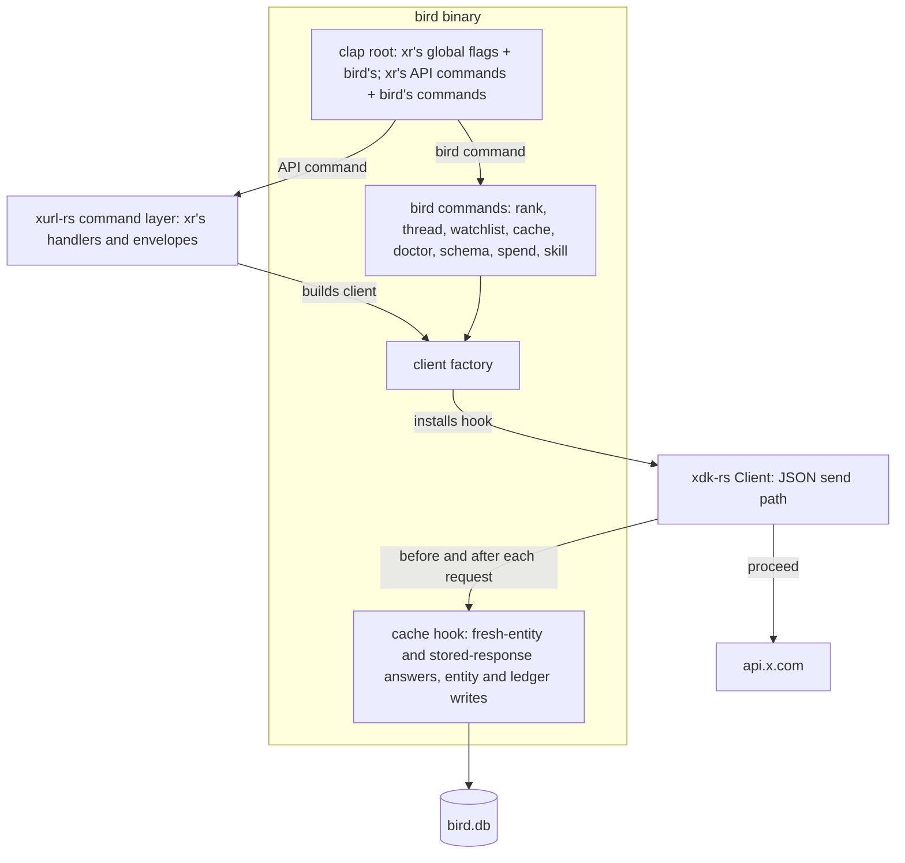
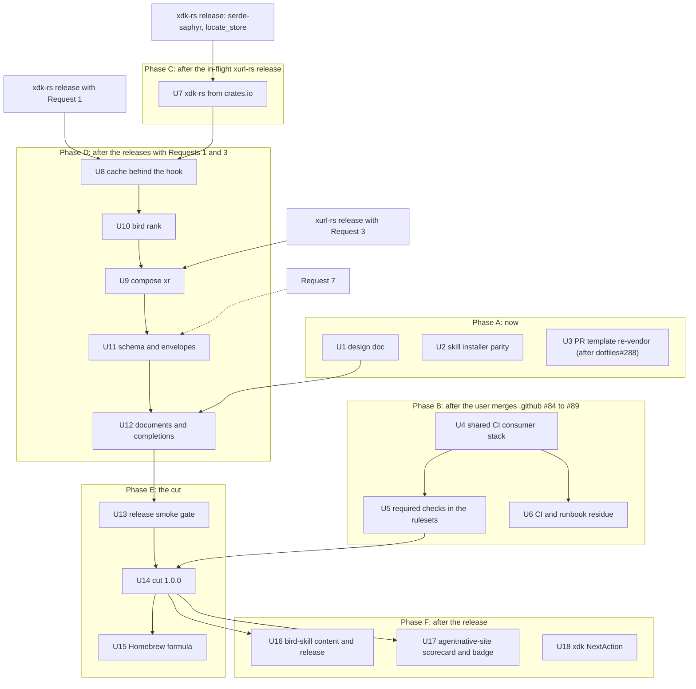

# bird 1.0.0 remaining work - Plan

## Goal Capsule

- **Objective:** bird 1.0.0 is installable from crates.io, GitHub releases, and Homebrew, and a bird user drives every
  `xr` API command with `xr`'s verbs, flags, and output, with bird's cache, spend ledger, ranking, and own commands on
  top, from one binary that passes `anc audit` with zero failures.
- **Means:** bird composes the xurl-rs command layer on an xdk-rs client carrying bird's cache hook (KTD5, KTD6, KTD9);
  the rest is repository, release, and external-surface work sequenced around the xurl-rs releases (KTD10).
- **Authority:** this plan, then the parity backlog's Rules (`docs/plans/2026-10-22-001-xurl-rs-parity-backlog.md`),
  then plan 002 (`docs/plans/2026-10-22-002-shared-ci-jobs-plan.md`) for the shared CI jobs' detail. Where xdk-rs or
  xurl-rs behavior and bird differ, the upstream form wins. The xurl-rs team owns the design and timing of every request
  in Requests to the xurl-rs team.
- **Stop conditions:** a unit that needs an upstream capability waits until the crates.io release carrying it exists. A
  shipped capability that differs from its request is adapted inside KTD5's seam and this plan is updated; a requirement
  the shipped shape cannot meet stops for the maintainer. Tagging a release, changing live settings, merging a
  cross-repo contract change, and any live X API call beyond the release smoke stop for the user's approval.
- **Execution profile:** six phases of stacked PRs (Sequencing). Phase A lands now; B waits on the user's review of
  `brettdavies/.github` #84 to #89; C waits on the in-flight xurl-rs release; D waits on the releases carrying Requests
  1 and 3; E is the cut; F follows the release.
- **Who finishes:** bird's lanes implement every unit; the xurl-rs team ships the requests on its own schedule; the user
  approves tags, live settings, and cross-repo contract merges.

---

## Product Contract

Product Contract preservation: carried from plan 003 with R-, F-, and AE-IDs kept. Changed: R1, R18, R19, R23, R24, R29
rewritten and R9 to R11, R25 to R28, R32 to R34 removed, because pagination leaves 1.0.0; F2, AE4, and AE6 removed with
them. Added: R35 to R46 and AE8 to AE10 for the 1.0.0 work plan 003 did not cover.

### Summary

bird stops re-implementing `xr`: its command set becomes `xr`'s API commands, composed in-process, plus the commands
only bird has, and every request goes through one xdk-rs client that carries bird's cache as a hook. Composed list
commands page exactly as `xr`'s do; bird's own `rank`, `thread`, and `watchlist fetch` follow `next_token` themselves.
Around that, bird finishes its CI parity, moves onto xdk-rs from crates.io, publishes 1.0.0 once to every channel, and
brings bird-skill and the agent-native scorecard up to the released surface.

### Problem Frame

Stacks 1, 2, and 4, stack 5 items 1 and 2, and stack 6 items 2, 3, and 5 have landed on `dev` (#129 to #170), and plan
003 designed the composition this plan carries forward. What remains spans three owners: bird's own repository work,
capabilities only the xurl-rs team can ship, and release surfaces in other repositories. The maintainer dropped
pagination from 1.0.0 for a from-scratch redesign, which removes the list loop, the budget policy, and the query cache
plan 003 depended on, so its unit sequence no longer holds.

### Key Decisions

- **bird composes `xr`'s API commands, `auth` included, and `bird login` is removed.** (session-settled: user-approved,
  chosen over keeping `bird login` beside or instead of `xr`'s `auth`: one verb set across both tools.) Governs R17.
- **bird's local ledger is `bird spend`.** Landed in #169. (session-settled: user-approved, chosen over `bird ledger`
  and `bird cache spend`: frees `usage` for `xr`'s family.) Governs R22.
- **bird writes no code in xurl-rs.** bird's needs go to the xurl-rs team as requests, and bird adapts to the names and
  shapes that ship. (session-settled: user-directed, chosen over bird opening the xdk-rs and xurl-rs PRs itself: the
  xurl-rs team owns its repository's design and timing.) Governs R3 to R8, R12 to R16, R24, R30, R31.
- **Pagination leaves 1.0.0 and is redesigned from scratch later; the pagination draft is deleted.** (session-settled:
  user-directed, chosen over shipping the list loop, budget policy, and query cache in 1.0.0, and over moving the
  draft's bird-owned rules into bird's design doc: the maintainer wants pagination designed again from a clean start.)
  Governs R1, R35 to R37.
- **Ranking is a bird command, `bird rank`, that follows `next_cursor` itself up to its limit.** (session-settled:
  user-directed, chosen over retiring ranking with `search --sort`, and over one page with a hand-passed cursor: one run
  gathers everything it ranks.) Governs R29.
- **bird's design doc draws the line between bird and `xr`, with the conformance doc folded in.** It cites xurl-rs
  `AGENTS.md` § "Where a change goes" as the canon for the line between xdk-rs and xurl-rs. (session-settled:
  user-directed, chosen over keeping the seam and conformance drafts as copies bound for xurl-rs, and over keeping a
  separate conformance doc: xurl-rs's canon for its own crate line lives in xurl-rs.) Governs R23, R24.
- **`block`, `unblock`, and `blocked` stay, as `xr`'s.** Governs R17.
- **bird's raw HTTP verbs do not return.** Removed in #164. Governs R21.
- **bird keeps its `BIRD_*` environment names.** Governs R19.

### Requirements

**xr stays whole**

- R1. The request hook and the library surface change nothing `xr` does.
- R2. Nothing in xdk-rs or xurl-rs depends on bird or names a bird concept, and `xr` installs no hook.

**Needed from xdk-rs: request hook**

- R3. An embedder installs a request hook on a client built from credentials or from a token store.
- R4. Before a request is sent, the hook can answer it with a response body the client decodes as X's, sending nothing
  and needing no credential.
- R5. Before any request is sent, the hook can decline it, and the caller receives an error in place of a response.
- R6. After a sent request completes, the hook observes the request as sent and its outcome, once per logical request
  after any rate-limit retry.
- R7. Every request on the JSON path reaches the hook, each page of a paginated call and each caller-id lookup included;
  multipart uploads can be declined and observed, never answered; streaming requests do not reach it.
- R8. A client with no hook behaves as it does today.

**Needed from xurl-rs: command layer**

- R12. xurl-rs exposes `xr`'s API commands and global flags as a supported library, separate from its meta commands and
  raw mode.
- R13. The library runs one parsed API command with parsed global flags, writers, the token store path, the environment
  as data, and a client factory, and returns `xr`'s exit code.
- R14. A composed command prints exactly what `xr` prints for the same parsed input.
- R15. The library exposes `xr`'s schema documents and its envelope renderer.
- R16. The library surface is documented, semver-checked in CI, and open to additive change without a major release.
- R30. xdk-rs exposes its post-vocabulary normalizer, or a public typed decode, so a body bird stored or requested
  itself reads `post_count` where `xr`'s output does.
- R31. `xr schema --list --output json` prints one `ok` document, not one `{"message"}` per row.

**bird composition**

- R17. bird's command set is `xr`'s API commands, `auth` included, plus `thread`, `watchlist`, `cache`, `doctor`,
  `schema`, `completions`, `skill`, `spend`, and `rank`; every bird verb `xr` has retires with no alias, `login` among
  them.
- R18. Every command bird runs goes through a client bird builds with its cache hook installed.
- R19. bird's global flags are `xr`'s plus `--refresh`, `--no-cache`, `--cache-only`, and `--examples`; `xr`'s form wins
  a conflict; every environment-bound flag reads its `BIRD_*` name.
- R20. Under `--cache-only` a composed read answers from the store or fails with bird's cache-miss error before any
  request, and a composed write refuses.
- R21. bird has no raw HTTP verbs.
- R22. `bird usage` and `bird usage credits` are `xr`'s; bird's estimate ledger and estimate-against-actual view live
  under `bird spend`.

**Pagination at 1.0.0**

- R35. A composed list command pages as `xr`'s does: one request per run, `--limit` as `xr` clamps it, `--cursor`
  addressing the next page, and the next cursor in `meta`.
- R36. bird's own commands that read more than one page (`rank`, `thread`, `watchlist fetch`) follow `next_token`
  themselves, one request per page, within their own bounds.
- R37. `--cache-only` answers what bird's cache answers today, fresh posts and users by id or username and stored
  non-entity responses, and fails any other request with bird's cache-miss error before it is sent.

**Ranking**

- R29. `bird rank <query> [--by likes|reposts|replies|quotes] [--min-likes <n>]` gathers up to the global `--limit`
  posts (1 to 1000, default 100) through the search request `xr search` sends, following `next_cursor`, then ranks once
  by the chosen public metric and drops posts below `--min-likes`.

**Design documents**

- R23. bird's design doc states what goes in bird and what goes in `xr`, cites xurl-rs `AGENTS.md` § "Where a change
  goes" for the line between xdk-rs and xurl-rs, and holds bird's conformance tests; it states no pagination contract.
- R24. Points from bird's drafts that suit xurl-rs's canon reach the xurl-rs team as suggestions, and bird keeps no copy
  of an xurl-rs document.

**Repository and CI**

- R38. bird's CI runs the shared jobs plan 002 adds (change scope, doc build, MSRV, completions freshness, output
  discipline, workflow concurrency, anc audit, surface-growth changelog check) through thin callers, and the rulesets
  require their checks.
- R39. Every canonical file in bird matches its source, the PR template included once dotfiles#288 merges.
- R40. bird's skill installer resolves each host's destination as `xr`'s does, honoring the host's config- and
  base-directory variables, `BIRD_SKILL_HOME`, and Codex's current skills directory.

**Release and distribution**

- R41. bird 1.0.0 depends on xdk-rs, and on xurl-rs once composed, from crates.io with no git dependency.
- R42. bird 1.0.0 is published once, after every other requirement here holds, to crates.io, a GitHub release with the
  seven attested target archives, and the Homebrew tap's prebuilt-archive formula with credential-setup caveats, and
  `scripts/release/postflight.sh` passes.
- R43. `anc audit` on the release commit shows zero failures.

**External surfaces**

- R44. bird-skill describes the 1.0.0 surface, and its `contract` check runs against the released binary.
- R45. agentnative-site carries a scorecard for bird 1.0.0, and bird's README carries its badge.
- R46. bird's `next_step.action` uses xdk's `NextAction` once the xdk-rs release bird pins carries every action bird
  emits.

### Key Flows

- F1. A composed read served from the cache: `bird read <id>` a second time the same UTC day; the hook answers; stdout
  is byte-identical to the first run; no request reaches X.
- F3. A retired verb: `bird tweet hi`, `bird me`, `bird login`, or `bird get /2/users/me` fails as an unknown command at
  exit 2.

### Acceptance Examples

- AE1. **Covers R4, R18.** A post cached today: `bird read <id>` sends nothing and prints what `xr read <id>` prints for
  that post.
- AE2. **Covers R1, R8.** xurl-rs with the hook and the library surface: its existing CLI tests and goldens pass
  unchanged.
- AE3. **Covers R14, R19.** `bird like <id> --output json` and `xr like <id> --output json` against the same scripted
  responses: same stdout, same exit code.
- AE5. **Covers R20, R37.** `--cache-only` and an empty store: `bird user jack` fails with bird's cache-miss error and
  sends nothing.
- AE7. **Covers R29.** `bird rank rust --limit 80` sends exactly the request `bird search rust --limit 80` sends and
  prints those posts sorted by like count, ties by id descending, with posts under `--min-likes` removed.
- AE8. **Covers R29, R36.** `bird rank rust --limit 250` sends three search requests, the second and third carrying the
  previous page's `next_token`, and ranks all 250 posts after the third.
- AE9. **Covers R35.** `bird search rust --limit 500` and `xr search rust --limit 500` send the same single request and
  print the same bytes.
- AE10. **Covers R37.** `bird search rust --cache-only` fails with bird's cache-miss error and sends nothing, whatever
  the store holds.

### Scope Boundaries

- In: U1 to U18 in bird, bird-skill, the Homebrew tap, and agentnative-site; the requests to the xurl-rs team.
- Out: any bird-authored change in xurl-rs or xurl-rs-skill; `xr`'s raw mode and meta commands (`schema`, `completions`,
  `version`, `examples`, `skill`, `validate`) in bird; any change to `xr`'s verbs, flags, or envelopes.
- Considered and not built:
  - A bird-side pre-flight spend guard (`--max-spend`, a hard cap) on `rank` and the list commands. It was the budget
    policy on the list loop, which leaves with pagination; bird's existing post-response cost estimate and the 1000-post
    ceiling on `rank` bound a run today. Evidence that would change the call: a ranking run's spend surprising a user.
  - A partial answer or request rewrite in the hook. No bird command and no composed `xr` verb sends an `ids=` batch, so
    the batch partition in `src/db/client/get.rs` retires with `BirdClient`'s transport code (KTD6).

#### Deferred to Follow-Up Work

- The pagination redesign: a crate list loop and registry, a budget policy and spend guard, the query cache with
  `--cache-only` list replay, checkpoints, author hydration, and the `cost`, `checkpoint`, `cache`, and `hydration`
  envelope fields (Requests 2 and 4 of the earlier design).
- Ranking over the local store with no request.
- `xr endpoints`, version constants for bird's design doc, and an ast-grep seam lint.
- A markdownlint cleanup of `docs/plans/` and `docs/brainstorms/` so CI can lint them.
- brettdavies/agentnative-cli#191 (anc accepts `src/error/mod.rs`), handed to the maintainer: it is blocked on anc's own
  advisory row, and bird's `p4-should-structured-enum` warn clears with the anc release that carries it.

### Outstanding Questions

#### Resolve Before Implementation

- (U8 onward; xurl-rs team) Which xdk-rs and xurl-rs releases carry Requests 1 and 3, and under what names; each Phase D
  unit starts against the release that ships its capability.

---

## Planning Contract

### Key Technical Decisions

Entries marked ⚑ are developer calls the maintainer is most likely to want to revisit.

- KTD1. **Requests 2 and 4 are withdrawn, and plan 003's U10, U11, U15, and U16 leave 1.0.0.** The list loop, the budget
  policy, the spend guard on it, the page context, the local list source, `thread` and `watchlist` on the loop, and the
  query cache all express the pagination contract's rules (identity, page sizing, cursors, stop reasons, replay), which
  the redesign rewrites. Building any of them now would bind the redesign to the draft. Instantiates the pagination Key
  Decision; governs R35 to R37.
- KTD2. ⚑ **The query cache and `--cache-only` list replay leave 1.0.0 with pagination, though they were added to 1.0.0
  earlier.** When the plan for the design docs proposed moving the draft's bird-owned rules, `--cache-only` replay among
  them, into bird's doc, the maintainer answered to drop pagination fully. The query cache's identity, ordering,
  end-cursor, and replay rules are contract D7.2 and D7.4, and its tables are stored data a redesign would migrate.
  `--cache-only` keeps today's behavior (R37). To restore it, U8 gains a sibling unit: a bird-side cache keyed by the
  rendered request URL minus page size and cursor, written from the hook's observations, with no xdk-rs dependency.
- KTD3. **Composed list commands keep `xr`'s one-call semantics; bird adds no paging to them.** A composed command
  prints exactly what `xr` prints (R14), so any bird paging would make the two answer the same input differently.
  Governs R35.
- KTD4. **bird's own multi-page commands follow `next_token` themselves.** `rank` follows it through xdk's search
  shortcut (KTD12); `thread` and `watchlist fetch` keep their current loops and rendered-URL requests unchanged, sent
  through the hooked client after U8. The redesign decides whether a crate loop replaces all three. Governs R36.
- KTD5. **bird adapts at one seam per upstream capability.** The client factory and the hook live in `src/xurl_client/`,
  composition in `src/cli/compose.rs`; a shipped name or shape that differs from its request changes those files and
  nothing else.
- KTD6. **bird's cache moves behind the hook, and the hook replaces bird's test seam.** `BirdClient`'s read and write
  logic (`src/db/client/`) becomes bird's hook with today's rules unchanged: fresh-entity answers by id or username,
  stored-response answers under `--cache-only`, and entity, stored-response, and ledger writes from the observation. The
  batch-ID partition has no caller left and is removed. `XurlClient` and `MockXurlClient` retire for a scripted hook
  that answers every request. Governs R18, R20, R37.
- KTD7. **bird reads a declined request as xdk's declined error and renders it with bird's `cache-miss` reason.** Its
  exit code is the one xdk-rs gives the declined error; bird's `cache-miss` exits 1 today, and moves to xdk's code if
  that differs, as every other code bird reports comes from `xdk::Error::exit_code`.
- KTD8. **bird relies on one hook consultation before every JSON request and one observation after its final attempt**
  (Request 1), and keys its cache on the rendered URL in the hook's view, as `compute_raw_cache_key` in
  `src/db/client/entity.rs` does today.
- KTD9. **bird composes by clap flattening and rebinds environment names after building the command.** bird's root
  flattens the library's global flags and bird's own; its command enum flattens the API commands beside bird's; each
  composed argument's `XURL_*` name is rebound to `BIRD_*` on the built `clap::Command` before matching. bird supplies a
  client factory that receives `Config` and `Auth` with `xr`'s flags applied (Request 3).
- KTD10. ⚑ **1.0.0 waits for the releases carrying Requests 1 and 3 rather than shipping before composition.**
  Composition retires 18 verbs and replaces bird's global flags, so a 1.0.0 cut before it would need a 2.0.0 for the
  same users months later; the backlog's hard-cutover rule wants one break. The alternative is to cut 1.0.0 now on
  bird's own verbs and compose in 2.0.0, which trades a second break for an earlier release.
- KTD11. ⚑ **No pre-flight spend guard in 1.0.0.** bird keeps its post-response cost estimate on stderr (`src/cost.rs`)
  and the `bird spend` ledger; `rank`'s ceiling of 1000 posts, the ceiling bird's `--limit` has today, bounds a run at
  about $5 at bird's current post price before any expanded users. The guard was a policy on the list loop and returns
  with the pagination redesign.
- KTD12. **`bird rank` calls xdk's search shortcut with the parameters `xr search` sends and passes each page's
  `next_token` as the next page's `pagination_token`.** Each page asks for `min(100, remaining)` posts, raised to X's
  minimum of 10; the run stops at `--limit` or when a page carries no `next_token`; posts dedup by id as `bird search`
  does today; ranking sorts by the `--by` metric's count, ties by id descending, then drops posts below `--min-likes`.
  Under `--dry-run` it prints the first page's request and sends nothing, as `xr search` does. Governs R29.
- KTD13. **bird opens the token store as `xr` does.** It calls xdk's `adopt_directory_layout` on the first command that
  opens the store, so a single-file `~/.xurl` moves into `~/.xurl/auth.yml` once, as `xr` moves it;
  `ResolvedPaths::token_store` becomes xdk's resolved default path, with tests injecting a temporary one. bird and `xr`
  share the store, and the composed `auth` commands read it through the same layout. Governs R41.
- KTD14. **One design doc replaces three.** `docs/designs/2026-10-22-bird-and-xr.md` ("What goes in bird and what goes
  in xr") replaces `docs/designs/2026-09-04-xurl-bird-seam.md` and `docs/designs/2026-09-04-bird-client-conformance.md`,
  and `docs/designs/2026-09-03-pagination-and-result-bounding.md` is deleted. It ships to `main`. Governs R23, R24.
- KTD15. **The Homebrew formula moves to prebuilt archives in the tap with the 1.0.0 bump.** It follows the path xurl-rs
  (tap #142) and agentnative (tap #151) took, needs the attested archives #157 turned on, and lands tap #123's
  credential caveats in the same step. Governs R42.
- KTD16. **The release smoke uses free endpoints only.** It runs `bird doctor`, `bird auth status`, `bird usage`,
  `bird usage credits`, and a `--dry-run` write, at an expected cost of $0; nothing in it reads a post or a user.
  Governs R42.
- KTD17. **`ci / Agent-native audit` is required on both `dev` and `main`.** (session-settled: user-approved, chosen
  over requiring it on `dev` only: matches xurl-rs and holds zero failures on the release PR.) Governs R38, R43.
- KTD18. **bird's skill installer reads its host table from `src/skill_install/skill.json` in `xr`'s shape.** The file
  gains `config_dir_env`, `base_dir_env`, and `legacy_destinations`, Codex installs to `~/.agents/skills/bird` with
  `~/.codex/skills/bird` as its legacy destination, and `BIRD_SKILL_HOME` takes the place of `XURL_SKILL_HOME`;
  `build.rs` codegens from it as today. Governs R40.

### High-Level Technical Design

Request path after U9:



What plan 003's units became:

| Plan 003 unit                                | Here          | Why                                                 |
| -------------------------------------------- | ------------- | --------------------------------------------------- |
| U8 `bird spend`                              | landed (#169) |                                                     |
| U9 cache behind the hook                     | U8            | carried, with today's cache rules (KTD6)            |
| U10 spend guard as a budget policy           | dropped       | pagination redesign (KTD1, KTD11)                   |
| U11 thread and watchlist on the loop         | dropped       | they keep their loops (KTD4)                        |
| U12 compose `xr`'s API commands              | U9            | carried, list commands keep `xr`'s semantics (KTD3) |
| U15 query cache store                        | dropped       | pagination redesign (KTD2)                          |
| U16 `--cache-only` list replay               | dropped       | pagination redesign (KTD2)                          |
| U17 `bird rank`                              | U10           | follows `next_cursor` itself (KTD12)                |
| U13 schema and envelopes through `xr`'s code | U11           | carried                                             |
| U14 documents and completions                | U12           | carried; the design doc moves to U1                 |

### Sequencing



U2 and U3 have no dependency inside this plan; U18 waits on whichever xdk-rs release first carries every action bird
emits, which can fall in Phase C or D.

### Assumptions

- The in-flight xurl-rs release publishes an xdk-rs with serde-saphyr in place of serde_yaml,
  `xdk::store::locate_store`, and `xdk::store::adopt_directory_layout`, all present on xurl-rs `dev` today.
- Requests 1 and 3 ship, possibly under other names or shapes; KTD5 confines the adaptation.
- No composed `xr` verb sends an `ids=` batch, so the hook needs no partial answer.
- `xr`'s webhooks family (xurl-rs #333 to #339), if it ships before U9, arrives in bird as composed API commands, and
  bird adds no webhook surface of its own.
- Reads of `/2/usage/tweets` and `/2/usage/credits` are free under pay-per-use pricing.
- The tap's prebuilt-archive bump path (tap #153, #157, #158) lands before bird's 1.0.0 bump; otherwise the bump takes
  the path tap #142 used for xurl-rs.
- dotfiles#288 may merge after the cut; U3 then follows the release and does not gate it.

### Risks & Dependencies

- **The upstream releases slip.** Phase D and the cut wait on them (KTD10); Phases A to C and every Phase F unit that
  does not need the release proceed meanwhile.
- **A request ships in a different shape.** KTD5 confines the change; a capability that cannot meet R3 to R8 or R12 to
  R16 stops for the maintainer.
- **The store move surprises a user.** KTD13 moves a single-file `~/.xurl` once, as `xr` already does; the move is
  xdk's, prints through the run's diagnostics, and is reversible by hand.
- **A large `rank` run costs more than expected.** KTD11 caps a run at 1000 posts and bird prints its cost estimate
  after each request.
- **bird's tests lose coverage when `MockXurlClient` goes.** U8 swaps the harness under unchanged assertions before
  deleting transport code.

---

## Requests to the xurl-rs team

bird is moving to compose `xr`'s commands in-process instead of re-implementing them, with its cache installed as a hook
on the xdk-rs client it supplies. bird writes no xurl-rs code. This is what bird needs, in priority order, with the
interface bird plans to code against and the behavior bird will test. Names and exact signatures are yours; bird adapts
to what ships. Every request is additive, and `xr` without an embedder behaves exactly as it does today. Requests 1 and
3 gate bird's 1.0.0; the rest do not. Numbers 2 and 4 are unused: bird does not ask for a list loop or for `xr`'s list
commands on one, because pagination is being redesigned after bird 1.0.0.

Already in flight, and bird's first dependency: an xdk-rs on crates.io with serde-saphyr in place of serde_yaml
(RUSTSEC-2024-0449), `xdk::store::locate_store`, and `xdk::store::adopt_directory_layout`.

### Request 1. A request hook on `xdk::api::Client`

bird needs to answer a request from its own store, decline one it must not send, and record what X returned, for every
request any caller makes on the client, `xr`'s command handlers included.

Shape bird codes against:

```rust
pub trait RequestHook: Send + Sync + 'static {
    fn before<'a>(&'a self, request: &'a HookRequest) -> BoxFuture<'a, HookDecision>;
    fn after<'a>(&'a self, request: &'a HookRequest, outcome: HookOutcome<'a>) -> BoxFuture<'a, ()>;
}
#[non_exhaustive] pub enum HookDecision { Proceed, Answer(serde_json::Value), Decline(String) }
#[non_exhaustive] pub struct HookRequest {
    pub method: String,               // as sent
    pub url: String,                  // fully rendered, query included
    pub target: RequestTarget,        // template, path params, query
    pub auth_type: String,            // as requested; empty = auto-detect
    pub username: String,             // as requested
    pub sent_as: Option<SentAs>,      // after only: scheme, app, user the request went out under
}
pub enum HookOutcome<'a> { Body(&'a serde_json::Value), Error { status: Option<u16>, error: &'a xdk::Error } }
impl ClientBuilder {
    pub fn request_hook(self, hook: impl RequestHook) -> Self;
    pub fn from_store(config: &Config, auth: Auth) -> Self;  // a builder for store-backed clients too
}
// xdk::Error::Declined { message }: a stable kind() and exit_code() of the team's choosing
```

Behavior bird depends on:

- `before` runs once per logical request on the JSON path, before credentials are resolved; `after` runs once after the
  final attempt, after any rate-limit wait and retry, for every request that was sent.
- `Answer` returns the body through the same decode a real response takes; nothing is sent and no credential is read.
  Answers are not limited by method: the hook's policy decides.
- `Decline` returns `Error::Declined` and sends nothing.
- `send_saving_identity`, every shortcut, and every page of a paginated call reach the hook. A multipart upload consults
  `before` for a decline (an answer there is a validation error) and is observed by `after`. Streaming requests never
  reach the hook.
- A client with no hook behaves exactly as today.

Acceptance bird tests:

- bird's whole test suite runs on a hook that answers every request, with no socket opened.
- An answered `read_post` decodes into the same `Post` the same body sent by X would.
- A declined request fails with the declined kind and exit code, and `xr`'s renderer prints it.
- A 429 waited out and retried produces one `before` and one `after`, carrying the second response.

### Request 3. `xr`'s command layer as a supported library

bird needs to put `xr`'s API commands and global flags in its own clap tree, run them exactly as `xr` runs them, and
print its own commands' output through `xr`'s envelope code.

Shape bird codes against:

```rust
pub mod compose {                                   // public, documented, semver-checked
    #[derive(clap::Args)] #[non_exhaustive] pub struct GlobalArgs { /* xr's global flags, raw mode excluded */ }
    #[derive(clap::Subcommand)] pub enum ApiCommand { /* every API command, auth and usage included; no meta command, no raw mode */ }
    pub trait ClientFactory: Send + Sync { fn build(&self, config: &Config, auth: Auth) -> xdk::Result<Client>; }
    #[non_exhaustive] pub struct Session<'a> { pub stdout: &'a mut dyn Write, pub stderr: &'a mut dyn Write,
                                               pub store_path: &'a Path, pub overrides: &'a EnvOverrides,
                                               pub factory: &'a dyn ClientFactory }
    pub async fn run(command: ApiCommand, globals: &GlobalArgs, session: Session<'_>) -> i32;
    pub fn schema_documents() -> impl Iterator<Item = (&'static str, serde_json::Value)>;
    pub mod output { /* OutputConfig and the ok, error, and dry-run envelope emitters, with Reason and NextStep */ }
}
```

Behavior bird depends on:

- `run` prints exactly what `xr` prints for the same parsed input, hints and diagnostics included, and returns `xr`'s
  exit code.
- The factory receives `Config` with `--timeout` and `--wait-on-rate-limit` applied and `Auth` with `--app` applied;
  `xr`'s own factory is the client it builds today.
- `xr` is built from the same module, so its help, parsing, and goldens do not change.
- No `ApiCommand` variant or `GlobalArgs` flag is named `thread`, `watchlist`, `cache`, `doctor`, `schema`,
  `completions`, `skill`, `spend`, `rank`, `--refresh`, `--no-cache`, `--cache-only`, or `--examples`, which bird uses.

Acceptance bird tests:

- bird's clap root flattens `GlobalArgs` and `ApiCommand` beside its own commands with no id collision.
- `bird like 123 --output json` and `xr like 123 --output json` on the same scripted hook print the same bytes and exit
  code.
- A factory error renders as `xr` renders a client build failure.

### Request 5. Points for xurl-rs's crate-line canon

xurl-rs `AGENTS.md` § "Where a change goes" is the canon for the line between xdk-rs and xurl-rs, and bird cites it
rather than holding a copy. bird's earlier draft of a scope policy carried points xurl-rs may want there, offered for
the team to take, reword, or leave:

- A third layer: a client is a program with an account, a machine, and a memory, built on xdk-rs; anything placed in a
  client is unavailable to every other consumer.
- Money and memory belong to a client: prices, spend policy, and caches of X's responses live in no xdk-rs or `xr` code.
- `xr`'s command layer is where flag parsing for an API capability is implemented once; a client that exposes an `xr`
  capability composes `xr`'s command rather than parsing its flags again.
- Two anti-patterns: a client that re-implements an `xr` command, its flags, or its envelope instead of composing it; a
  hook in xdk-rs or `xr` that names a client concept.

### Request 6. A public post-vocabulary normalizer

bird stores X's bodies as sent and prints some of them through its own commands (`thread`, `watchlist fetch`, stored
responses). bird needs xdk-rs's normalizer (`crates/xdk/src/api/response/vocabulary.rs`, `normalize`), or a public typed
decode, so a stored user object prints `post_count` where `xr`'s typed output does.

Acceptance bird tests: a stored body carrying `public_metrics.tweet_count` prints `post_count` after normalization, and
a body already in the current vocabulary is unchanged.

### Request 7. `xr schema --list --output json` as one `ok` document

`xr schema --list --output json` prints one `{"message"}` document per row with no `status`. bird needs it to print one
`ok` document, as every other command does, because `bird schema --list` merges `xr`'s list with bird's own and prints
through `xr`'s renderer.

Acceptance bird tests: the output parses as one JSON document with `"status": "ok"` naming every schema.

### Request 8. Canonical files re-vendored in xurl-rs

`github-repo-setup/scripts/check-canonical-drift.sh` reports `.github/pull_request_template.md`,
`.markdownlint-cli2.yaml`, `scripts/generate-changelog.py`, and `cliff.toml` drifted from their sources in xurl-rs.
agent-skills `main` orders a `Removed` section between Deprecated and Fixed in `generate-changelog.py`; dotfiles#288
adds the `Breaking changes`, `Deprecated`, and `Removed` headings to the PR template, which wants a second re-vendor
once it merges. bird re-vendored the same files in #129.

### Request 9. xurl-rs on the shared CI jobs

Once `brettdavies/.github` carries the shared jobs plan 002 adds, xurl-rs can call them in place of its in-repo copies.
Plan 002's U10 gives the caller inputs and the required-check renames adoption implies (`Doc build` becomes
`ci / Doc build`); xurl-rs's anc floor of 98 needs re-measuring there, because the shared job audits source and binary
together.

### Request 10. xurl-rs-skill upkeep

- `scripts/generate-changelog.py`, `cliff.toml`, `scripts/sync-dev-after-release.sh`, `scripts/release/_lib.sh`,
  `scripts/release/drift.sh`, and `scripts/release/guarded-paths.sh` drift from the agent-skills templates.
- `SECURITY.md` links GitHub private vulnerability reporting, which is off on xurl-rs-skill and on for xurl-rs. The
  maintainer wants reports made to the repository that ships the binary unless they concern the skill's own scripts;
  bird-skill's `SECURITY.md` routes every report to bird's form.
- Once plan 002's shared shellcheck job merges, the skill's in-repo shellcheck job can call it.

### Request traceability

| Request                 | Requirements | bird units that wait for it                                       |
| ----------------------- | ------------ | ----------------------------------------------------------------- |
| In-flight release       | R41          | U7                                                                |
| 1. Request hook         | R3 to R8     | U8                                                                |
| 3. Command layer        | R12 to R16   | U9, U11                                                           |
| 5. Canon points         | R24          | none                                                              |
| 6. Normalizer           | R30          | none; `thread` and `watchlist` print `tweet_count` until it ships |
| 7. Schema list envelope | R31          | U11                                                               |
| 8 to 10. Upkeep         | R39          | none                                                              |

---

## Implementation Units

### Unit Index

| U-ID | Title                                           | Key files                                             | Depends on                          |
| ---- | ----------------------------------------------- | ----------------------------------------------------- | ----------------------------------- |
| U1   | The bird and `xr` design doc                    | `docs/designs/`                                       | none                                |
| U2   | Skill installer destinations as `xr`'s          | `src/skill_install/`                                  | none                                |
| U3   | PR template re-vendor                           | `.github/pull_request_template.md`                    | dotfiles#288                        |
| U4   | Shared CI consumer stack                        | `.github/workflows/`, `scripts/`                      | `.github` #84 to #89 merged         |
| U5   | Required checks in the rulesets                 | `.github/rulesets/`                                   | U4; user approval                   |
| U6   | CI and runbook residue                          | `.github/workflows/build-examples.yml`, `RELEASES.md` | U4                                  |
| U7   | xdk-rs from crates.io                           | `Cargo.toml`, `src/config.rs`                         | in-flight release                   |
| U8   | bird's cache behind the hook                    | `src/xurl_client/`, `src/db/client/`                  | U7; Request 1 release               |
| U10  | `bird rank`                                     | `src/rank.rs`, `src/cli/`                             | U8                                  |
| U9   | bird composes `xr`'s API commands               | `src/cli/`                                            | U10; Request 3 release              |
| U11  | `bird schema` and envelopes through `xr`'s code | `src/schema_print.rs`, `src/output/`                  | U9; Request 7                       |
| U12  | Documents and completions                       | `AGENTS.md`, `README.md`, `docs/`, `completions/`     | U11, U1                             |
| U13  | Release smoke gate                              | `scripts/release/preflight.sh`                        | U12                                 |
| U14  | Cut 1.0.0                                       | version carriers, release branch                      | U13, U5, U3 or its deferral         |
| U15  | Homebrew formula on prebuilt archives           | brettdavies/homebrew-tap                              | U14                                 |
| U16  | bird-skill content and first release            | brettdavies/bird-skill                                | U14                                 |
| U17  | agentnative-site scorecard and badge            | brettdavies/agentnative-site, `README.md`             | U14                                 |
| U18  | xdk `NextAction`                                | `src/output/envelope.rs`                              | an xdk-rs release with every action |

### U1. The bird and `xr` design doc

- **Goal:** one shipped design doc says what goes in bird and what goes in `xr`, and the three drafts are gone.
- **Requirements:** R23, R24; KTD14.
- **Dependencies:** none; lands now.
- **Files:** `docs/designs/2026-10-22-bird-and-xr.md` (new), `docs/designs/2026-09-04-xurl-bird-seam.md` (deleted),
  `docs/designs/2026-09-04-bird-client-conformance.md` (deleted),
  `docs/designs/2026-09-03-pagination-and-result-bounding.md` (deleted).
- **Approach:**
  1. Open with the three layers: xdk-rs (the library), `xr` (the X-approvable CLI built on it), and bird (the client
     with an account, a machine, and a memory), citing xurl-rs `AGENTS.md` § "Where a change goes" for the first line
     and holding none of its text.
  2. State the line between bird and `xr`: bird composes every `xr` API command and adds no flag to one; bird's own
     commands are the ones `xr` cannot have (cache, spend, rank, watchlist, thread, the merged schema list, doctor,
     skill); money and persistent state live in bird; a capability every embedder would need is a request to the xurl-rs
     team, never a bird fork.
  3. State how bird pages at 1.0.0 (R35, R36), with no pagination contract.
  4. Fold in the conformance tests bird runs: no HTTP-client crate among bird's direct dependencies; no bird command
     that performs what a composed `xr` command performs, while bird's own commands call the endpoints they need through
     the hooked client; the composed parity test (U9); `anc audit` at zero failures.
  5. Carry a `## Seam` section of `n/a` with its reason, or drop the convention if nothing else in `docs/designs/` uses
     it.
- **Patterns to follow:** the present-tense, no-history rule for tracked docs; `CONCEPTS.md` terms.
- **Test expectation:** none -- documentation; markdownlint on the new file is the check.
- **Verification:** no tracked file outside `docs/plans/` and `docs/brainstorms/` names a deleted draft, and
  `scripts/release/preflight.sh mechanics` lists no unguarded draft.

### U2. Skill installer destinations as `xr`'s

- **Goal:** `bird skill install` puts the bundle where each host reads it, and a relocated host config is honored.
- **Requirements:** R40; KTD18.
- **Dependencies:** none; lands now.
- **Files:** `src/skill_install/skill.json`, `src/skill_install/mod.rs`, `build.rs`, `src/cli/runner.rs` (the variables
  join the runner's captured environment), `AGENTS.md` and `README.md` (the host table), `tests/cli_smoke.rs`, the unit
  tests in `src/skill_install/mod.rs`.
- **Approach:**
  1. Bring `skill.json` to `xr`'s shape: `config_dir_env`, `base_dir_env`, and `legacy_destinations`, with Codex at
     `~/.agents/skills/bird`.
  2. Resolve a destination in `xr`'s order: the host's config-directory variable, else `BIRD_SKILL_HOME`, else the
     host's base-directory variable, else `HOME`.
  3. Capture each variable once in the runner's environment, as `HOME` is captured today, so tests inject them.
- **Patterns to follow:** xurl-rs `crates/xurl-cli/src/cli/skill_install/` (`destination.rs`, `skill.json`) and
  `crates/xurl-cli/src/cli/env.rs`.
- **Test scenarios:**
  - With `CLAUDE_CONFIG_DIR=/x`, `bird skill install claude_code --dry-run` plans `/x/skills/bird`.
  - With `BIRD_SKILL_HOME=/h` and no host variable, the Codex destination is `/h/.agents/skills/bird`.
  - `XDG_CONFIG_HOME=/c` moves the opencode destination to `/c/opencode/skills/bird`.
  - `OPENCODE_CONFIG_DIR` wins over `BIRD_SKILL_HOME`, which wins over `XDG_CONFIG_HOME`.
  - A Codex install reports the legacy `~/.codex/skills/bird` copy when one exists.
  - With none of the variables and no `HOME`, install fails with its existing missing-home envelope.
- **Verification:** every host's planned destination matches `xr`'s rule for the same environment, and no test reads the
  process environment.

### U3. PR template re-vendor

- **Goal:** bird's PR template matches the canonical one with the `Breaking changes`, `Deprecated`, and `Removed`
  headings.
- **Requirements:** R39.
- **Dependencies:** dotfiles#288 merged.
- **Files:** `.github/pull_request_template.md`.
- **Approach:** copy the merged template byte for byte; if the changelog generator's categories changed with it,
  re-vendor `scripts/generate-changelog.py` in the same PR.
- **Test expectation:** none -- vendored file; the canonical drift check is the gate.
- **Verification:** `check-canonical-drift.sh` reports zero drift for bird.

### U4. Shared CI consumer stack

- **Goal:** bird's pull requests run the shared doc build, MSRV, completions freshness, output discipline, workflow
  concurrency, change scope, anc audit, and surface-growth changelog check.
- **Requirements:** R38.
- **Dependencies:** the user's review and merge of `brettdavies/.github` #84 to #89.
- **Files:** per plan 002's U5 to U9: `.github/workflows/ci.yml`, `.github/workflows/changelog-bump.yml`,
  `.github/workflows/guard-r20.yml` (deleted), `scripts/lint-stdio.sh`, `scripts/cargo-inputs.sh`,
  `scripts/check-surface-bump.sh`, `scripts/hooks/pre-push`, `completions/`, `tests/hook_ci_parity.rs`.
- **Approach:** rebase lane B's draft stack (#130, #136, #140, #142, #148) onto `dev`, repoint each shared-workflow
  reference from the branch ref to `@main`, and land it as one stack; plan 002 owns each job's detail.
- **Patterns to follow:** plan 002 U5 to U9.
- **Test scenarios:** as plan 002's U5 to U9 list them; in addition:
  - `tests/hook_ci_parity.rs` fails when any of the four hook steps loses its `ci.yml` input.
- **Verification:** each new check reports on a code PR and is skipped on a documentation-only PR, and every head's
  rollup is green before the merge.

### U5. Required checks in the rulesets

- **Goal:** the new checks gate merges on `dev` and `main`.
- **Requirements:** R38, R43; KTD17.
- **Dependencies:** U4 merged and each check reporting on `dev`; the user's approval of the live change.
- **Files:** `.github/rulesets/protect-dev.json`, `.github/rulesets/protect-main.json`.
- **Approach:** add the contexts plan 002's U11 lists, `ci / Agent-native audit` on both rulesets and
  `changelog-bump / Surface growth needs a minor section` on `protect-dev` only, then apply the live rulesets from the
  committed files after approval and read them back.
- **Test expectation:** none -- settings; the read-back diff is the check.
- **Verification:** the live rulesets match the committed JSON field for field.

### U6. CI and runbook residue

- **Goal:** every bird workflow runs on pull requests only, as `ci.yml` does, and the runbook names the surface-growth
  check.
- **Requirements:** R38.
- **Dependencies:** U4.
- **Files:** `.github/workflows/build-examples.yml`, `RELEASES.md` (Versioning).
- **Approach:** drop the `push` trigger from `build-examples.yml`, keeping its concurrency group; name the
  surface-growth check where RELEASES.md's Versioning section describes a minor bump.
- **Test expectation:** none -- workflow trigger and prose; actionlint and markdownlint are the checks.
- **Verification:** a push to `dev` starts no `Build examples` run, and a pull request still does.

### U7. xdk-rs from crates.io

- **Goal:** bird builds and publishes against the released xdk-rs, and opens the token store as `xr` does.
- **Requirements:** R41; KTD13.
- **Dependencies:** the in-flight xurl-rs release on crates.io.
- **Files:** `Cargo.toml`, `Cargo.lock`, `deny.toml` (any skip it no longer needs), `src/config.rs`,
  `src/cli/runner.rs`, `src/login.rs` and the other store openers, `tests/` that build `ResolvedPaths`.
- **Approach:**
  1. Replace the source pin with the released version, so `cargo deny check sources` no longer warns about an unknown
     source, and drop any `deny.toml` skip entry only the pinned commit needed.
  2. Collapse `ResolvedPaths::token_store` from `Option` to xdk's resolved default path, with `XURL_TOKEN_STORE` still
     taking precedence.
  3. Call `adopt_directory_layout` where bird first opens the store, once per run.
- **Patterns to follow:** xurl-rs `crates/xurl-cli/src/cli/runner.rs`, where `xr` adopts the layout before building
  `Auth`.
- **Test scenarios:**
  - A temporary single-file store moves to `<dir>/auth.yml` on the first command and is found there on the second.
  - A store already in a directory is opened in place and nothing moves.
  - `XURL_TOKEN_STORE` pointing at a file is used as given.
  - With no store anywhere, `bird doctor` reports the default path it would use.
- **Verification:** `cargo publish --dry-run` and `cargo deny check` pass with no git dependency, and
  `cargo tree -i serde_yaml` is empty.

### U8. bird's cache behind the hook

- **Goal:** every request bird sends goes through one hooked `xdk::Client`, and bird's cache and ledger work as that
  hook.
- **Requirements:** R18, R20, R37; KTD6, KTD7, KTD8.
- **Dependencies:** U7; the xdk-rs release that carries Request 1.
- **Files:** `Cargo.toml`, `src/xurl_client/mod.rs` (the client factory), `src/xurl_client/hook.rs` (new),
  `src/xurl_client/mock.rs` (the scripted test hook), `src/db/client/`, `src/db/mod.rs`, `src/cli/runner.rs`,
  `src/cli/dispatch.rs`, the handlers that call `BirdClient::get` and `request`, the tests that use `MockXurlClient`.
- **Approach:**
  1. Implement bird's hook from `BirdClient`'s read path with today's rules (KTD6), honoring `--refresh` and
     `--no-cache`.
  2. Under `--cache-only`, answer from the store or decline, writes included (R20, R37).
  3. Write entities, stored responses, and the ledger from the observation.
  4. Build the client through the store-backed builder with bird's user agent and the hook (KTD5).
  5. Replace `MockXurlClient` with a scripted hook that answers every request and records what it saw.
- **Execution note:** keep the existing cache tests' assertions, swap only the harness, and see them pass before
  deleting `BirdClient`'s transport code.
- **Patterns to follow:** `src/db/client/get.rs` freshness rules; `src/db/client/entity.rs` cache keys.
- **Test scenarios:**
  - A GET for a post cached today is answered and the scripted transport sees no request.
  - `--refresh` on the same GET proceeds and the observation rewrites the stored entity.
  - `--no-cache` proceeds and writes nothing.
  - Covers AE5. `--cache-only` on an empty store fails with bird's `cache-miss` reason, xdk's declined exit code, and a
    message naming `--cache-only`.
  - Covers AE10. A search request under `--cache-only` declines whatever the store holds.
  - `--cache-only` on a write declines before any request.
  - A 404 observation writes nothing and logs nothing billable.
  - A store that cannot open leaves the hook out and requests proceed.
- **Verification:** bird's full suite passes on the scripted hook, and no bird test opens a socket.

### U10. `bird rank`

- **Goal:** `bird rank <query>` ranks up to `--limit` posts from a search at the cost of that search.
- **Requirements:** R29, R36; KTD4, KTD12.
- **Dependencies:** U8.
- **Files:** `src/rank.rs` (new), `src/cli/mod.rs`, `src/cli/dispatch.rs`, `schema/rank.schema.json` (new),
  `tests/rank.rs` (new), `examples/rank.txt` (new).
- **Approach:**
  1. Build the search call `xr search` builds through xdk's search shortcut on bird's hooked client, and follow
     `next_token` per KTD12.
  2. After the last page, rank and filter per KTD12.
  3. Print the success envelope: `data` the ranked posts, `includes` as fetched, `meta` with the last `next_cursor` and
     a `rank` field carrying `by`, `min_likes`, and the number dropped.
- **Patterns to follow:** `src/search.rs` (dedup by id, cost estimate per page); xurl-rs
  `crates/xurl-cli/src/cli/commands/reads.rs` for the parameters `xr search` sends.
- **Test scenarios:**
  - `--limit 80` on scripted answers sends one request whose path and query equal those `xr search rust --limit 80`
    builds, taken as a fixture from `xr`'s search handler at the pinned xurl-rs version.
  - Covers AE8. `--limit 250` sends three requests carrying the previous `next_token`, asking for 100, 100, and 50
    posts, and ranks all 250.
  - A page with no `next_token` ends the run with fewer posts than `--limit`.
  - `--limit 5` asks X for 10 and ranks only 5.
  - `--limit 2000` is clamped to 1000 with bird's existing clamp notice.
  - `--by reposts` orders by `repost_count`, ties by id descending.
  - `--min-likes 5` drops posts with fewer than five likes and reports the number dropped.
  - A post repeated across pages appears once.
  - `--dry-run` prints the first request and sends nothing.
  - `--cache-only` fails with the cache-miss error and sends nothing.
- **Verification:** `bird rank` holds no request URL of its own; its requests come from xdk's search shortcut.

### U9. bird composes `xr`'s API commands

- **Goal:** bird's command set is `xr`'s API commands plus bird's own, with every overlapping bird verb retired.
- **Requirements:** R14, R17, R19, R20, R21, R35; KTD3, KTD9; F1, F3.
- **Dependencies:** U10; the xurl-rs release that carries Request 3.
- **Files:** `Cargo.toml`, `src/cli/mod.rs`, `src/cli/compose.rs` (new), `src/cli/runner.rs`, `src/cli/dispatch.rs`,
  `src/cli/argv.rs`, `src/cli/clap_errors.rs`, `src/cli/commands/` (retired handlers deleted), `src/bookmarks.rs`,
  `src/search.rs`, `src/profile.rs`, `src/login.rs`, `src/cli/commands/writes/` (deleted), `tests/cli_smoke.rs`,
  `tests/compose_parity.rs` (new).
- **Approach:**
  1. Flatten the library's global flags and bird's globals into bird's root, and its API commands beside bird's own
     commands; rebind environment names to `BIRD_*` (KTD9).
  2. Dispatch an API command to the library's `run` on bird's runtime with bird's factory and U8's hook.
  3. Retire `login`, `me`, `profile`, `bookmarks`, `search`, `tweet`, `reply`, `like`, `unlike`, `repost`, `unrepost`,
     `follow`, `unfollow`, `dm`, `block`, `unblock`, `mute`, `unmute`, and bird's write guard; `search --sort`,
     `--min-likes`, and `--pages` go with `search`; bird's `--page` alias, `-v` count, and `--pretty` give way to `xr`'s
     flags (R19).
- **Test scenarios:**
  - Covers AE3. For `like`, `read`, `user`, `search`, and `usage credits`, bird and a direct library `run`, each on a
    client whose only hook is the same scripted answering hook, print the same bytes and exit codes.
  - Covers AE9. `bird search rust --limit 500` sends one request, as `xr` does.
  - Covers AE7. `bird rank rust --limit 80` and the composed `bird search rust --limit 80` send the same request.
  - Covers F1 / AE1. `bird read <id>` twice: the second run sends nothing and prints the same bytes.
  - Covers F3. `bird tweet hi`, `bird me`, `bird login`, and `bird get /2/users/me` fail as unknown commands at exit 2
    and send nothing.
  - `bird auth status` runs `xr`'s `auth status` against bird's token store.
  - Every argument with an environment binding reads a `BIRD_` name; `XURL_OUTPUT=json` does not change bird's output.
  - `bird --help` lists exactly `xr`'s API verbs and bird's own commands.
  - `bird --cache-only like <id>` declines before any request.
- **Verification:** `anc audit` shows zero failures, with `p5-must-read-write-distinction` and `p5-must-force-yes`
  passing again through the composed `delete`; no bird command performs what a composed command performs.

### U11. `bird schema` and bird's envelopes through `xr`'s code

- **Goal:** `bird schema` lists `xr`'s documents beside bird's own, and bird's own commands print `xr`'s envelope
  through `xr`'s renderer.
- **Requirements:** R15, R17.
- **Dependencies:** U9; Request 7 for the merged list's envelope, else bird wraps `xr`'s rows itself until it ships.
- **Files:** `src/schema_print.rs`, `src/output/`, `schema/`, `tests/schema_parity.rs`, `tests/envelope_consistency.rs`,
  `tests/json_envelope.rs`.
- **Approach:** replace bird's envelope emitter with the library's renderer; `bird schema --list` merges the library's
  documents with bird's own, bird's winning for its own command names.
- **Test scenarios:**
  - `bird schema --list` names every `xr` API document and every bird document once, as one `ok` document.
  - `bird cache stats --output json` and a composed command share the success-envelope keys.
  - A bird error and a composed error render the same envelope keys.
- **Verification:** the envelope tests pass against the renderer with no bird-side emitter left.

### U12. Documents and completions

- **Goal:** bird's documents describe the composed verb set and 1.0.0's paging, and the completions match the binary.
- **Requirements:** R17, R23, R35 to R37.
- **Dependencies:** U11, U1.
- **Files:** `AGENTS.md`, `README.md`, `docs/CLI_DESIGN.md`, `docs/DEVELOPER.md`, `CONCEPTS.md`, `completions/`,
  `examples/`, `src/skill_install/skill.json` (`description`).
- **Approach:** rewrite the command reference with `spend` and `rank`, the global-flag table, and the exit-code table
  (with `cache-miss` at xdk's declined code); describe composed paging and `--cache-only` per R35 to R37; regenerate
  completions from the composed tree.
- **Test expectation:** none -- documentation and regenerated files; the completions freshness check holds them.
- **Verification:** no bird document names a retired verb, `BIRD_XURL_PATH`, a subprocess transport, or `--max-spend`.

### U13. Release smoke gate

- **Goal:** `scripts/release/preflight.sh smoke` checks the release candidate against X at no cost.
- **Requirements:** R42; KTD16.
- **Dependencies:** U12.
- **Files:** `scripts/release/preflight.sh` (`gate_smoke`), `RELEASES-PREFLIGHT.md`.
- **Approach:** fill `gate_smoke` with the KTD16 commands against the candidate binary and a seeded `$SMOKE_HOME`, each
  asserting exit 0 and an `ok` envelope; the gate prints that it calls X and its expected cost before the first call.
- **Patterns to follow:** the template's `_lib.sh` smoke helpers; xurl-rs's `gate_smoke`.
- **Test scenarios:**
  - With no credentials in `$SMOKE_HOME`, the gate fails before its first call to X and names the missing credential.
  - A `--dry-run` write prints a `dry_run` envelope and reaches no endpoint.
- **Verification:** the gate passes on the release branch once the user approves the live run, and the X usage endpoints
  show no new post or user reads.

### U14. Cut 1.0.0

- **Goal:** bird 1.0.0 is tagged and published from `main`.
- **Requirements:** R41 to R43.
- **Dependencies:** U13; U5; U3 merged or recorded as following the release; every other unit in Phases A to D merged.
- **Files:** the version carriers RELEASES.md lists (`Cargo.toml`, `Cargo.lock`, `completions/`), `CHANGELOG.md`
  (generated), the release branch.
- **Approach:**
  1. Cut `release/v1.0.0` from `main` and overlay `dev` per RELEASES.md; bump the version carriers; generate the
     changelog from the PR bodies.
  2. Run every `scripts/release/preflight.sh` gate; the live smoke runs after the user approves it.
  3. Open the release PR to `main`; it merges through the admin bypass once green.
  4. Tag after the user approves; `release.yml` publishes; run `scripts/sync-dev-after-release.sh`, then
     `scripts/release/postflight.sh`.
- **Execution note:** this is release mechanics; verify against the published artifacts, not unit tests.
- **Test expectation:** none -- release; the preflight and postflight gates are the checks.
- **Verification:** `postflight.sh` passes for the GitHub release, the crates.io publish, and the Homebrew formula
  (after U15), and `dev` and `main` CI are green.

### U15. Homebrew formula on prebuilt archives

- **Goal:** `brew install brettdavies/tap/bird` installs the attested 1.0.0 archive and prints credential-setup caveats.
- **Requirements:** R42; KTD15.
- **Dependencies:** U14's published release with attestations.
- **Files (brettdavies/homebrew-tap):** `Formula/bird.rb`, plus whatever the tap's prebuilt bump path changes.
- **Approach:** take the 1.0.0 bump through the tap's prebuilt path, as tap #142 did for xurl-rs, verifying each archive
  against its attestation before pinning its checksum; land tap #123's caveats with it, so both reach the tap's `main`
  together.
- **Patterns to follow:** tap #142 and #151;
  `docs/solutions/integration-issues/homebrew-tap-automated-formula-updates-via-dispatch.md`;
  `docs/solutions/architecture-patterns/homebrew-all-bottle-publishing-pipeline-architecture-2026-04-20.md`.
- **Test expectation:** none -- formula; the tap's CI and `brew install` from the tap are the checks.
- **Verification:** a clean `brew install brettdavies/tap/bird` reports 1.0.0, builds nothing from source, and prints
  the caveats.

### U16. bird-skill content and first release

- **Goal:** bird-skill describes the released 1.0.0 surface and its `contract` check runs against the released binary.
- **Requirements:** R44.
- **Dependencies:** U14.
- **Files (brettdavies/bird-skill):** `SKILL.md`, `references/`, `templates/watchlist-monitor.md`, `evals/`, `scripts/`
  (the write-op gate's envelope parsing), the contract harness, `.github/rulesets/`; bird's
  `src/skill_install/skill.json` (`update`) in bird.
- **Approach:**
  1. Work through the stale-passage list in backlog stack 7 item 1 against the 1.0.0 binary.
  2. Point the write-op gate at the 1.0.0 envelope (`status`, `reason`, `exit_code`).
  3. Add the contract harness against the released binary and make `contract` a required check after the user approves
     the ruleset change.
  4. Cut bird-skill's first tagged release, after the user approves the tag, so `VERSION` and `CHANGELOG.md` arrive.
  5. Describe `update` in bird's `skill.json` as the re-clone `bird skill update` performs.
- **Test scenarios:**
  - The write-op gate refuses a write without `--force` by reading the 1.0.0 `confirmation-required` envelope.
  - `tests/run.sh` passes against the stub `bird` updated to 1.0.0's envelopes.
  - Eval 01's call-count criterion holds with the ledger recording cache hits.
- **Verification:** no passage in the bundle names a retired verb, the subprocess transport, `BIRD_XURL_PATH`, or
  `kind`.

### U17. agentnative-site scorecard and badge

- **Goal:** the agent-native registry scores bird 1.0.0, and bird's README shows the badge.
- **Requirements:** R45.
- **Dependencies:** U14.
- **Files:** brettdavies/agentnative-site `registry.yaml`, `scorecards/bird-v1.0.0.json` (via
  `scripts/regen-scorecards.sh`); bird `README.md`.
- **Approach:** regenerate bird's scorecard at 1.0.0 with the site's script, open the site PR, and add the badge to
  bird's README in a bird PR once the scorecard is live.
- **Test expectation:** none -- generated scorecard and a badge; the site's CI is the check.
- **Verification:** the site serves bird 1.0.0's scorecard with zero failures, and the README badge resolves.

### U18. xdk `NextAction`

- **Goal:** bird's `next_step.action` is xdk's enum, not a copy.
- **Requirements:** R46.
- **Dependencies:** an xdk-rs release whose `NextAction` carries every action bird emits.
- **Files:** `src/output/envelope.rs`, `schema/envelope.schema.json`, `tests/envelope_consistency.rs`.
- **Approach:** replace bird's 13-action enum and its spelling conversion with xdk's type, keeping bird-only actions
  only if xdk lacks them.
- **Test scenarios:**
  - Every error bird emits renders the same `next_step.action` string before and after the swap.
- **Verification:** bird's envelope schema's action set equals xdk's for every action bird emits.

---

## Verification Contract

| Gate                                                                                                                                                                                                                                                                                   | When                                                                  |
| -------------------------------------------------------------------------------------------------------------------------------------------------------------------------------------------------------------------------------------------------------------------------------------- | --------------------------------------------------------------------- |
| `cargo fmt --all --check`, `cargo clippy --all-targets -- -D warnings`, `cargo test --all`, `RUSTDOCFLAGS="-D warnings" cargo doc --no-deps`, `cargo deny check` (all four rows), `cargo publish --dry-run`, shellcheck and `shfmt -i 2 -ci -bn` (the `scripts/hooks/` pair runs them) | every bird PR                                                         |
| The shared jobs of U4 (completions freshness, doc build, MSRV, output discipline, workflow concurrency, anc audit, surface growth)                                                                                                                                                     | every bird PR after U4                                                |
| The acceptance tests under each request in Requests to the xurl-rs team                                                                                                                                                                                                                | the PR that moves bird onto the release carrying it (U7, U8, U9, U11) |
| `anc audit --output json` with zero failures                                                                                                                                                                                                                                           | U9, U10, U12, and the release commit                                  |
| agent-skills `github-repo-setup/scripts/check-canonical-drift.sh` reporting zero drift for bird                                                                                                                                                                                        | U3 and the release branch                                             |
| Every `scripts/release/preflight.sh` gate, then `scripts/release/postflight.sh`                                                                                                                                                                                                        | U14                                                                   |

---

## Definition of Done

- U1 to U18 merged in their repositories, or recorded in the backlog with the reason they are not done.
- bird 1.0.0 is on crates.io, on a GitHub release with seven attested archives, and in the Homebrew tap as a prebuilt
  formula, and `postflight.sh` passes.
- bird `dev` and `main` are green on their tips, with no open PRs, Dependabot PRs, or alerts; `cargo deny check` is
  clean with no ignores; `anc audit` shows zero failures.
- AE1, AE3, AE5, and AE7 to AE10 each hold as a passing test; AE2 holds in xurl-rs's own suite.
- bird's `--help` lists `xr`'s API verbs and bird's own commands and nothing else.
- Every PR this work opened in another repository is merged, or handed to the maintainer with a one-line reason.
- No abandoned-attempt code, unused trait, or test double for a removed seam remains.

---

## Sources / Research

- bird code: `src/db/client/get.rs` (today's cache rules, `--cache-only`), `src/search.rs` and `src/thread.rs` (page
  loops), `src/watchlist/check.rs`, `src/cost.rs`, `src/cli/dispatch.rs` (`clamp_limit`), `src/config.rs`
  (`ResolvedPaths::token_store`), `src/skill_install/`, `scripts/release/preflight.sh` (`gate_smoke` is a placeholder).
- xurl-rs `dev` at `f0f2bc6`: `crates/xdk/src/store/layout.rs` (`locate_store`, `adopt_directory_layout`),
  `crates/xurl-cli/src/cli/runner.rs`, `crates/xurl-cli/src/cli/mod.rs` (global `--limit` clamped to 1..=100,
  `--cursor`), `crates/xurl-cli/src/cli/skill_install/`, `AGENTS.md` § "Where a change goes".
- Plans: `docs/plans/2026-10-22-001-xurl-rs-parity-backlog.md`, `docs/plans/2026-10-22-002-shared-ci-jobs-plan.md`,
  `docs/plans/2026-10-22-003-feat-bird-extends-xr-plan.md` (the composition design this plan carries forward),
  `docs/plans/2026-10-22-004-feat-xr-output-contract-and-post-vocabulary-plan.md`.
- Homebrew tap: #142 (xurl-rs prebuilt formula), #151 (agentnative), #153, #157, #158 (prebuilt bump without a
  bottle), #123 (bird caveats).
- agentnative-site: `registry.yaml`, `scorecards/bird-v0.2.0.json`, `scripts/regen-scorecards.sh`.
