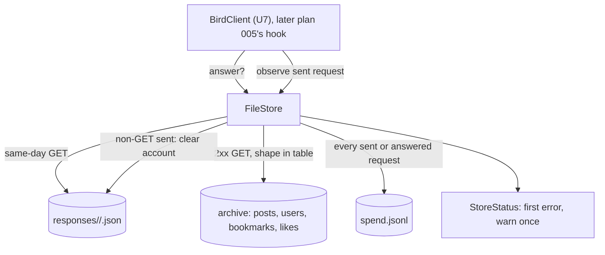
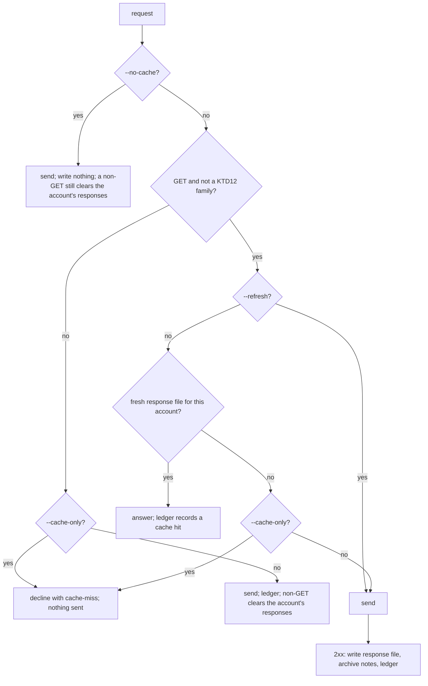
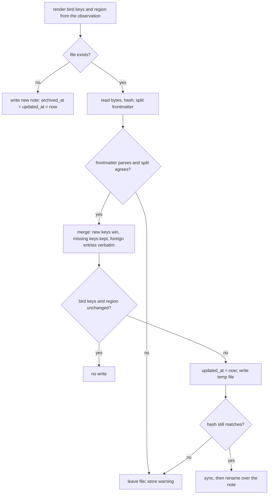
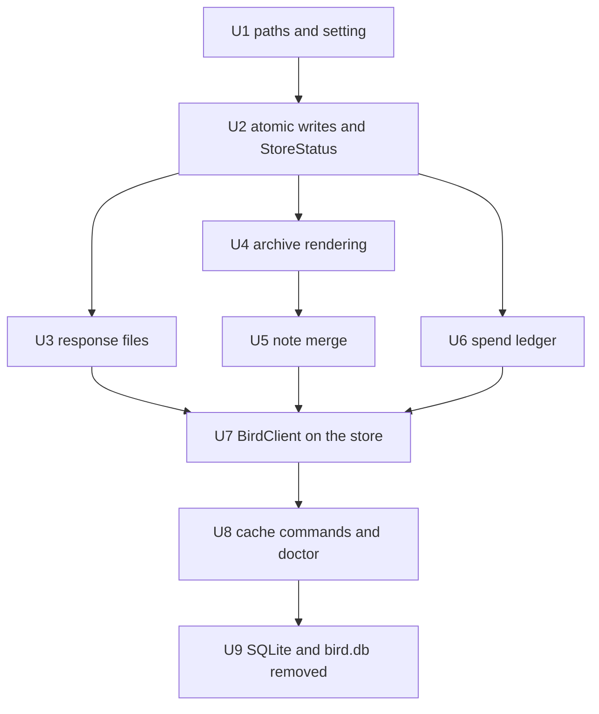

# bird file store - Plan

## Goal Capsule

- **Objective:** what a bird user reads from X lands as Markdown notes in a folder they choose, which can be a notes
  vault, and a repeat of the same request the same UTC day sends nothing, costs nothing, and prints what the first run
  printed; no database is left on disk.
- **Means:** a file store in `src/store/` in place of `bird.db`: a Markdown archive, per-account JSON response files,
  and a JSONL spend ledger (KTD1, KTD10, KTD15).
- **Authority:** plan 005's Product Contract (R20, R37, R48, R49) and its KTD6, KTD8, KTD19, and KTD20, then this plan.
  Plan 005 wins on product behavior; this plan's KTDs win on mechanism. U-IDs here are local to this plan: U1 to U9
  together deliver plan 005's U21, and this plan is plan 005's U20.
- **Stop conditions:** a finding that contradicts one of the Key Decisions below stops for the maintainer. No unit
  changes what a composed command prints (plan 005 R14).
- **Execution profile:** Phase A of plan 005, before its U8. One stack of PRs in unit order, no upstream dependency.
- **Who finishes:** bird's lanes implement every unit; the maintainer can mark up the ⚑ calls, each settled below under
  Maintainer Calls with its reason.

---

## Product Contract

### Summary

bird replaces `bird.db` with three kinds of files: one Markdown note per post, user, bookmark, and like in an archive
directory the user can point at a vault; one JSON file per stored response, which answers the same request for the same
account until the UTC day ends; and one JSONL spend ledger that `bird spend` reads. `bird cache stats`,
`bird cache clear`, and `bird doctor` report and manage these files, and 0.3.0 removes the 0.2.0 database the first time
it runs.

### Problem Frame

bird 0.2.0 keeps everything in one SQLite file under the config directory (`src/db/store/mod.rs`): posts and users as
JSON blobs with a few extracted columns, bookmark positions nobody reads back (`get_bookmarks` is test-only), raw
responses that answer only under `--cache-only` (`src/db/client/get.rs`), and the usage tables `bird spend` aggregates.
None of it is readable without bird, and none of it can live in a notes vault. The maintainer wants bird to be a client
with a memory the user owns: posts and people as notes, with repeat requests still free and still byte-identical to
`xr`'s output.

The current store also carries latent defects the move fixes: the entity classifier files posts from
`/2/users/{id}/liked_tweets` or a timeline as user rows (prefix match in `is_entity_endpoint`), the raw-response key
collides when a query value contains `&` or `=` (`normalize_url` rebuilds the query from decoded pairs), and a malformed
`config.toml` is silently replaced by defaults (`toml::from_str(&s).unwrap_or_default()` in `src/config.rs`).

### Key Decisions

- **bird's store is files, not a database: a Markdown archive plus JSON response files.** (session-settled:
  user-directed, chosen over SQLite with a JSONL export and over a Markdown-only store: the default must be Markdown for
  a local knowledge base, and repeat requests still print `xr`'s exact output.) Carried from plan 005. Governs R1 to
  R11.
- **0.3.0 deletes the 0.2.0 `bird.db` on first run, and nothing else in bird refers to it.** (session-settled:
  user-directed, chosen over leaving it in place or importing it.) Carried from plan 005. Governs R19.
- **A GET is answered only by the response file for the same request (method, normalized URL, account) written the same
  UTC day, judged by the file's mtime.** Carried from plan 005 R37 and KTD8. Governs R7, R8.
- **Only GET is answered or stored, and direct-message responses are never stored.** Carried from plan 005 KTD6. Governs
  R9.
- **The spend ledger is a JSONL file.** Carried from plan 005 R48. Governs R13, R14.
- **`bird archive` exits non-zero when it cannot write; every other command warns once on a store failure and keeps its
  result.** Carried from plan 005 KTD20. Governs R18.

### Requirements

**Locations and the archive-dir setting**

- R1. The archive lives under bird's data directory by default, and the user moves it with an `archive_dir` key in
  `config.toml` or a `BIRD_ARCHIVE_DIR` variable, which the runner captures with the rest of its environment.
- R2. Response files live under bird's cache directory and the ledger under bird's data directory, outside the archive,
  so a vault holds only notes.

**Archive**

- R3. Each post, user, bookmark, and like bird reads is one Markdown file with YAML frontmatter, named by X's id, under
  a name valid on all seven release targets.
- R4. A post's note carries its text, its author, the posts it replies to, quotes, or reposts as links to their notes,
  and its public metrics; a user's note carries the profile.
- R5. A later observation of a post or user rewrites the parts of its note bird owns and keeps every frontmatter key and
  every line of text bird does not own.
- R6. bird never prunes the archive, and `bird cache clear` never touches it.

**Response files**

- R7. A GET repeated for the same account the same UTC day is answered from its response file, and a composed command
  prints the same bytes it printed the first time (plan 005 AE1, AE10).
- R8. Under `--cache-only` a GET with no fresh response file fails with bird's `cache-miss` error before anything is
  sent (plan 005 R20, AE5).
- R9. No non-GET request, direct-message read, usage read, or media-upload status read is stored or answered.
- R10. A response written for one account never answers a request for another (plan 005 KTD8).
- R11. Response files older than the current UTC day are removed, and `bird cache clear` removes all of them.
- R20. A GET sent after the same account's write the same UTC day is sent, not answered from a response stored before
  the write.

**Commands and reporting**

- R12. `bird cache stats` and the `cache` section of `bird doctor` report the archive, response, and ledger locations
  and their counts from one shape, and say whether each location is usable.
- R13. Every request bird sends or answers outside `--no-cache` appends one ledger record carrying its estimated cost,
  and `bird spend --sync` appends the actual figures X reports.
- R14. `bird spend` reports the same totals, days, top endpoints, and actuals from the ledger that it reports from the
  usage tables today.
- R15. `bird cache clear` asks for confirmation as it does today and removes response files only.

**Failure handling**

- R16. A store failure never changes a printing command's output or exit code and prints one `[store] warning` line per
  run, none under `--quiet`.
- R17. An invalid `archive_dir` value (relative, or not a directory) fails with bird's `config-error` and a `next_step`
  naming the setting.
- R18. `bird archive` fails with a structured error naming the path and the OS error when a note cannot be written (plan
  005 KTD20).

**Migration**

- R19. The first command past config load removes `bird.db` and the older `cache.db`, each with its `-wal` and `-shm`
  files, from bird's config directory and says so once; bird links no SQLite.

### Acceptance Examples

- AE1. **Covers R7, R10.** `bird read 1849` run twice as `alice` the same UTC day: the second run sends nothing and
  prints the first run's bytes. Run as `bob` after that, it is sent.
- AE2. **Covers R5.** A note for post 1849 whose frontmatter carries a user-added `tags: [ai]` and a paragraph the user
  wrote after the bird region: a later fetch with new like counts rewrites `like_count` and keeps `tags` and the
  paragraph byte for byte.
- AE3. **Covers R20.** After `bird bookmark 1849`, `bird bookmarks` the same day is sent, not answered from the page
  stored before the bookmark.
- AE4. **Covers R16, R18.** With a read-only archive directory, `bird search rust` prints its results, exits 0, and
  prints one `[store] warning`; `bird archive bookmarks` exits 5 with `reason: io` and the archive path in `command`.
- AE5. **Covers R19.** A config directory holding a 0.2.0 `bird.db` with its `-wal` and `-shm` files and an older
  `cache.db`: after `bird doctor`, all four are gone and stderr said so once.

### Scope Boundaries

- In: the file store, its paths and setting, the spend ledger, `bird cache`, the doctor `cache` section, the 0.2.0
  database removal, and `BirdClient` moved onto the store, all ahead of plan 005's hook (U8).
- Out: the request hook and its client factory (plan 005 U8), `bird archive` itself (plan 005 U22), the archive format
  page, README, and migration guide (plan 005 U12).
- Considered and not built:
  - Embedding each post's raw X JSON in its note, or a sidecar `.json` beside it. A note keeps the fields bird renders,
    and response files keep whole bodies for the day; evidence to change the call: a user needing a field the
    frontmatter tables omit.
  - Human-readable filenames (date, author, first words). They change with edits and renames and need per-OS sanitizing;
    Obsidian's `aliases` key gives user notes a readable link name instead.
  - Write-once notes. Metrics and renamed usernames would never update.
  - A `bird cache clear --archive` flag (KTD17).
  - An `--archive-dir` flag. `BIRD_ARCHIVE_DIR` covers a one-run override; a flag can follow if a user asks.
  - File locks on archive notes. Atomic rename plus the edit check in KTD8 keep a note whole; a lock would not
    coordinate with a sync daemon or an editor.
  - A size cap on response files. The daily prune bounds them to one day of requests.
  - An allowlist of answerable endpoints (KTD12).
  - Writing through a symlinked note to its target. A rename replaces a symlink with a file
    ([docs/solutions/deployment-issues/stow-symlink-breakage-by-atomic-writers.md](../solutions/deployment-issues/stow-symlink-breakage-by-atomic-writers.md)),
    but nothing suggests vault users symlink single notes; evidence to change the call: a user who does.
  - Keeping a rewritten note's file mode. A note bird replaces is 0600 like every file it writes; a user who loosens a
    note's mode for group sharing would see it reset.
  - Sweeping orphaned `.bird-*.tmp` files. One is left only when the process dies mid-write, and it is hidden and
    harmless; evidence to change the call: orphans showing up in a vault's sync history.
  - Repairing a torn last ledger line before an append. A torn line appears only after a crash mid-write and costs that
    record and the next one appended to it, which the reader skips with its warning.
  - Retrying a note whose file changed during the merge. The next observation of that post writes it.
  - More never-answered families than KTD12's three. Compliance-job and other status reads join the table when a
    composed command reaches one; no bird command or xdk-rs shortcut at `f6cec23` does.

#### Deferred to Follow-Up Work

- A `bird archive` re-render pass that rewrites every note at a new `bird_format`.

Two items plan 005 owns: `note_tweet` in `src/fields.rs` `POST_FIELDS` (plan 005 U22), and a `cargo test` row on
`windows-latest` and `macos-latest` in `brettdavies/.github`'s `rust-ci.yml` (plan 005 U23).

### Maintainer Calls

Each ⚑ call is settled; the units build it. The maintainer can mark any of them up.

- ⚑ Likes are relation notes (KTD5), because `bird archive likes` otherwise leaves no way to find the liked posts in the
  vault.
- ⚑ A denylist of state endpoints, not an allowlist of content endpoints (KTD12). Together with KTD13 it keeps a stale
  answer to a day and to reads the account has not changed, and an allowlist would leave every composed read missing
  from it uncached.
- ⚑ A write removes its account's response files (KTD13), because R20 needs a read after one's own write to be sent.
- ⚑ One ledger file with lock and compaction (KTD15). The lock is a few lines of std within bird's MSRV, and one file
  keeps `bird spend` a single read.
- ⚑ The response key keeps `ids=` and `usernames=` lists in request order (KTD10), because a sorted key could answer one
  order with another order's bytes and R7 promises the same bytes.
- ⚑ `cache.db`, the store before `bird.db`, goes with it (KTD19). 0.2.0 copied its usage rows into `bird.db` and left
  the file behind, so it holds nothing `bird.db` did not, and the Goal leaves no database on disk.
- ⚑ `BIRD_ARCHIVE_DIR` wins over `config.toml` (KTD2), the usual variable-over-file order, so a test or agent run is
  never redirected by the user's standing config.
- `bird archive posts` reads the user's own posts, `/2/users/{id}/tweets`; plan 005 U22 owns how it calls it.

---

## Planning Contract

### Key Technical Decisions

Entries marked ⚑ are calls the maintainer is most likely to revisit.

**Layout and settings**

- KTD1. **Three roots, one per kind of data, from the `dirs` crate.** Archive: `dirs::data_dir()/bird/archive`. Ledger:
  `dirs::data_dir()/bird/spend.jsonl`. Response files: `dirs::cache_dir()/bird/responses`. `config.toml` stays in
  `dirs::config_dir()/bird`. The archive and ledger are the user's data and the responses are disposable, which is the
  XDG split; the ledger sits outside the archive so a vault receives notes only. On macOS and Windows `config_dir` and
  `data_dir` resolve to the same folder, where the names do not collide.

| OS      | Archive (default)                            | Ledger                                           | Responses                         |
| ------- | -------------------------------------------- | ------------------------------------------------ | --------------------------------- |
| Linux   | `~/.local/share/bird/archive`                | `~/.local/share/bird/spend.jsonl`                | `~/.cache/bird/responses`         |
| macOS   | `~/Library/Application Support/bird/archive` | `~/Library/Application Support/bird/spend.jsonl` | `~/Library/Caches/bird/responses` |
| Windows | `%APPDATA%\bird\archive`                     | `%APPDATA%\bird\spend.jsonl`                     | `%LOCALAPPDATA%\bird\responses`   |

- KTD2. ⚑ **`BIRD_ARCHIVE_DIR` beats `archive_dir` in `config.toml`, which beats the default.**
  `ResolvedPaths::from_env` captures `dirs::data_dir()`, `dirs::cache_dir()`, and `dirs::home_dir()`;
  `EnvOverrides::from_env` captures `BIRD_ARCHIVE_DIR` (empty counts as unset, as `XURL_TOKEN_STORE` does); `FileConfig`
  gains `archive_dir`. A leading `~/` (or `~\` on Windows) expands against the captured home; any other relative path is
  a `config-error` (exit 78) whose `next_step` is `fix-input` naming the key and the variable, because a relative path
  would scatter notes across working directories. The variable wins because AGENTS.md documents `BIRD_*` variables as
  the way non-interactive callers configure one run, and a test or agent run must not be redirected by the user's
  standing config; `username` keeps its existing file-over-variable order. `ResolvedConfig` records which source won so
  doctor can report it.
- KTD3. ⚑ **A `config.toml` that does not parse is a `config-error` (exit 78) naming the file.** Today it silently
  becomes the default config; with `archive_dir` in it, a typo would send the user's notes to the default folder with no
  signal.

**Archive files**

- KTD4. **Notes are named by X id, and an id that is not 1 to 20 ASCII digits is never used as a path.** Layout:
  `posts/<post_id>.md`, `users/<user_id>.md`, `bookmarks/<account_user_id>/<post_id>.md`,
  `likes/<user_id>/<post_id>.md`. Digit-only names carry no `:`, no Windows reserved name (`CON`, `NUL`, `COM1`), no
  trailing dot or space, nothing case folding or Unicode normalization changes on APFS or NTFS, and stay under 25
  characters; the relation directories use the account's user id, which the request path carries, rather than a username
  that can change. Plan 005 KTD8 names archive files by id. A bad id is skipped with the store warning, which also
  closes path traversal.
- KTD5. ⚑ **A bookmark or a like is its own create-only note that links to the post's note.** The relation is written
  once, when first seen, and never rewritten or removed, so an un-bookmarked post keeps its note; the post's note
  carries no relation keys, so a post rewrite never has to merge relation state. Likes join bookmarks because
  `bird archive likes` (plan 005 R49) would otherwise leave liked posts indistinguishable from any other post in the
  vault. Bookmark positions are dropped: nothing reads them today.
- KTD6. **Frontmatter is a closed, ordered set of keys per note kind, rendered by bird.** Every string is a YAML
  double-quoted scalar: JSON string escaping (YAML 1.2 accepts every JSON escape) plus `\u` escapes for the code points
  YAML forbids unescaped (DEL, C1 controls, U+2028, U+2029, U+FEFF). Ids are always strings, because Obsidian reads
  numbers as JavaScript doubles and a 19-digit id loses digits. A key is written only when its source field is present.
  Lists are block sequences, the style Obsidian writes. bird never writes `tags`, the key vault users own; `aliases` on
  a user note is the one merged key (KTD8). Field tables are in the High-Level Technical Design.
- KTD7. **The note body is a bird region between `<!-- bird:begin -->` and `<!-- bird:end -->`, and post text is escaped
  only where Markdown or Obsidian would read it as syntax.** X's `&amp;`, `&lt;`, and `&gt;` are decoded first. The
  escaper backslash-escapes `\`, `` ` ``, `*`, `[`, `]`, `<`, `|`, and `$` everywhere; `_` at a word boundary; `#`
  before a non-space character; `&` when it begins an entity reference; `~`, `=`, and `%` when doubled; `^` before a
  word at a line's end; and a line-start `>`, `-`, `+`, or `N.`/`N)` marker. Leading spaces on a line are dropped so no
  line becomes a code block. Newlines stay newlines, which Obsidian renders as breaks. Minimal escaping keeps vault
  search working on the text as posted: `@some_user` and `e.g.` stay as written. Every X-supplied string a region shows
  (post text, names, bios, locations, link text) goes through the escaper, because the escaper is also the guard against
  a post planting a Dataview code block, inline Dataview JavaScript, or HTML in the user's vault. An X-supplied URL
  becomes a link only when its scheme is `http` or `https`, with spaces, parentheses, and angle brackets
  percent-encoded; any other URL is written as escaped text. Links are relative Markdown links (`../users/12.md`), which
  Obsidian, GitHub, and editors all resolve, and post and user URLs are the id forms `https://x.com/i/status/<id>` and
  `https://x.com/i/user/<id>`, which never change. Media are links, not embeds, so opening a note fetches nothing.
- KTD8. **A rewrite merges: bird's keys update, everything else stays.** The steps, in the rewrite flowchart below: bird
  keys present in the new observation overwrite, bird keys it lacks keep their stored value, `archived_at` is kept,
  `aliases` is the union with bird's alias first, frontmatter entries with other keys are copied verbatim in their order
  after bird's keys, and only the region's text is replaced. A note whose bird keys and region are unchanged is not
  written, so an editor's reformatting causes no churn, and `updated_at` moves only when content changes. The file's
  SHA-256 is taken at read and again just before the rename; a mismatch (the user saved meanwhile) skips the note with
  the store warning, and its next observation merges the saved file. A frontmatter that does not parse, or whose line
  split disagrees with the parse, leaves the file untouched with the store warning. The hash, not the mtime, is the edit
  check, because synced and network filesystems keep mtimes to the second
  ([docs/solutions/best-practices/cloud-sync-concurrent-writer-safety-pattern-2026-04-20.md](../solutions/best-practices/cloud-sync-concurrent-writer-safety-pattern-2026-04-20.md)).
- KTD9. **Every file write is write-then-rename through `tempfile` in the target's own directory.** The temporary file
  is named `.bird-<random>.tmp`, so Obsidian hides it, and a rename never crosses filesystems; a name is never built
  with `Path::with_extension`, which replaces the last extension
  ([docs/solutions/logic-errors/rust-path-with-extension-replaces-not-appends-2026-03-27.md](../solutions/logic-errors/rust-path-with-extension-replaces-not-appends-2026-03-27.md)).
  A replacement of an existing note and a ledger compaction are `sync_all`ed before the rename, because a crash could
  otherwise leave an empty file in place of the user's annotations or spend history; a new note and a response file are
  not, since the next observation recreates either. New files are 0600 and new directories 0700 on Unix, as `bird.db`
  was, because the archive holds the user's bookmarks.

**Response files**

- KTD10. ⚑ **The key is the method and the normalized URL inside a per-account directory.** Path:
  `responses/<account_key>/<request_key>.json`, where `account_key` is the first 16 hex digits of SHA-256 over a
  versioned prefix, the app name, and the user, and `request_key` is the SHA-256 hex over a versioned prefix, the
  method, and the normalized URL. The account is plan 005 KTD8's: the app and user the request went out under, with the
  user empty for an app-only request. A user-context request whose user cannot be named (no requested username and no
  default user for the app) is neither answered nor stored, so it can never share the app-only key. Normalization reuses
  `compute_raw_cache_key`'s rules in `src/db/client/entity.rs` (scheme and host as parsed, pairs sorted by key, the sort
  stable so repeated keys keep their order) with two changes. Each key and value is percent-encoded again when the query
  is rebuilt, so `q=a%26b%3Dc` and `q=a&b=c` no longer collide. The `ids` and `usernames` lists are not sorted, because
  a reply lists objects in the order asked and a sorted key would answer one order with another's bytes. Hashing keeps
  every name valid on all seven targets whatever the app is called; the per-account directory makes KTD13 one directory
  removal.
- KTD11. **A response file holds the whole body X returned, with the request it answers.** It is one JSON object:
  `format` (1), `method`, `url` (normalized), `app`, `user`, `status`, and `body`. Storing the whole decoded body rather
  than `data`, `includes`, and `meta` alone (plan 005 KTD6) keeps `errors` and anything else X sent, so an answer
  decodes exactly as the first response did. Only 2xx responses are written. A file answers when its mtime's UTC date is
  today's and its stored `format`, `method`, `url`, `app`, and `user` equal the request's; anything else, an unreadable
  file included, is a miss.
- KTD12. ⚑ **Three state families are never stored or answered: direct messages, usage, and media upload.** Paths under
  `/2/dm_` (plan 005 KTD6), `/2/usage/`, and `/2/media/` go to X every time and are recorded only in the ledger. A
  same-day usage answer would hide a credits drop from plan 005's release smoke gate (KTD16 there), and a same-day
  answer to xdk's `MEDIA_UPLOAD_STATUS` GET would hold the upload wait at its first reply. Every other GET is stored and
  answered, which matches the settled rule and the savings it exists for. The prefixes live in one table with a test per
  row; the alternative, an allowlist of content endpoints, answers less and needs an entry for every new content
  endpoint.
- KTD13. ⚑ **Any non-GET request bird sends removes that account's response files.** A same-day read after one's own
  write would otherwise print the state before the write: `bird bookmarks` after `bird bookmark 1849` would omit 1849,
  and an agent checking its own bookmark would send it again. Clearing the account's directory is the smallest form that
  keeps every read after a write honest. The clearing runs under `--no-cache` too, since a later run would otherwise
  answer from the state before that write. A `--dry-run` sends nothing and clears nothing.
- KTD14. **Response files are pruned once per UTC day.** The first command each UTC day that opens the store removes
  response files whose mtime is before today and empty account directories, then touches `responses/.pruned`; the
  marker's mtime is the check, so other runs that day only stat it. The archive is never pruned (R6).

**Ledger**

- KTD15. ⚑ **One `spend.jsonl` file, appended under a shared lock and compacted under an exclusive one.** Appends and
  compaction lock a sibling `spend.lock` through `std::fs::File::lock_shared` and `File::lock` (stable since Rust 1.89,
  within bird's 1.94 MSRV), because compaction replaces the ledger's inode and an append racing it would land in the
  replaced file. A run whose first record is older than 90 days compacts: request records older than 90 days go, and
  each date keeps its latest actual record. This keeps today's 90-day retention (`prune_old_usage`). An append writes
  one whole line in one write. The reader skips lines it cannot parse and warns once. One file per month needs no lock
  but turns the settled single file into a set; the lock is a few lines of std.

| Key                               | Kind    | Type                                                | From today's table                                          |
| --------------------------------- | ------- | --------------------------------------------------- | ----------------------------------------------------------- |
| `v`                               | both    | integer, 1                                          | none                                                        |
| `kind`                            | both    | `"request"` or `"actual"`                           | which table                                                 |
| `ts`                              | request | RFC 3339 UTC string                                 | `usage.timestamp`; `date_ymd` is derived from it            |
| `method`, `endpoint`              | request | string; `endpoint` as `normalize_endpoint` gives it | `usage.method`, `usage.endpoint`                            |
| `object_type`, `object_count`     | request | `post`, `user`, `write`, or `none`; integer         | same columns, as `log_api_call` fills them                  |
| `estimated_cost`                  | request | number, USD                                         | same column                                                 |
| `cache_hit`                       | request | boolean                                             | same column                                                 |
| `app`, `username`                 | request | string, empty when none                             | `usage.username`; `app` is new, for plan 005 KTD8's account |
| `date`, `post_count`, `synced_at` | actual  | `YYYY-MM-DD`, integer, RFC 3339                     | `usage_actual`                                              |

**Failure handling, commands, and migration**

- KTD16. **One `StoreStatus` per run records store failures; printing commands warn once, `bird archive` reads it after
  each page.** The first failure prints `[store] warning: <what> failed for <path>: <os error>` unless quiet, and later
  ones print nothing, keeping the zero-allocation quiet path `tests/diag_quiet_lazy_eval_test.rs` locks. `bird archive`
  (plan 005 U22) checks the first archive write error after each page and exits with `reason: io`, exit 5 (the existing
  `Reason::Io`, which already maps to 5), the path in `command`, and a `next_step` of `fix-input` whose template sets
  `BIRD_ARCHIVE_DIR` and whose `docs` points at the archive format page. The hook in plan 005 U8 cannot fail a request
  from its `after` call, so the shared status is how `archive` learns of a failed write. `bird archive` under
  `--no-cache` or `BIRD_NO_CACHE=1` is `invalid-args` (exit 2): it would write nothing.
- KTD17. **`bird cache clear` removes response files only, and no flag widens it.** The archive is the user's data and
  may share a folder with notes bird did not write, so deleting it stays a file-manager or shell action the user takes
  knowing that; it is not a cache, so it does not belong under `bird cache`. The ledger is kept, as `clear` keeps the
  usage tables today. Inside `responses/` only names matching a request key or a bird temporary file are removed.
- KTD18. **`bird cache stats` and doctor's `cache` section serialize one `StoreReport`.** It has three objects and a
  verdict. `archive`: `path`, `source` (`default`, `config`, or `env`), `exists`, `writable`, `posts`, `users`,
  `bookmarks`, `likes`, `size_mb`. `responses`: `path`, `exists`, `writable`, `files`, `fresh`, `size_mb`. `ledger`:
  `path`, `exists`, `size_mb`. `writable` is `access(2)` with `W_OK` on Unix, inside `#[cfg(unix)]`, and the absence of
  the read-only attribute on Windows, so reporting writes nothing into the user's vault; for a missing location it is
  the nearest existing ancestor's. `healthy` is true when every location is writable. Counts come from reading each
  directory. `max_size_mb`, `raw_responses`, and `schema_version` go: nothing caps the files, and there is no schema to
  version.
- KTD19. **The SQLite stores are removed on every run past config load until they are gone.** `<config_dir>/bird/bird.db`
  and `<config_dir>/bird/cache.db`, each with its `-wal` and `-shm` files, are removed whatever the cache flags say,
  because nothing reads them and a `--no-cache` habit would otherwise keep them forever. `cache.db` goes too: 0.2.0
  copied its usage rows into `bird.db` and left the file. The removal prints `[store] removed the 0.2.0 store at <path>`
  once per removed store unless quiet. A failed removal is a store failure under KTD16. `cache.db`'s import and the
  SQLite migrations go with rusqlite.
- KTD20. **An answered request writes only its ledger record.** Its data reached the archive when it was first observed,
  so a cache hit leaves notes and response files alone.
- KTD21. **What a response archives is decided by its endpoint shape, not a path prefix.** A shape is the template with
  every parameter written as `{}`: plan 005's U8 derives it from xdk's `RequestTarget` template, and until then the
  store derives it from `normalize_endpoint` (`src/db/mod.rs`, which U7 moves to `src/store/endpoint.rs`). The table in
  the High-Level Technical Design maps each shape to posts or users in `data` and to the relation it adds;
  `includes.users` become user notes, `includes.tweets` and `includes.posts` post notes, and an unknown shape archives
  nothing. Field names are read in both vocabularies (`repost_count` or `retweet_count`, `referenced_posts` or
  `referenced_tweets`, `post_count` or `tweet_count`) until xdk-rs publishes its normalizer (plan 005 Request 6), after
  which bodies are normalized first.
- KTD22. **The cache flags keep their meanings over files.** `--no-cache` and `BIRD_NO_CACHE=1` read and write nothing,
  ledger included, as today (`log_api_call` returns early with no store); only KTD13's clearing and KTD19's removal
  still run. `--refresh` sends and writes. `--cache-only` answers or fails with `cache-miss`, and refuses writes.
  `bird login` no longer clears the store after a sign-in, because responses are already kept per account.
- KTD23. **`src/db/` becomes `src/store/`, with no file over 200 lines.** `BirdClient` moves to `src/store/client/`;
  plan 005 U8's file list follows the move.

### High-Level Technical Design

Where each request's data goes:



One request's path through the store:



Rewriting one note (KTD8):



On-disk layout (Linux defaults):

```text
~/.config/bird/config.toml            archive_dir, username, watchlist
~/.local/share/bird/archive/          or archive_dir / BIRD_ARCHIVE_DIR
  posts/1849000000000000000.md
  users/12.md
  bookmarks/12/1849000000000000000.md
  likes/12/1849000000000000000.md
~/.local/share/bird/spend.jsonl
~/.local/share/bird/spend.lock
~/.cache/bird/responses/
  .pruned
  3f9a0c1e5b7d2a46/<64 hex>.json
```

Module layout:

```text
src/store/
  mod.rs            FileStore: open, answer, observe, record, invalidate
  paths.rs          StorePaths and the archive-dir setting
  status.rs         StoreStatus: first error, warn once
  atomic.rs         write-then-rename and Unix modes
  endpoint.rs       normalize_endpoint and the endpoint shape, moved from src/db/mod.rs
  responses.rs      key, read and verify, write, prune, clear
  ledger.rs         append, lock, compact
  spend_view.rs     the aggregates bird spend prints
  report.rs         StoreReport for cache stats and doctor
  legacy.rs         0.2.0 bird.db removal
  archive/
    mod.rs          shape table and the observation fan-out
    post.rs         post keys and region
    user.rs         user keys and region
    relation.rs     bookmark and like notes
    yaml.rs         scalar escaping
    markdown.rs     text escaping
    merge.rs        frontmatter split, merge, edit check
  client/           BirdClient, moved from src/db/client/
```

Endpoint shapes and what they archive (KTD21):

| Shape                                                                                                                                                                           | `data` holds | Relation note                    |
| ------------------------------------------------------------------------------------------------------------------------------------------------------------------------------- | ------------ | -------------------------------- |
| `/2/tweets`, `/2/tweets/{}`, `/2/tweets/search/recent`, `/2/tweets/search/all`, `/2/tweets/{}/quote_tweets`                                                                     | posts        | none                             |
| `/2/users/{}/tweets`, `/2/users/{}/mentions`, `/2/users/{}/timelines/reverse_chronological`, `/2/lists/{}/tweets`                                                               | posts        | none                             |
| `/2/users/{}/bookmarks`                                                                                                                                                         | posts        | bookmark, for the path's user id |
| `/2/users/{}/liked_tweets`                                                                                                                                                      | posts        | like, for the path's user id     |
| `/2/users`, `/2/users/{}`, `/2/users/me`, `/2/users/by`, `/2/users/by/username/{}`                                                                                              | users        | none                             |
| `/2/users/{}/followers`, `/2/users/{}/following`, `/2/users/{}/muting`, `/2/users/{}/blocking`, `/2/tweets/{}/liking_users`, `/2/tweets/{}/retweeted_by`, `/2/lists/{}/members` | users        | none                             |
| any other shape                                                                                                                                                                 | nothing      | none                             |

Post note keys, in order (KTD6). Today's `posts` table stores `id`, `author_id`, `conversation_id`, and the post's JSON;
the keys spread that JSON into named fields bird's `POST_FIELDS` and `EXPANSIONS` request (`src/fields.rs`).

| Key                                                                                              | Type            | Source                                                                                      |
| ------------------------------------------------------------------------------------------------ | --------------- | ------------------------------------------------------------------------------------------- |
| `type`                                                                                           | `"x-post"`      | constant                                                                                    |
| `id`                                                                                             | string          | `id`                                                                                        |
| `url`                                                                                            | string          | `https://x.com/i/status/<id>`                                                               |
| `author_id`                                                                                      | string          | `author_id`                                                                                 |
| `author`                                                                                         | string          | `username` of the `includes.users` entry for `author_id`                                    |
| `created_at`                                                                                     | string          | `created_at`                                                                                |
| `conversation_id`                                                                                | string          | `conversation_id`                                                                           |
| `reply_to`, `quotes`, `repost_of`                                                                | string          | `referenced_posts` (or `referenced_tweets`) of type `replied_to`, `quoted`, `retweeted`     |
| `lang`                                                                                           | string          | `lang`                                                                                      |
| `like_count`, `repost_count`, `reply_count`, `quote_count`, `bookmark_count`, `impression_count` | integer         | `public_metrics`, `retweet_count` read as `repost_count`                                    |
| `hashtags`, `mentions`                                                                           | list of strings | `entities.hashtags[].tag`, `entities.mentions[].username`                                   |
| `links`                                                                                          | list of strings | `entities.urls[].expanded_url`, else `url`                                                  |
| `media`                                                                                          | list of strings | `includes.media` entries named in `attachments.media_keys`: `url`, else `preview_image_url` |
| `archived_at`, `updated_at`                                                                      | string          | first write; last content change                                                            |
| `bird_format`                                                                                    | integer, 1      | constant                                                                                    |

Post region: the text (`note_tweet.text` when present, else `text`), a line linking the author's note, the post's UTC
time, and its X URL, then one line each for the post it replies to, quotes, or reposts, linked to that post's note, and
one link per media URL.

User note keys, in order. Today's `users` table stores `id`, `username`, and the user's JSON.

| Key                                                                                             | Type            | Source                                               |
| ----------------------------------------------------------------------------------------------- | --------------- | ---------------------------------------------------- |
| `type`                                                                                          | `"x-user"`      | constant                                             |
| `id`, `username`, `name`                                                                        | string          | same fields                                          |
| `url`                                                                                           | string          | `https://x.com/i/user/<id>`                          |
| `description`, `location`                                                                       | string          | same fields                                          |
| `website`                                                                                       | string          | `entities.url.urls[0].expanded_url`, else `url`      |
| `created_at`                                                                                    | string          | `created_at`                                         |
| `verified`, `protected`                                                                         | boolean         | same fields                                          |
| `profile_image_url`                                                                             | string          | same field                                           |
| `followers_count`, `following_count`, `post_count`, `listed_count`, `like_count`, `media_count` | integer         | `public_metrics`, `tweet_count` read as `post_count` |
| `pinned_post_id`                                                                                | string          | `pinned_tweet_id`                                    |
| `aliases`                                                                                       | list of strings | `@<username>`, merged with the stored list           |
| `archived_at`, `updated_at`, `bird_format`                                                      | as for posts    |                                                      |

User region: a heading with the name and `@username`, the escaped bio, and a line with the X URL, website, and location.

Relation note keys: `type` (`"x-bookmark"` or `"x-like"`), `account_id`, `account` (username when known), `post_id`,
`post_url`, `archived_at`, `bird_format`. Region: one line linking the account's note and the post's note. Today's
`bookmarks` table stores `username`, `post_id`, `position`, and `refreshed_at`; `refreshed_at` becomes `archived_at` and
`position` is dropped (KTD5).

### Assumptions

- X post and user ids are strings of 1 to 20 decimal digits.
- X API v2 post text arrives with `&`, `<`, and `>` written as `&amp;`, `&lt;`, and `&gt;`; U4's fixtures pin it.
- X returns referenced posts in `includes.tweets`, or `includes.posts` once its vocabulary moves.
- `std::fs::File::lock` and `lock_shared` work on the local filesystems bird's data directory sits on for all seven
  targets; where a filesystem refuses, the ledger falls back to an unlocked append and skips compaction, under the store
  warning.
- `tempfile`'s `persist` replaces an existing file atomically on every target (`rename(2)`, `MoveFileExW` with
  `MOVEFILE_REPLACE_EXISTING`).
- serde-saphyr 2.0, already in bird's lockfile through xdk-rs, parses the frontmatter Obsidian writes; bird adds it as a
  direct dependency.
- Obsidian hides dot-prefixed files, so temporary files never show in a vault.
- A user points `archive_dir` at a folder inside a vault, not at the vault's root; U12's archive format page says so.
- No bird command and no composed `xr` verb relies on `ids=` batches being answered across orders (plan 005
  Assumptions).
- One account sends at most a few thousand distinct GETs a day, so one flat directory per account suffices.
- The maintainer wants the 90-day ledger retention 0.2.0 has.
- `pulldown-cmark` as a dev-dependency passes `cargo deny check`; it renders U4's escaping round-trip test.

### Risks & Dependencies

- **CI runs the store's tests on Linux only.** `rust-ci.yml` in `brettdavies/.github` runs `cargo check` on Windows and
  nothing on macOS, so rename-over-existing, file locks, and permissions on those targets are compiled, not tested. The
  fix is a test row in the shared workflow (plan 005 U23); until it lands, the release's postflight fresh run (plan 005
  U14) on macOS is the only exercise outside Linux.
- **A note open in another Windows program can refuse the rename.** The write fails with the store warning, or
  `bird archive`'s error, and the next observation retries; no retry loop is built.
- **A thinner observation can shorten a note's text.** A post first seen with `note_tweet` and later without it gets the
  shorter `text` in its region; plan 005 U22 adding `note_tweet` to `POST_FIELDS` narrows this.
- **An editor reformatting bird's keys makes bird rewrite them in its own style on the next content change.** The
  semantic no-op check (KTD8) keeps reformatting alone from causing writes.
- **Plan 005 depends on this plan's shapes.** U8 consumes `FileStore` and the shape table, U22 reads `StoreStatus`, U12
  documents KTD4 to KTD8, and plan 005's release smoke depends on KTD12's usage exclusion.

### System-Wide Impact

- **Output contracts:** `schema/cache-stats.schema.json` and `schema/doctor.schema.json` change shape (KTD18), and
  doctor's `xurl` and `linked_xurl_version` become `xdk` and `linked_xdk_version` (plan 005 U21 step 4). Both are 0.3.0
  breaking changes for the changelog.
- **User data:** the 0.2.0 spend history in `bird.db` is deleted unread (settled); MIGRATING.md says so (plan 005 U12).
- **Privacy:** bookmarks and likes now sit in plain files, 0600 on Unix, in a folder the user may sync; direct messages
  never reach disk.
- **Security:** notes carry text strangers wrote into a vault where plugins such as Dataview run code; KTD7's escaper
  and URL rule are the boundary, and U4's adversarial corpus is its test. Ids become paths only after KTD4's digit
  check.
- **Agents:** `bird cache stats --output json` and `bird doctor` give an agent the archive path and its source, so it
  can find notes without guessing.

---

## Implementation Units



### U1. Store paths and the archive-dir setting

- **Goal:** bird resolves its three store locations from captured inputs, with the archive movable by config key or
  variable.
- **Requirements:** R1, R2, R17; KTD1, KTD2, KTD3.
- **Dependencies:** none.
- **Files:** `src/config.rs`, `src/store/paths.rs` (new), `src/store/mod.rs` (new), `src/lib.rs`, `src/cli/runner.rs`,
  `tests/cli_smoke.rs`, and every test that builds `ResolvedPaths` (`src/cli/runner.rs`, `src/doctor.rs`,
  `src/watchlist/check.rs`, `tests/`).
- **Approach:**
  1. `ResolvedPaths` gains `data_dir`, `cache_dir`, and `home_dir`; `EnvOverrides` gains `archive_dir`; `FileConfig`
     gains `archive_dir`.
  2. `StorePaths` resolves the archive directory and its source, the responses directory, and the ledger path from those
     inputs only; `ResolvedConfig` carries it in place of `cache_path` and `cache_max_size_mb`.
  3. A `config.toml` that fails to parse returns a config error naming the file.
- **Patterns to follow:** `ResolvedPaths::token_store` and `XURL_TOKEN_STORE` in `src/config.rs`: captured once, empty
  means unset.
- **Test scenarios:**
  - `archive_dir_defaults_under_the_data_dir`: no key, no variable; the archive is `<data_dir>/bird/archive` and the
    source is `default`.
  - `config_archive_dir_moves_the_archive`: `archive_dir = "/v/X"`; the archive is `/v/X`, source `config`.
  - `env_archive_dir_beats_config`: both set; the variable's path wins, source `env`.
  - `empty_env_archive_dir_counts_as_unset`: `BIRD_ARCHIVE_DIR=""` with a config key; the config's path wins.
  - `tilde_expands_against_the_captured_home`: `~/notes` with home `/h`; the archive is `/h/notes`.
  - `relative_archive_dir_is_a_config_error`: `notes/x`; exit 78, `reason: config-error`, `next_step.action` is
    `fix-input`, and the message names `archive_dir` and `BIRD_ARCHIVE_DIR`.
  - `malformed_config_toml_is_a_config_error`: `archive_dir = "/v` (unterminated); exit 78 naming `config.toml`.
  - `responses_and_ledger_never_follow_the_archive`: with `archive_dir` set, the responses directory stays under the
    cache dir and the ledger under the data dir.
  - `no_store_path_reads_the_process_environment`: with injected empty `EnvOverrides` and temporary `ResolvedPaths`,
    setting `BIRD_ARCHIVE_DIR` in the process changes nothing.
- **Verification:** every store path in a test comes from injected inputs, and the existing config tests pass with the
  new fields.

### U2. Atomic writes and store failure reporting

- **Goal:** every store file lands whole or not at all, and a failure is reported once without changing a command's
  result.
- **Requirements:** R16, R18; KTD9, KTD16.
- **Dependencies:** U1.
- **Files:** `src/store/atomic.rs` (new), `src/store/status.rs` (new), their unit tests.
- **Approach:**
  1. One write helper takes a target path, bytes, and a durability flag, and writes through a `.bird-*.tmp` file in the
     target's directory.
  2. Directory creation uses 0700 and file creation 0600 on Unix, behind `#[cfg(unix)]` as `src/config.rs` does today.
  3. `StoreStatus` holds the first failure and whether the warning was printed, shared by `Arc`, and exposes the first
     archive failure for strict callers.
- **Patterns to follow:** `BirdDb::ensure_file_permissions` and `enforce_permissions` in `src/db/store/mod.rs`; the
  locked-writer pattern in `src/output/mod.rs`.
- **Test scenarios:**
  - `an_interrupted_write_leaves_the_old_file`: a write whose rename is never reached (temp dropped) leaves the previous
    bytes and no partial file.
  - `a_write_never_leaves_a_visible_temp_file`: after a successful write, the directory holds only the target.
  - `new_files_are_private`: a new file is 0600 and a new directory 0700 (Unix).
  - `the_first_failure_warns_once`: three failures print one `[store] warning` line naming the first path and OS error.
  - `quiet_store_failures_touch_no_writer`: under quiet, a failure never locks the diagnostic writer (the `PanicOnWrite`
    harness).
  - `strict_callers_see_the_first_archive_failure`: after a failed note write, `StoreStatus` returns that path and
    error.
- **Verification:** no store module writes a file except through the helper.

### U3. Response files

- **Goal:** a GET's 2xx body is stored per account and answers the same request until the UTC day ends.
- **Requirements:** R7, R8, R9, R10, R11, R20; KTD10, KTD11, KTD12, KTD13, KTD14.
- **Dependencies:** U2.
- **Files:** `src/store/responses.rs` (new), its unit tests.
- **Approach:**
  1. The key function applies KTD10's normalization; carry `compute_raw_cache_key`'s existing tests over, inverting the
     one that expects `ids=3,1,2` and `ids=1,2,3` to share a key.
  2. Read returns an answer only when KTD11's freshness and field checks pass; write stores KTD11's object through U2's
     helper without `sync_all`.
  3. The KTD12 family table is consulted before any read or write; invalidation removes one account directory; pruning
     follows KTD14; clear removes only key-shaped files and temps.
- **Patterns to follow:** `compute_raw_cache_key` and `normalize_url` in `src/db/client/entity.rs`; `BirdDb::is_stale`
  in `src/db/store/posts.rs` for the UTC-day comparison.
- **Test scenarios:**
  - `a_same_day_response_answers_the_same_request`: write then read for the same method, URL, and account returns the
    stored status and body.
  - `query_order_does_not_change_the_key`: `?a=1&b=2` and `?b=2&a=1` share a key.
  - `an_encoded_ampersand_does_not_collide`: `?q=a%26b%3Dc` and `?q=a&b=c` get different keys.
  - `id_list_order_is_part_of_the_key`: `ids=3,1,2` and `ids=1,2,3` get different keys.
  - `another_account_gets_no_answer`: written for (`default`, `alice`), read for (`default`, `bob`) misses; read for
    (`other`, `alice`) misses.
  - `app_only_requests_key_on_an_empty_user`: a bearer request written and read with an empty user hits; read as `alice`
    misses.
  - `an_unnamed_user_context_request_is_not_cached`: a user-context request with no requested username and no default
    user writes no file and is never answered, even when an app-only file exists for the same URL.
  - `yesterdays_file_is_a_miss`: a file whose mtime is 23:59:59 UTC the previous day misses at 00:00:01.
  - `a_file_for_another_request_under_the_same_name_is_a_miss`: a file whose stored URL differs from the request's
    misses.
  - `an_unreadable_file_is_a_miss`: truncated JSON misses and is overwritten by the next write.
  - `non_2xx_bodies_are_not_stored`: a 404 observation writes no file.
  - `state_families_are_never_stored` (one case per KTD12 row): GETs of `/2/dm_events`, `/2/usage/credits`, and
    `/2/media/upload?command=STATUS` write and answer nothing.
  - `a_write_clears_its_accounts_responses`: invalidating `alice` removes her directory and leaves `bob`'s.
  - `pruning_runs_once_a_day`: two prunes the same day scan once; files from yesterday go, today's stay, and empty
    account directories go.
  - `clear_removes_only_bird_files`: a stray `notes.txt` in `responses/` survives `clear`.
- **Verification:** the key, read, and write paths share one normalization function and one family table.

### U4. Archive rendering

- **Goal:** a response's posts, users, bookmarks, and likes become note contents and paths per KTD4 to KTD7 and KTD21.
- **Requirements:** R3, R4; KTD4, KTD5, KTD6, KTD7, KTD21.
- **Dependencies:** U2.
- **Files:** `src/store/archive/mod.rs`, `post.rs`, `user.rs`, `relation.rs`, `yaml.rs`, `markdown.rs` (all new), their
  unit tests, `Cargo.toml` (`pulldown-cmark` dev-dependency, `serde-saphyr` dependency).
- **Approach:**
  1. The shape table maps a shape to the `data` kind and relation; `observe` yields, per response, the posts, users, and
     relations to write, each with its validated path.
  2. Each renderer produces bird's ordered keys (only present fields) and the region text.
  3. `yaml.rs` and `markdown.rs` are pure functions with property-style tests.
- **Patterns to follow:** `PostRow::from_api_json` and `UserRow::from_api_json` in `src/db/store/entities.rs` for field
  extraction; `extract_metric` and `is_retweet` in `src/search.rs` for the vocabulary-aware reads; `src/fields.rs` for
  the fields bird requests.
- **Test scenarios:**
  - `a_search_page_archives_posts_and_their_authors`: a body with two posts and two `includes.users` yields two post
    notes and two user notes.
  - `a_bookmarks_page_adds_bookmark_notes_for_the_path_user`: `/2/users/12/bookmarks` with two posts yields two posts
    and `bookmarks/12/<id>.md` for each.
  - `a_liked_posts_page_files_posts_not_users`: `/2/users/12/liked_tweets` yields post notes and like notes and no user
    note built from a post.
  - `a_timeline_page_files_posts`: `/2/users/12/timelines/reverse_chronological` yields post notes.
  - `an_unknown_shape_archives_nothing`: `/2/spaces/1` yields no note.
  - `included_posts_get_their_own_notes`: a quoted post in `includes.tweets` gets a note, and the quoting post links it.
  - `a_non_numeric_id_is_never_a_path`: a post with id `../x` yields no note and a store warning.
  - `legacy_and_current_metric_names_render_alike`: `retweet_count: 3` and `repost_count: 3` both render
    `repost_count: 3`; `tweet_count` renders `post_count`.
  - `absent_fields_write_no_keys`: a post with only `id` and `text` renders no metric, `lang`, or list key.
  - `ids_render_as_strings`: `id: "1849000000000000000"` stays a string after a serde-saphyr parse.
  - `yaml_scalars_round_trip`: names and bios containing `a: b`, `#`, `"`, `\`, newlines, U+0085, U+2028, emoji, `yes`,
    `null`, `~`, and a leading `@`, `*`, `&`, `!`, `%`, `|`, `>` each parse back to the original string.
  - `escaped_text_renders_as_plain_text`: for adversarial texts (`# heading`, `**bold**`, `[a](b)`, `<!-- bird:end -->`,
    `` `code` ``, `| a | b |` with a delimiter row, `1. item`, `> quote`, `&copy;`), rendering the region's text through
    pulldown-cmark yields only text events equal to the input.
  - `obsidian_syntax_is_inert`: `[[link]]`, `==mark==`, `%%c%%`, `$x$`, `#tag`, and a line ending `^abc` come out
    escaped.
  - `ordinary_text_is_untouched`: `@some_user said e.g. Q&A at 5.30` renders byte-identical.
  - `post_and_user_urls_use_the_id_forms`: a post's `url` is `https://x.com/i/status/<id>` with or without its author in
    the body.
  - `media_render_as_links`: a photo in `includes.media` appears in `media` and as a link, never as an image embed.
  - `bios_and_names_are_escaped`: a user named `` ```dataviewjs `` with a bio holding `<script>` renders both as inert
    text in the region.
  - `only_http_urls_become_links`: an `expanded_url` of `javascript:alert(1)` renders as escaped text, and
    `https://e.com/a b(c)` renders as a link with the space and parentheses percent-encoded.
- **Verification:** every note kind's key order matches the High-Level Technical Design tables, and the escaping tests
  pass on the adversarial corpus.

### U5. Note merge on rewrite

- **Goal:** writing a note that exists updates bird's parts and keeps the user's.
- **Requirements:** R5, R6; KTD8.
- **Dependencies:** U4.
- **Files:** `src/store/archive/merge.rs` (new), its unit tests.
- **Approach:**
  1. Split the file into frontmatter and body; parse the frontmatter with serde-saphyr and split it line-wise into
     top-level entries; a key-set mismatch between the two refuses the merge.
  2. Merge per KTD8, render, and compare bird's keys and region to the stored ones before deciding to write.
  3. Write through U2's helper with `sync_all`, checking the stored hash before the rename and skipping the note on a
     mismatch.
  4. Relation notes skip the merge: an existing relation note is left alone.
- **Test scenarios:**
  - Covers AE2. `user_keys_and_text_survive_a_metrics_update`: a note with `tags: [ai]`, a user comment line, and a
    paragraph after the region; a fetch with a new `like_count` changes only `like_count`, `updated_at`, and nothing
    outside bird's parts.
  - `an_unchanged_observation_writes_nothing`: the same body twice leaves the file's bytes and mtime alone.
  - `editor_reformatting_alone_causes_no_write`: bird's keys rewritten unquoted and in flow style with the same values;
    the next identical observation does not write.
  - `archived_at_survives_every_rewrite`: `archived_at` keeps its first value after three content changes, and
    `updated_at` moves each time.
  - `a_thinner_observation_keeps_stored_keys`: a later body without `public_metrics` keeps the stored counts.
  - `aliases_are_merged`: a stored `aliases: ["Jack D"]` and a rename to `@jack2` yield `["@jack2", "@jack", "Jack D"]`.
  - `a_missing_region_is_restored_above_the_users_text`: a note whose markers were deleted gets a new region at the
    body's start and keeps the user's text after it.
  - `an_unparseable_frontmatter_is_left_alone`: a note with `tags: [a` is not written, and the store warns.
  - `a_save_during_the_merge_is_not_lost`: the file changes between read and rename (test hook); the note keeps the
    user's new bytes, the store warns, and the next observation merges into them.
  - `a_relation_note_is_written_once`: a second bookmarks page carrying the same post leaves its bookmark note
    untouched.
- **Verification:** across the merge tests no byte outside bird's keys and region changes.

### U6. Spend ledger

- **Goal:** every request appends one ledger record, and `bird spend` reports from the ledger what it reports from the
  usage tables today.
- **Requirements:** R13, R14; KTD15.
- **Dependencies:** U2.
- **Files:** `src/store/ledger.rs` (new), `src/store/spend_view.rs` (new), `src/spend/mod.rs`, `src/spend/sync.rs`,
  `src/spend/pretty.rs`, their tests.
- **Approach:**
  1. Append builds the whole line, takes the shared lock, and writes once.
  2. Compaction, under the exclusive lock, runs when the first record is older than 90 days and writes through U2's
     helper with `sync_all`.
  3. `spend_view` streams the file and computes `UsageSummary`, `DailyUsage`, `EndpointUsage`, and the actual days with
     today's SQL semantics: cost excludes cache hits, calls count them, savings sum the hits' cost, the top ten
     endpoints exclude hits.
  4. `sync_actual_usage` appends one `actual` record per day instead of `upsert_actual_usage`.
- **Patterns to follow:** the queries and tests in `src/db/usage.rs`, carried over with the same fixtures and
  assertions.
- **Test scenarios:**
  - `summary_matches_the_sql_semantics`: the fixtures of `log_usage_and_query_summary` give 2 calls, 1 hit, $0.015 cost,
    $0.015 savings.
  - `days_group_by_utc_date_newest_first`: the `query_daily_usage_groups_by_day` fixture gives the same rows.
  - `top_endpoints_exclude_cache_hits`: the `query_top_endpoints_aggregates` fixture gives the same ranking.
  - `the_latest_actual_per_date_wins`: two `actual` records for 2026-10-21 report the later count.
  - `records_older_than_90_days_are_compacted`: a ledger starting 91 days back loses those records on the next append
    and keeps the rest in order.
  - `an_unreadable_line_is_skipped`: a ledger with one malformed line among valid records reports every valid record and
    warns once.
  - `parallel_appends_lose_nothing`: two threads appending 500 records each with a compaction between yield 1000
    records.
  - `an_empty_ledger_reports_zeros`: no file gives the empty report `bird spend` prints today.
  - `no_cache_runs_write_no_record`: a request under `--no-cache` appends nothing.
- **Verification:** the spend JSON for the carried fixtures is identical before and after the move.

### U7. BirdClient on the file store

- **Goal:** bird's reads are answered from response files and its observations write the archive and ledger, with SQLite
  out of the request path.
- **Requirements:** R7, R8, R9, R10, R13, R16, R20; KTD10, KTD13, KTD16, KTD20, KTD21, KTD22, KTD23.
- **Dependencies:** U3, U5, U6.
- **Files:** `src/db/client/` moved to `src/store/client/` (`mod.rs`, `get.rs`, `write.rs`, `embedded.rs`),
  `src/db/client/entity.rs` (removed), `normalize_endpoint` moved from `src/db/mod.rs` to `src/store/endpoint.rs`,
  `src/cli/runner.rs`, `src/cli/dispatch.rs`, `src/cli/commands/login.rs`, `src/bookmarks.rs`, `src/search.rs`,
  `src/thread.rs`, `src/profile.rs`, `src/watchlist/check.rs`, `src/raw.rs`, `src/spend/`,
  `tests/diag_quiet_lazy_eval_test.rs` (its forced store failure becomes an unwritable responses directory), the tests
  that build a `BirdClient`.
- **Approach:**
  1. The runner resolves the app and its default user once from the token store it opens (the `--app` value or the
     store's default app) before the store moves into the client; each request's account is then that app with the
     requested username, else the default user, and an empty user for an app-only request (KTD10).
  2. `BirdClient::get` answers from the response file or sends; the batch partition, `rebuild_url_with_ids`, and the
     entity-row freshness checks go, since no entity rows remain to answer from.
  3. A sent 2xx GET writes its response file and archive notes; every request writes its ledger record; a sent non-GET
     clears the account's responses.
  4. Store failures go to `StoreStatus`; `login` stops clearing the store.
- **Execution note:** carry the existing cache tests' assertions over and swap their fixtures to temporary directories
  before deleting the SQLite paths.
- **Patterns to follow:** `BirdClient::get` and `log_api_call` in `src/db/client/`, which prices each request through
  `cost::Request` and learns the caller's id from a `/2/users/me` body, answered or sent, for owned-read rates
  (`src/cost/mod.rs`); `MockXurlClient` for scripted responses.
- **Test scenarios:**
  - Covers AE1. `a_repeat_read_the_same_day_sends_nothing`: `GET /2/tweets/1849` twice through `BirdClient::get` on
    `MockXurlClient`; the mock sees one request and both results carry the same body.
  - `a_user_lookup_is_not_answered_from_a_search`: a search that included jack, then `GET /2/users/by/username/jack`;
    the lookup is sent.
  - `refresh_sends_and_rewrites`: `--refresh` on a stored GET sends, and the note's `updated_at` moves when metrics
    changed.
  - `no_cache_writes_nothing`: `--no-cache` leaves the archive, responses, and ledger untouched.
  - `cache_only_on_an_empty_store_is_a_cache_miss` (plan 005 AE5): the mock sees nothing and the error is `cache-miss`.
  - `cache_only_declines_a_write`: `--cache-only` on a like sends nothing.
  - Covers AE3. `a_write_clears_the_accounts_stored_pages`: a stored bookmarks page, a sent
    `POST /2/users/{id}/bookmarks`, then the page again; the mock sees the second page request.
  - `a_dry_run_clears_nothing`: a `--dry-run` like leaves the stored responses.
  - `a_no_cache_write_still_clears_stored_responses`: a stored bookmarks page, the same write sent under `--no-cache`,
    then the page without flags; the mock sees the second page request.
  - `a_cache_hit_touches_no_note`: an answered GET leaves every note's mtime alone and appends one `cache_hit` record.
  - `a_dm_read_reaches_only_the_ledger`: a DM events GET writes no response file and no note, and one ledger record.
  - Covers AE4, first half. `a_read_only_archive_keeps_the_commands_output`: search with an unwritable archive prints
    the same stdout and exit 0, and one `[store] warning`.
  - `login_keeps_the_store`: a sign-in leaves response files and notes in place.
  - `a_scripted_session_writes_a_valid_archive` (`tests/archive_files.rs`, new): bird's search, bookmarks, and profile
    commands on scripted responses write notes whose paths follow KTD4, whose frontmatter parses with serde-saphyr, and
    whose regions render as text with pulldown-cmark.
- **Verification:** no handler references `BirdDb`, and the full suite passes with every store under a temporary
  directory.

### U8. Cache commands and the doctor `cache` section

- **Goal:** `bird cache stats`, `bird cache clear`, and `bird doctor` report and manage the files from one
  `StoreReport`.
- **Requirements:** R12, R15; KTD17, KTD18.
- **Dependencies:** U7.
- **Files:** `src/store/report.rs` (new), `src/cli/commands/cache.rs`, `src/doctor.rs`,
  `schema/cache-stats.schema.json`, `schema/doctor.schema.json`, `examples/cache-stats.txt`, `examples/cache-clear.txt`,
  `tests/doctor_schema_runtime.rs`, `tests/schema_parity.rs`, `tests/cli_smoke.rs`.
- **Approach:**
  1. `StoreReport` counts each directory and checks writability per KTD18; `cache stats` prints it in JSON, `--pretty`,
     and `--raw` text, and doctor embeds it.
  2. `cache clear` keeps its confirmation, targets the responses directory, and reports the count and size removed and
     the archive path it kept.
  3. Doctor's `xurl` object and `linked_xurl_version` become `xdk` and `linked_xdk_version`; both schemas follow.
- **Patterns to follow:** today's `CacheStatus` and the `cache stats` printers; the schema parity tests.
- **Test scenarios:**
  - `stats_count_each_note_kind`: an archive with 3 posts, 2 users, 1 bookmark, and 1 like reports those counts and the
    archive's source.
  - `stats_report_fresh_and_stale_responses`: two of today's files and one of yesterday's report `files: 3`, `fresh: 2`.
  - `a_missing_store_is_healthy_when_creatable`: a fresh temporary home reports `exists: false`, `healthy: true`.
  - `a_read_only_archive_is_unhealthy`: an archive directory without write permission reports `writable: false`,
    `healthy: false` (Unix).
  - `clear_keeps_the_archive_and_ledger`: after `cache clear --force`, response files are gone and every note and the
    ledger remain.
  - `clear_without_force_asks_first`: under `--no-interactive`, `cache clear` exits 1 with `confirmation-required` and
    removes nothing.
  - `doctor_and_stats_share_the_cache_shape`: doctor's `cache` object and `cache stats` minus `status` have the same
    keys.
  - `doctor_names_xdk`: doctor JSON carries `xdk` and `linked_xdk_version` and no `xurl` key.
  - `the_schemas_match_the_runtime`: `tests/doctor_schema_runtime.rs` and the schema parity tests pass against the new
    shape.
- **Verification:** every key either command prints is in its schema, and no output names `bird.db`, `raw_responses`, or
  `max_size_mb`.

### U9. SQLite and the 0.2.0 database removed

- **Goal:** bird links no SQLite and leaves no `bird.db` behind.
- **Requirements:** R19; KTD19.
- **Dependencies:** U8.
- **Files:** `Cargo.toml`, `Cargo.lock`, `deny.toml` (any entry only rusqlite needed), `src/db/` (deleted),
  `src/store/legacy.rs` (new), `src/cli/runner.rs`, `CONCEPTS.md` (Entity store, Raw response cache, Cache mode, and
  Cost ledger entries describe the files), `AGENTS.md` (Architecture, Cache modes, and Token and file permissions name
  the files), `tests/cli_smoke.rs`.
- **Approach:**
  1. Remove rusqlite, rusqlite_migration, the migrations, the `cache.db` import, and the anti-tamper check.
  2. The runner calls the legacy removal after config load on every command, before dispatch.
- **Test scenarios:**
  - Covers AE5. `the_first_run_removes_bird_db_and_its_sidecars`: a config directory with all three files; after
    `bird doctor` they are gone, and stderr carries one removal line.
  - `the_second_run_says_nothing`: a run after the removal prints no removal line.
  - `removal_ignores_cache_flags`: under `--no-cache` the files are still removed.
  - `quiet_removal_prints_nothing`: under `--quiet` the files go and stderr is empty.
  - `a_failed_removal_warns_and_continues`: an undeletable `bird.db` (read-only directory, Unix) leaves the command's
    exit code alone and prints one store warning.
  - `an_older_cache_db_is_removed_too`: a `cache.db` alone in the config directory is removed, with one removal
    line.
- **Verification:** `cargo tree -i rusqlite` is empty, `cargo deny check` passes, and no tracked file outside
  `docs/plans/`, `docs/brainstorms/`, and `CHANGELOG.md` names `bird.db` except the removal code, its tests, and the
  migration docs plan 005 U12 writes.

---

## Verification Contract

| Gate                                                                                                                                                                                                                                                                                                                                              | When                                      |
| ------------------------------------------------------------------------------------------------------------------------------------------------------------------------------------------------------------------------------------------------------------------------------------------------------------------------------------------------- | ----------------------------------------- |
| `cargo fmt --all --check`, `cargo clippy --all-targets -- -D warnings`, `cargo test --all`, `RUSTDOCFLAGS="-D warnings" cargo doc --no-deps`, `cargo deny check`                                                                                                                                                                                  | every PR in the stack                     |
| `cargo publish --dry-run --allow-dirty`                                                                                                                                                                                                                                                                                                           | U4 and U9, which change dependencies      |
| `cargo clippy --target x86_64-pc-windows-gnu --all-targets -- -D warnings` and the Windows libc grep (both in `scripts/hooks/pre-push`)                                                                                                                                                                                                           | every PR in the stack                     |
| The U4 escaping and YAML round-trip tests over the adversarial corpus                                                                                                                                                                                                                                                                             | U4 and any change to `src/store/archive/` |
| `tests/doctor_schema_runtime.rs` and `tests/schema_parity.rs`                                                                                                                                                                                                                                                                                     | U8                                        |
| An integration test that runs bird on scripted search, bookmarks, and user responses into a temporary archive and checks every note (frontmatter parses with serde-saphyr, region renders as text with pulldown-cmark, path matches KTD4); the sample archive it writes is attached to the stack's last PR for the maintainer to open in Obsidian | U7, and the stack's last PR               |

---

## Definition of Done

- U1 to U9 merged to `dev`, each with its tests seen failing against the code before it.
- No `bird.db` is created, read, or left behind; rusqlite is out of the tree.
- A note's bytes outside bird's keys and region never change across rewrites in the U5 tests.
- `bird cache stats`, `bird cache clear`, `bird doctor`, and `bird spend` print the shapes this plan fixes, and their
  schemas match.
- Plan 005's U8, U12, and U22 can be built from this plan with no further store design question.
- No dead SQLite code, test double, or migration remains.

---

## Sources / Research

- bird: `src/db/store/mod.rs` (tables and migrations), `src/db/store/maintenance.rs` (stats, clear, prune),
  `src/db/store/entities.rs`, `src/db/client/entity.rs` (`compute_raw_cache_key`, `normalize_url`,
  `is_entity_endpoint`), `src/db/client/get.rs` (answers only from entity rows and, under `--cache-only`, raw
  responses), `src/db/usage.rs` (ledger queries), `src/db/mod.rs` (`normalize_endpoint`), `src/config.rs`,
  `src/cli/runner.rs`, `src/doctor.rs` (`CacheStatus`), `src/cli/commands/cache.rs`, `src/cli/commands/login.rs`,
  `src/spend/`, `src/fields.rs`, `src/output/envelope.rs` (`Reason::Io`, `Action::FixInput`),
  `schema/cache-stats.schema.json`, `schema/doctor.schema.json`, `Cargo.toml`.
- xdk-rs at `f6cec23`: `crates/xdk/build.rs` (the shortcut endpoint table, including `GET_LIKED_POSTS`, `GET_TIMELINE`,
  `GET_USAGE_CREDITS`, and `MEDIA_UPLOAD_STATUS`), `crates/xdk/src/api/request/mod.rs` (`RequestTarget::Template` with
  `{name}` segments).
- `brettdavies/.github` `.github/workflows/rust-ci.yml` (`check-windows` runs `cargo check` only).
- Plan 005: R20, R37, R48, R49, KTD6, KTD8, KTD16, KTD19, KTD20, U8, U12, U21, U22, Request 6.
- Learnings: `docs/solutions/best-practices/cloud-sync-concurrent-writer-safety-pattern-2026-04-20.md` (hash over mtime
  for edit detection on synced paths),
  `docs/solutions/logic-errors/rust-path-with-extension-replaces-not-appends-2026-03-27.md` (temporary file naming),
  `docs/solutions/deployment-issues/stow-symlink-breakage-by-atomic-writers.md` (rename replaces a symlink).
